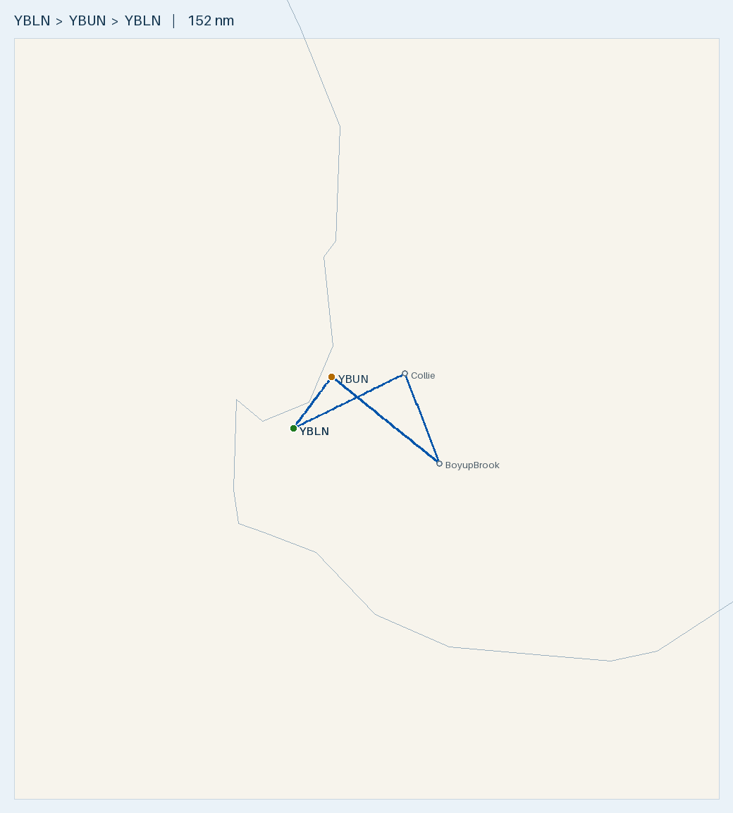

# Plan — Busselton → Collie → Boyup Brook → Bunbury → Busselton (day loop)

**Route (single-day loop, land back at Busselton):**
- YBLN **Busselton** → **Collie (YCOI)** → **Boyup Brook (YBOP)** → **Bunbury (YBUN)** → YBLN **Busselton**
- **Landings:** Collie, Boyup Brook, Bunbury, YBLN (**4 landings**; depart YBLN).

**Aircraft:** 1 × [Tecnam P2002 Sierra](../../aircraft/P2002.md) · Rotax 912 ULS · MTOW **600 kg** · 99 L usable
**Planning basis:** **Wind 230/09 (eastbound 3,500 ft legs) / 240/09 (westbound 2,500 ft legs)** (GPWT 06Z) · Cruise 100 KTAS, 2,500–3,500 ft · Burn **20 L/hr** (conservative) · **final reserve 10 L (30 min, day VFR)** · variation **~2°W**
**Loading:** **2 persons on board** (pilot + instructor) **170 kg combined** · **no cargo** · empty weight **365 kg** · **fuel 80 L** (as specified)
**Data source:** ERSA FAC/RDS **03 SEP 2026** for YBLN/YBUN. **Collie (YCOI) and Boyup Brook (YBOP) are Shire ALAs — not in ERSA** (details below are from the operators' airstrip cards — *"it is a requirement to check airstrip condition and details with the owner"*). Weather from the 04 OCT area brief / GAF / TAFs / GPWT.

> ✈️ **Bottom line (the instructor's route):** a ~**152 nm, ~1 h 37 m** loop that **stays in GAF Area A1 the whole inland portion** (Collie and Boyup Brook are both A1) and then **returns down the coast via Bunbury** — so it **avoids Area B's broken 2500 ft layer** that made the Manjimup version marginal. Still a **low-level VFR day** (~2,000–2,500 ft under the A1 scattered bases), but scattered-not-broken and with **Bunbury (coast, certified, AVGAS) as a bail-out** on the way home. Fuel is a non-issue: depart 80 L, land back ~48 L. **The watch items are the strips, not the weather:** **Boyup Brook is 900 m of gravel/dirt with trees both ends**, **Collie has tall trees all round**, and **Bunbury has active cranes + a bird hazard**.

---

## Route Summary — leg-by-leg nav log

**Winds (°T):** **230/09** for the eastbound **3,500 ft** legs (1 YBLN → Collie, 2 Collie → Boyup Brook), **240/09** for the westbound **2,500 ft** legs (3 Boyup Brook → Bunbury, 4 Bunbury → YBLN) — pilot's planning winds from the GPWT 06Z Busselton box (240/09 @ 2,000 ft, 220/09 @ 5,000 ft) · TAS 100 kt · 20 L/hr · var ~2°W. **HDG columns are wind-corrected.** Fuel-left departs YBLN with **80 L**.

| Leg | Segment | Dist (nm) | Level | Wind °T | **Track °M** | **HDG °M** | GS (kt) | Climb (ft) | Time (+1 min/2,000 ft climb) | Leg fuel (L) | Cum. | Fuel left (L) | GAF area |
|:---:|---------|----------:|:-----:|:-------:|:------------:|:----------:|--------:|-----------:|-----:|-------------:|-----:|--------------:|:--------:|
| 1 | YBLN → Collie (YCOI) | 44.6 | 3,500 | 230/09 | **066** | **067** | 109 | 3,450 | 26 m | 8.8 | 26 m | 71 | A1 |
| 2 | Collie → Boyup Brook (YBOP) | 34.5 | 3,500 | 230/09 | **161** | **166** | 97 | 2,700 | 23 m | 7.6 | 49 m | 64 | **A1** |
| 3 | Boyup Brook → Bunbury (YBUN) | 49.6 | 2,500 | 240/09 | **311** | **306** | 96 | 1,600 | 32 m | 10.6 | 81 m | 53 | A1 → coast |
| 4 | Bunbury → YBLN | 23.2 | 2,500 | 240/09 | **219** | **221** | 92 | 2,450 | 16 m | 5.5 | 97 m | **48** | coastal |
| **—** | **Loop total** | **152** | — | — | — | — | — | — | **~1 h 37 m** | **~32** | — | **~48** | — |

*Leg time = cruise time at GS + **1 min per 2,000 ft of climb** (climb = cruise level − departure field elevation: YBLN 56, Collie 795, Boyup Brook 900, Bunbury 53 ft). Fuel at 20 L/hr on the total.*
*Magnetic = true + 2° (var ~2°W; airstrip cards show 2.1–2.2°W). True tracks: 064 / 159 / 309 / 217.*

- **Levels:** eastbound legs 1–2 planned **3500**, but **only if the cloud base is ≥ 4,500 ft** (1,000 ft vertical clearance above 3,000 AMSL). With the BKN 4,000 observed at Busselton, cruise **at or below 3,000 AMSL (2,500–3,000)** where clear-of-cloud applies. Westbound legs 3–4 **2,500**. Route LSALT 3,000 — flying below it in day VMC with visual terrain clearance (highest nearby terrain 1,730 ft hill ~7 nm off track on leg 3).
- **The wind nets out:** tailwind-ish on the way out (leg 1 GS **109 kt**), headwind home (leg 4 GS **91 kt**). Total within a minute/litre of nil-wind.

- **Depart** YBLN; **land** Collie, Boyup Brook, Bunbury, then home (**4 landings**).
- **Shared CTAFs — brief them:** **Collie and Boyup Brook are both CTAF 126.7**; **Busselton and Bunbury are both 127.0** (~20 nm apart). Essentially two CTAFs for the whole loop — full position + field-name calls.
- All WA (AWST) — no timezone change.

## Fuel plan — one Busselton fill does the loop

| Point | Fuel type | State | Next | Land with (GPWT wind) | Over 30-min reserve (10 L) |
|-------|-----------|------:|------|---------------------:|---------------------------:|
| YBLN depart | **Mogas (aeroclub)** | **80 L** | whole 152 nm loop | **~48 L** back at YBLN | **+38 L** |

- **Range is irrelevant** — the loop burns ~32 L (incl. climb allowance). 80 L lands you home ~48 L, **~5× the final reserve**.
- **No fuel at Collie or Boyup Brook** (both nil). **Bunbury has AVGAS** (Air BP card bowser) — a genuine backstop (the 912 runs on 100LL), though you won't need it. **No Mogas anywhere on the loop** — fill at Busselton.
- **80 L is within MTOW** but close — see W&B. Don't add baggage without re-checking.

## Weight & Balance (empty **365 kg**; pilot + instructor 170 kg; no cargo; 80 L)

| Item | Mass (kg) | Arm (in) | Moment (kg·in) |
|------|----------:|---------:|---------------:|
| Empty (as advised) | 365 | ~67.8 | 24,747 |
| Occupants (pilot + instructor) | 170 | 70.86 | 12,046 |
| Cargo | 0 | — | 0 |
| **Zero-fuel** | **535** | **68.69** | **36,793** |
| + Fuel 80 L | 57.6 | 60.23 | 3,469 |
| **Takeoff (80 L)** | **592.6** | **67.9** | **40,262** |

- **592.6 kg < 600 MTOW ✓** (~7 kg margin); CoG **67.9 in**, inside **63.4–70.4 in ✓**. Weight, not fuel, is the close number.
- **No baggage on top of 80 L** without re-running W&B; keep occupants ≤ ~173 kg at 80 L, or carry less fuel. Confirm the real empty weight/arm from the airframe's W&B record.

## Route Map

- 🗺️ **[Interactive: `map.geojson`](map.geojson)** · 🌐 **[Great Circle Mapper](https://www.gcmap.com/mapui?P=YBLN-Collie-BoyupBrook-YBUN-YBLN)**
- Regenerate: `.venv/bin/python scripts/route_map.py map YBLN "Collie@-33.3599,116.201" "BoyupBrook@-33.8956,116.450" YBUN YBLN --out flightplans/P2002/YBLN-YCOI-YBOP-YBUN`

---

## Weather & NOTAMs — for 1300 local (0500Z) departure, 04 OCT 2026

**Sources:** GAF **WA-S** (valid 0500–1100Z = 1300–1900 local) + TAFs. *GAF heights AMSL; TAF heights AGL.* Area QNH 1023.

**☁️ Cloud — this route beats the weather by staying in A1:**
- **A1 (Collie, Boyup Brook, inland legs):** **SCT CU/SC 3000/6000** — scattered base ~3000 AMSL, >10 km, **no showers in Area A**. Workable. *(Collie and Boyup Brook are both confirmed in A1; Manjimup — the field that made the earlier plan marginal — sat on the A1/B border, and **Area B had BKN CU/SC 2500 + BKN ST 1500/2500 + isolated showers**. This loop never enters B.)*
- **Coast (Bunbury, YBLN):** latest YBLN TAF (040009Z) **BKN030** at 1pm (320/10), then **FM041100 (1900 local) SHOWERS OF LIGHT RAIN SCT020 BKN030**; YBUN **SCT035** (270/10). Coastal legs fine in the daytime window — **evening rain/lower cloud arrives ~1900 local, so be home mid-to-late afternoon** with margin.
- **GPWT (WA-S) 03Z & 06Z** — the route sits at the corner of four boxes. **06Z (1400 local)**: 2,000 ft **240/09 (coast) → 260–270/11–13 (inland)**; 1,000 ft **250/09 coast, 260/10 Boyup box**; 5,000 ft 220–270/09–12. 03Z is similar low down (250–270/09–11) and a bit stronger/more NW-ish higher up (up to 300/25 at 7,000 ft inland — irrelevant at our levels). **Temps ~ISA +2 to +4** (+15–17 °C at 1–2,000 ft inland) → density altitude at Boyup ≈ **1,400–1,500 ft**, Collie ≈ 1,300 ft — minor.
- **FZLVL 9500 ft** → no icing at our levels. **CU/SC ⇒ MOD TURB** below cloud. All **SIGMETs are eastern Australia** — none for SW WA.

**What it means:** **low-level VFR, ~2,000–2,500 ft AMSL** under the scattered bases (the 4,500–5,500 ft cruise is still off). Over the inland terrain (Collie 795 ft, Boyup Brook 900 ft, hills between) a scattered 3000 ft base leaves ~2,000 ft — comfortable while it stays scattered. **If the CU builds toward broken, bail to the coast via Bunbury** (certified, AVGAS). Be home before 1900 local (YBLN base lowers, GAF ends).

**NOTAMs of note:**
- **YBLN C46/26** — increased **ibis** wildlife hazard in vicinity, to 15 Oct.
- **YBUN** — **two lit cranes 361 ft AMSL ~1.5 NM NW (BRG 295) of the ARP** (DAP minima amended, C70/C71, to 3 Dec); another crane 302 ft AMSL SW (C63, to 30 Oct); **bird hazard vcy RWY 07/25** (C58); model-aircraft + searchlight-display ops (ERSA). Brief the Bunbury arrival.

---

## Aerodromes

| Aerodrome | Role | Position | Elev | Runway | Fuel | CTAF / freq | Key notes |
|-----------|------|----------|-----:|--------|------|-------------|-----------|
| **[YBLN](../../aerodromes/YBLN.md) Busselton** *(CERT)* | Depart & return | -33.687, 115.400 | 56 ft | 03/21 grooved, 2460 × 45 m | AVGAS · Jet A1 · **aeroclub Mogas** | **127.0** · FIA 124.9 | Fill Mogas. **Bird hazard** (ibis). Shares 127.0 w/ Bunbury |
| **Collie (YCOI)** *(ALA)* | Stop 1 | -33.360, 116.201 | 795 ft | **10/28 sealed bitumen, 1170 m** | **Nil** | **126.7** · FIA 124.9 · PAL 122.3 | **BEWARE TALL TREES** all round; Shire ALA, gate combo 9734 |
| **Boyup Brook (YBOP)** *(ALA)* | Stop 2 | -33.896, 116.450 | 900 ft | **18/36 UNSEALED gravel/dirt, 900 m** | **Nil** | **126.7** · FIA 124.9 | **Trees both ends**, dam; **nil lighting (day only)**; **crosswind in a westerly** — inspection pass, read windsock |
| **[YBUN](../../aerodromes/YBUN.md) Bunbury** *(CERT)* | Stop 3 (last before home) | -33.378, 115.677 | 53 ft | 07/25 sealed, 18 m wide (07 TORA 1015 / 25 TORA 1219 m) | **AVGAS** (card bowser) | **127.0** · FIA 124.9 | ⚠️ **Cranes NW + bird hazard**; model acft; shares 127.0 w/ Busselton |

### [YBLN](../../aerodromes/YBLN.md) — Busselton (WA) — HOME BASE
- -33.687, 115.400 · Elev 56 ft · **CERT** · AVGAS + Jet A1 (+ **aeroclub Mogas** — off-book) · **CTAF 127.0** · FIA 124.9
- **RWY 03/21 grooved, 2460 m × 45 m.** ⚠️ ERSA/NOTAM **bird hazard** (straw-necked & Australian white ibis, to 15 Oct) — lookout on dep/arr.

### Collie (YCOI) — STOP 1 — **Shire ALA (airstrip card, Aug 2018 — verify currency)**
- **-33.3599, 116.2010** (33°21.593′S 116°12.059′E) · **Elev 795 ft** · **RWY 10/28, 1170 m, sealed bitumen** · **Nil fuel** · var 2.1°W
- **CTAF 126.7** · Melbourne Centre (FIA) 124.9 · **PAL on 122.3** · windsock · white cones.
- ⚠️ **BEWARE TALL TREES** surrounding the strip (both approaches). Collie town 280°M / 2.2 nm.
- Shire-run: **personal access & vehicle gate combination 9734.** Contacts — Works Supervisor 0407 770 490, Parks & Gardens 0417 956 320, Duty Ranger 0408 931 274, Shire (08) 9734 9000. Courtesy call advisable.

### Boyup Brook (YBOP) — STOP 2 — **Shire ALA (airstrip card — verify with owner)**
- **-33.8956, 116.4500** (33°53.738′S 116°26.998′E) · **Elev 900 ft** · **RWY 18/36, 900 m, UNSEALED (gravel and dirt)** · **Nil fuel** · **Nil lighting (day only)** · var 2.2°W
- **CTAF 126.7** · Melbourne Centre (FIA) 124.9 · windsock · white cones. Town 325°M / 5.5 nm.
- ⚠️ **Trees off both ends** (per the strip diagram) and a **dam** near the strip — mind the approach/climb-out obstacle clearance.
- ⚠️ **Gravel/dirt, 900 m — the only unsealed strip on the loop.** 900 m is ample length for a P2002, but **use soft/rough-field technique, mind the prop** (loose gravel), and **check TODR/LDR for 900 ft elevation on a warm afternoon** near your ~592 kg weight. Confirm current surface condition with the **Boyup Brook Shire (08) 9765 1200** (Works Mgr 9765 1220) before going — the card warns surface/condition must be checked with the owner.
- ⚠️ **CROSSWIND — the single 18/36 runway vs a westerly (the day's main concern).** At **10 kt** the components are: dead **west (270°) = 10 kt pure crosswind** (worst case, 0 headwind); **WSW (240°) ⇒ RWY 18, ~8.7 kt xw + 5 kt hw**; **WNW–NW (300–320°) ⇒ RWY 36, ~6–9 kt xw + 5–8 kt hw**. **GPWT 06Z confirms it: Boyup box 1,000 ft 260/10** ⇒ on **RWY 18: ~2 kt headwind, ~10 kt crosswind from the right** — the slight southerly lean is exactly why **18 is the runway** (on 36 it'd be a ~2 kt tailwind). **All within the P2002's 22 kt demonstrated crosswind** — but on **gravel with trees both ends** (reduced grip, tree turbulence/wind-gradient on short final) treat it with respect.
- 🌲 **Tree line immediately west of the field (satellite + local knowledge):** a **dense west tree band runs alongside the northern/central runway** — i.e. upwind of the **RWY 18 touchdown zone** — and the **north approach (RWY 18) is clearer** than the south (RWY 36 has the road + more bush). **In a true westerly/WSW, prefer RWY 18:** the touchdown zone sits in the **lee of the west trees** (reduced *steady* crosswind) with the cleaner approach. *(In a NW wind, RWY 36 gives a headwind and the crosswind is only ~6 kt anyway — judgement call; the shelter matters most for a dead-west wind.)*
- ⚠️ **The shelter is turbulent, not calm:** behind that dense upwind line expect **wind-gradient + rotor in the last 100–200 ft** (crosswind easing then gusting/curling as you sink below treetop height) and **sink crossing into the lee**. Still the better runway — just fly it expecting bumps: a little extra approach speed, active feet, ready for an early go-around.
- ✅ **Plan: inspection pass before landing.** Overfly to **read the windsock/actual direction and check the gravel surface**, join for the favourable runway (RWY 18 in a westerly/WSW), and fly the approach prepared for the lee turbulence. **Be ready to go around and re-position** if the flare isn't working out — a go-around is the normal response to a bad picture on short final.

### [YBUN](../../aerodromes/YBUN.md) — Bunbury (WA) — STOP 3 (final before home)
- -33.378, 115.677 · Elev 53 ft · **CERT** · **AVGAS** (Air BP card bowser) · **CTAF 127.0** · FIA 124.9
- **RWY 07/25 sealed, 18 m wide** — declared 07 TORA 1015 m / 25 TORA 1219 m.
- ⚠️ **NOTAM hazards:** **two marked/lit cranes 361 ft AMSL ~1.5 NM NW of the ARP (BRG 295)** infringing the inner horizontal surface (to 3 Dec; DAP minima amended); another crane **302 ft AMSL ~2.65 NM SW** (to 30 Oct); **bird hazard vcy RWY 07/25**; model-aircraft and searchlight-display ops. 
- ⚠️ **Shares CTAF 127.0 with Busselton** (~20 nm) — full position/field-name calls.

## Pre-Flight Checks
- [ ] **Occupants:** pilot + instructor, 170 kg combined — re-run W&B if actual weights differ. **No baggage** at 80 L.
- [ ] **ALA condition / PPR:** **Boyup Brook** surface condition with the Shire (08) 9765 1200 (gravel/dirt, 900 m); **Collie** access gate combo 9734 / courtesy call. Both airstrip cards say *check with the owner.*
- [ ] **Busselton Mogas** filled, **80 L on board**. Nil fuel at Collie/Boyup; **Bunbury AVGAS** is the only en-route backstop.
- [ ] **W&B on the day** — 80 L + 170 kg + no cargo ≈ **592.6 kg (~7 kg under MTOW)**, CoG in limits. Tight — no extra weight.
- [ ] **Runways (current winds):** YBLN **RWY 03** (320/10), Collie **RWY 28** (7 kt W), Bunbury **RWY 25** (270/10). **Boyup Brook — in a westerly/WSW prefer RWY 18 (clearer north approach; touchdown sheltered by the west tree line), ~6–10 kt xw. Inspection pass to read the windsock + check the gravel, expect lee turbulence in the flare, be ready to go around.**
- [ ] **Timing:** daytime window is good; **evening showers / lower cloud at YBLN from ~1900 local** — be home mid-to-late afternoon.
- [ ] **Performance / DA / TODR** at Collie (795 ft), **Boyup Brook (900 ft, gravel, trees both ends)**, on a warm afternoon.
- [ ] **☁️ Cloud / go-no-go:** A1 **SCT 3000/6000** → **low-level ~2,000–2,500 ft**. If CU builds to a broken base over the inland terrain, **divert to the coast via Bunbury**. Home before 1900 local.
- [ ] **Radio plan:** YBLN **127.0** → area **124.9** → **Collie 126.7** → **Boyup Brook 126.7** → **Bunbury 127.0** → YBLN **127.0**. (Collie+Boyup share 126.7; YBLN+Bunbury share 127.0.) Collie PAL on 122.3.
- [ ] **Hazards:** Busselton **ibis**; Collie & Boyup Brook **tall trees**; **Bunbury cranes (NW) + bird hazard**; verify current ERSA + **NOTAMs** and latest TAF/GAF/GPWT.
