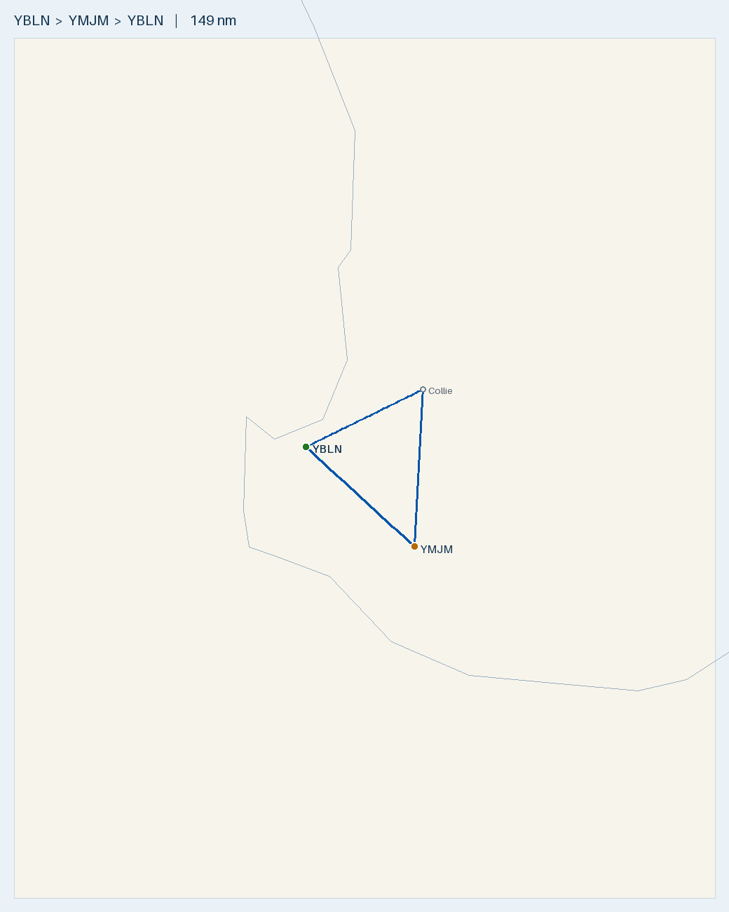

# Plan — Busselton → Collie → Manjimup → Busselton (day triangle)

**Route (single-day triangle, land back at Busselton):**
- YBLN **Busselton** → **Collie (YCOI)** → **Manjimup (YMJM)** → YBLN **Busselton**
- **Landings:** Collie, Manjimup, YBLN (3 landings; depart YBLN, no overfly waypoints).

**Aircraft:** 1 × [Tecnam P2002 Sierra](../../aircraft/P2002.md) · Rotax 912 ULS · MTOW **600 kg** · 99 L usable
**Planning basis:** **Nil wind** (no forecast applied — recompute HDG/GS with the day's actual wind) · Cruise 100 KTAS · Burn **20 L/hr** (conservative; POH ~15–18) · **final reserve 10 L (30 min, day VFR)** · variation **~2°W**
**Loading:** **2 persons on board** (pilot + instructor) **170 kg combined** · **no cargo / no extra weight** (as advised) · empty weight **365 kg**
**Data source:** ERSA FAC/RDS effective **03 SEP 2026** for **YBLN** and **YMJM Manjimup**. **Collie (YCOI) is a Shire ALA — not in ERSA** (details from Country Airstrips Australia / the Shire; verify on the day).

> ℹ️ **Occupants:** **pilot + instructor, 2 on board**, combined **170 kg** (as advised) — fits the two-seat P2002.

> ✈️ **Bottom line:** a ~**149 nm, ~1 h 29 m** (nil-wind) inland triangle into the jarrah country. **Departing with 80 L** you land back at Busselton with ~**50 L** — the whole day burns only ~**30 L**, so you have **5× the final reserve** in the tanks. **Weight is fine but not loose:** 80 L + pilot & instructor (170 kg) + no cargo = **~593 kg, ~7 kg under the 600 kg MTOW** (CG in limits) — don't add bags on top without re-checking. The real things to manage are the **two elevated inland fields**: **Collie 795 ft** (tall trees on the strip) and **Manjimup 942 ft** (single 1224 m runway, 0.3% slope) — **watch density altitude** on a warm afternoon. **No Mogas en route** (Collie has no fuel, Manjimup is AVGAS-only) but one Busselton fill covers everything.

---

## Route Summary — leg-by-leg nav log

**Nil wind** · TAS 100 kt · 20 L/hr · var ~2°W. With no wind, **HDG = track** and **GS = TAS (100 kt)**; apply the day's actual wind before flight. Fuel-left assumes departing YBLN with **80 L** (as specified).

| Leg | Segment | Dist (nm) | Track °T | HDG °M | GS (kt) | Time | Leg fuel (L) | Cum. time | Fuel left (L) |
|:---:|---------|----------:|:--------:|:------:|--------:|-----:|-------------:|----------:|--------------:|
| 1 | YBLN → Collie (YCOI) | 44.6 | 064 | 066 | 100 | 27 m | 8.9 | 27 m | 71 |
| 2 | Collie → Manjimup (YMJM) | 53.8 | 183 | 185 | 100 | 32 m | 10.8 | 59 m | 60 |
| 3 | Manjimup → YBLN | 50.3 | 312 | 314 | 100 | 30 m | 10.1 | 89 m | 50 |
| **—** | **Triangle total** | **149** | — | — | — | **~1 h 29 m** | **~30** | — | **~50** |

- **Depart** YBLN; **land** at Collie, Manjimup, then back at YBLN (**3 landings**). No overfly-only turning points.
- **Nil-wind times/fuel** shown above (~1 h 29 m, ~30 L). Wind will shift GS and headings leg-by-leg — apply the forecast on the day; the NE/S/NW triangle means a steady wind largely cancels over the round trip.
- **Runways (expected winds):** **YBLN — RWY 03** (TAF 320/10 ⇒ ~3 kt headwind, ~9 kt crosswind). **Collie — RWY 28** (7 kt westerly ⇒ ~7 kt headwind, ~1 kt xw, near straight down the strip). **Manjimup — RWY 30** (7 kt SW ⇒ ~2 kt headwind, ~7 kt crosswind from the left; RWY 30 is also the **uphill** end, so you land uphill / depart uphill into the breeze). All well inside the P2002's **22 kt demonstrated crosswind**. Confirm on CTAF/AWIS.
- All WA (AWST) — no timezone change.

## Fuel plan — you will have plenty

| Point | Fuel type | State | Next leg | Land with (nil wind) | Over 30-min reserve (10 L) |
|-------|-----------|------:|----------|---------------------:|---------------------------:|
| YBLN depart | **Mogas (aeroclub)** | **80 L** (as specified) | whole 149 nm triangle | **~50 L** back at YBLN | **+40 L** |

- **Huge fuel margin.** The whole day burns ~30 L, so 80 L lands you back with ~50 L — **five times the 10 L final reserve**. Even in a strong headwind you'd land well over reserve. Fuel is nowhere near the constraint.
- **80 L is within MTOW** (just): 80 L = 57.6 kg, so with pilot + instructor (170 kg) and no cargo takeoff weight is **~593 kg, ~7 kg under 600 kg** — legal, CG in limits, but it's the *weight* that's close, not the fuel. **Don't add baggage on top of 80 L without re-running W&B.**
- **No Mogas en route**, but it doesn't matter — one Busselton fill covers everything. Collie has no fuel; Manjimup has an Air BP H24 **AVGAS** card bowser (Carnet/cash, ph 0428 711 269) if you ever wanted a top-up (the 912 runs on 100LL fine).

## Weight & Balance (empty **365 kg**; pilot + instructor 170 kg; no cargo; 80 L fuel)

| Item | Mass (kg) | Arm (in) | Moment (kg·in) |
|------|----------:|---------:|---------------:|
| Empty (as advised) | 365 | ~67.8 | 24,747 |
| Occupants (pilot + instructor) | 170 | 70.86 | 12,046 |
| Cargo | 0 | — | 0 |
| **Zero-fuel** | **535** | **68.69** | **36,793** |
| + Fuel 80 L | 57.6 | 60.23 | 3,469 |
| **Takeoff (80 L)** | **592.6** | **67.9** | **40,262** |

- **592.6 kg < 600 MTOW ✓** — but only **~7 kg of margin**, so this is close. CoG **67.9 in**, inside **63.4–70.4 in ✓**.
- **Weight, not fuel, is the thing to watch at 80 L.** Because it's this close to MTOW, **do not add baggage on top** without re-running the numbers. (At the given 170 kg combined, you're fine; anything above ~173 kg of occupants with 80 L would push you over 600 kg.)
- You don't *need* 80 L (the trip is ~40 L incl. reserve), so if you'd rather have more weight margin, carrying less fuel buys it back kilo-for-kilo.
- Empty **arm** assumed ~67.8 in (planning). **Confirm the real empty weight AND arm** from this airframe's Weight & Balance Record before flight.

## Route Map

- 🗺️ **[Interactive: `map.geojson`](map.geojson)** · 🌐 **[Great Circle Mapper](https://www.gcmap.com/mapui?P=YBLN-Collie-YMJM-YBLN)**
- Regenerate: `.venv/bin/python scripts/route_map.py map YBLN "Collie@-33.360,116.201" YMJM YBLN --out flightplans/P2002/YBLN-YCOI-YMJM`

## Density altitude & terrain
- **Both inland fields are elevated — Collie 795 ft, Manjimup 942 ft** — and legs 2/3 cross the jarrah-forested Darling Plateau (terrain to ~1000 ft+). On a warm spring/summer afternoon DA at Manjimup can approach **~3,000–4,000 ft**; **check TODR/landing distance for the 98 hp Rotax** near MTOW and prefer a **cool-of-the-day departure** off the two inland strips.
- **Manjimup is a single sealed runway, 12/30, 1224 m, with a 0.32% slope down to the SE** (so **RWY 30 is the uphill/NW end**). The expected **7 kt SW** favours **RWY 30**, which also gives you the preferred **uphill landing**; the ~7 kt crosswind is well within limits. 1224 m is generous for a light P2002 — just note the uphill departure if you launch on 30.
- ⚠️ **Cruise altitude is cloud-limited, not terrain-limited, for the 04 OCT 1pm window — see Weather below.** The 4 OCT GAF/TAFs give a **broken base ~2500–3000 ft** over the route, so the nominal "~4,500–5,500 ft" cruise is **unusable** (you'd be in/above cloud). Plan a **low-level VFR cruise ~2,000–2,500 ft AMSL** where terrain allows, and treat the Collie→Manjimup leg as the squeeze. On a clear day the hemispheric ~5,500 ft (E) / ~4,500 ft (W) would apply.

---

## Weather & NOTAMs — for 1300 local (0500Z) departure, 04 OCT 2026

**Sources:** GAF **WA-S** issued 032225Z, **valid 0500–1100Z (1300–1900 local)** — covers the 1pm plan. TAFs issued 031708Z–032218Z. *GAF heights are **AMSL**; TAF heights are **AGL** above the field.* Area QNH 1023.

**Route areas:** **Collie → A1** · **YBLN & Manjimup → on the A1/B border.**

**☁️ Cloud is the binding factor (your concern is justified):**

| Area | Route part | Forecast cloud | Read |
|------|-----------|----------------|------|
| **A1** | YBLN→Collie leg, Collie | **SCT CU/SC 3000/6000** (the SCT ST 1500/2500 is *N of Jurien* only — not us) | Scattered base ~3000 AMSL — workable |
| **B** | Manjimup + southern legs | **BKN CU/SC 2500/6000**, **BKN ST 1500/2500** in the lower part, **ISOL SHRA (4000 m vis)** | **Broken base ~2500 AMSL over 900–1200 ft terrain — the squeeze** |

- **TAFs:** YBLN **BKN030** at 1pm (wind 320/10), lowering to **BKN020 from 1900 local**; YBUN **SCT035**; **no TAF for Collie or Manjimup** (GAF is all you get inland).
- **FZLVL 9500 ft** → no icing at our levels. **CU/SC ⇒ MOD TURB** expected below cloud. ISOL smoke (FU) 4000 m vis SW of Jurien. **All SIGMETs are eastern Australia — none for SW WA.**

**What it means for the flight:**
- **Low-level VFR only** (~2,000–2,500 ft AMSL). The **4,500–5,500 ft cruise is off** — you'd be in/above a broken layer (not legal/safe VFR).
- The **Collie→Manjimup leg and the Manjimup end** sit under Area B's **BKN 2500 AMSL** over ~1000–1200 ft plateau (+ masts to **1234/1405/1661 ft AMSL**, east of track) with **isolated showers** that can drop vis below VMC. That compresses the usable band to a thin slice and is the part most likely to go sub-VMC.
- **Plan = launch-and-assess with a low committal threshold, not a confident go.** YBLN→Collie (A1, SCT 3000) should be fine. **Use Collie as the go/no-go point:** look south toward Manjimup before committing; **if you can't stay clear of cloud with ≥~1000 ft above terrain and good vis, turn back to YBLN the way you came** (Collie is a safe bail-out — no fuel there, but you depart YBLN with ~80 L so range is a non-issue). Two pilots on board (pilot + instructor) helps the decision.
- **Don't be late home:** YBLN base lowers to BKN020 from 1900 local and the GAF ends at 1900 local — be back mid-afternoon with margin.

**NOTAMs of note (from the area brief):**
- **YMJM C15/26** — declared TODA/gradient: RWY 12 TODA 1284 (3.60%), RWY 30 TODA 1284 (3.37%), reduced supplementary TKOF distances. Use for the Manjimup performance check. *(Obstacle-light NOTAM C14/26 expired 17 Sep — ignore.)*
- **Drone ops C2551/26** — multirotor <25 kg, 3 NM radius of a point **~5 NM W of the Collie→Manjimup leg**, SFC–1000 ft AGL, **daily 0600–1700 local**, on CTAF 126.7 — monitor and give room.
- **YBLN C46/26** — increased **ibis** wildlife hazard in vicinity, active to 15 Oct (matches the ERSA bird note).

---

## Aerodromes

| Aerodrome | Role | Position | Elev | Runway (surface, length) | Fuel | CTAF / freq | Key notes |
|-----------|------|----------|-----:|--------------------------|------|-------------|-----------|
| **[YBLN](../../aerodromes/YBLN.md) Busselton** *(CERT)* | Depart & return (home) | -33.687, 115.400 | 56 ft | 03/21 grooved, 2460 × 45 m | AVGAS · Jet A1 · **aeroclub Mogas** | **CTAF 127.0** · FIA 124.9 | Fill Mogas here. **Bird hazard** (wetland birds) near AD |
| **Collie (YCOI)** *(ALA, not in ERSA)* | Stop 1 | -33.360, 116.201 | 795 ft | 10/28 sealed, 1150 m | **None** | PAL **122.3** · area 124.9 | **CAUTION tall trees**; Shire-run, courtesy call; no landing fee/ASIC |
| **[Manjimup (YMJM)](../../aerodromes/YMJM.md)** *(ERSA, non-towered)* | Stop 2 | -34.254, 116.143 | 942 ft | 12/30 sealed, **TORA 1224 m** × 18 m, 0.32% slope down to SE | **AVGAS only** (H24 card bowser; no Jet A1, no Mogas) | **CTAF 126.7** · FIA 124.9 | Air BP Carnet/cash, ph 0428 711 269. Single runway; elevated — watch DA |

### [YBLN](../../aerodromes/YBLN.md) — Busselton (WA) — HOME BASE (depart & return)
- -33.687, 115.400 · Elev 56 ft · **CERT** · AVGAS + Jet A1 (+ **aeroclub Mogas** — off-book, arrange with the club) · **CTAF 127.0** · FIA 124.9 · ERSA mag var **3°W**
- **RWY 03/21 grooved, 2460 m, 45 m wide** (RDS: TORA 2460 / TODA 2520, level). Fill Mogas here before departure.
- ⚠️ **ERSA ADDITIONAL INFO (verbatim):** *"Bird hazard. Possibility of large numbers of wetland birds in the vicinity of AD."* — lookout on departure/arrival.

### Collie (WA) — STOP 1 — **ALA (YCOI), not in ERSA FAC**
- **-33.360, 116.201** · **Elev 795 ft** · **RWY 10/28, 1150 m, sealed** · **No fuel** · No landing fee, no ASIC
- **PAL 122.3** (pilot-activated lighting) · area/FIA 124.9 · windsocks at both thresholds · **CAUTION: tall trees** near the strip.
- **Expected wind 7 kt westerly ⇒ RWY 28** (~7 kt headwind, ~1 kt crosswind — essentially straight down the runway). Confirm on arrival.
- ~2 nm from Collie town. Shire-operated — courtesy call advisable: **Collie Shire (08) 9734 9000 / 0408 250 048**. *(Details: Country Airstrips Australia — verify currency before flight; not an ERSA-published field.)*

### [Manjimup (YMJM)](../../aerodromes/YMJM.md) — STOP 2 — **ERSA, non-towered**
- **-34.254, 116.143** (341515.5S 1160835.3E) · **Elev 942 ft** · **CTAF 126.7** · FIA Melbourne Centre 124.9 (from 3000 ft)
- **RWY 12/30, sealed** (flexible pavement, PCR 60/F/B/Y/U) · **RDS declared: TORA 1224 m / TODA 1284 / ASDA 1224 / LDA 1224**, **width 18 m**, **slope 0.32% down to the SE**.
- **Expected wind 7 kt SW ⇒ RWY 30** (~2 kt headwind, ~7 kt crosswind from the left; RWY 30 = uphill end, giving the favoured uphill landing). Confirm on arrival.
- **Fuel: AVGAS only** — Air BP H24 card bowser, **Carnet card or cash/cheque only**, ph **0428 711 269**. **No Jet A1, no Mogas.**
- **ERSA ADDITIONAL INFO:** none published for this cycle — **still read the current ERSA FAC + NOTAMs** before flight.

## Pre-Flight Checks
- [ ] **Occupants:** pilot + instructor, 170 kg combined (as advised) — re-run W&B if the actual weights differ.
- [ ] **Courtesy calls:** Collie (Shire). Manjimup is ERSA/public but call ahead if you want fuel confirmed.
- [ ] **Busselton Mogas** arranged and **80 L on board** (aeroclub, off-book). No Mogas en route; lands back ~50 L; Manjimup AVGAS is the only en-route backstop; Collie has no fuel.
- [ ] **W&B on the day** against real empty weight/arm — **80 L + pilot & instructor (170 kg) + no cargo ≈ 593 kg (~7 kg under MTOW)**. Margin is tight: **no baggage on top**, keep occupants ≤ ~173 kg, or carry less fuel.
- [ ] **Runways (expected wind):** YBLN **RWY 03** (320/10), Collie **RWY 28** (7 kt W), Manjimup **RWY 30** (7 kt SW, uphill landing). Confirm on CTAF/AWIS.
- [ ] **Density altitude / TODR** at **Collie (795 ft)** and **Manjimup (942 ft)** on a warm afternoon; factor the **0.32% Manjimup slope** (uphill departure if launching RWY 30).
- [ ] **Radio:** YBLN **CTAF 127.0**, Collie **PAL 122.3** (activate lighting if needed) / area 124.9, Manjimup **CTAF 126.7**; FIA 124.9 throughout.
- [ ] **☁️ Cloud / go-no-go (the decider):** broken base **~2500–3000 ft** → **low-level VFR ~2,000–2,500 ft only**; Area B (Manjimup/southern legs) is the squeeze with **ISOL showers**. **Assess at Collie before committing south; turn back to YBLN if you can't stay clear of cloud with ≥~1000 ft above terrain + good vis.** Be home before 1900 local (base lowers, GAF ends).
- [ ] **Hazards:** Busselton **wetland bird hazard**; Collie **tall trees**; drone ops near Collie→Manjimup leg (CTAF 126.7); verify current ERSA + **NOTAMs** for YBLN/YMJM and latest TAF/GAF/GPWT.
