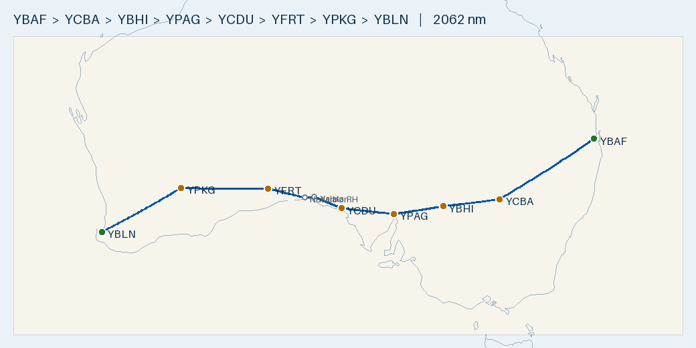

# Plan — 2-day westbound crossing: Archerfield → Port Augusta → Busselton

**Route:** YBAF Archerfield → YCBA Cobar → YBHI Broken Hill → **YPAG Port Augusta (overnight)** → YCDU Ceduna → *Yalata → Nullarbor Roadhouse* → YFRT Forrest → YPKG Kalgoorlie → YBLN Busselton
**Aircraft:** [Cirrus SR20 G1 (s/n 1312)](../../aircraft/SR20.md) · AVGAS · 56 USG usable · MTOW 3000 lb (1361 kg)
**Planning basis:** 150 KTAS · 12.5 USG/hr (11.6 book) · reserve 10.1 USG (45 min) · var per leg from ERSA · **nil wind** (apply the forecast on the day)
**Loading (planning assumption, none stated):** 2 front-seat occupants 150 kg + 15 kg baggage/equipment (165 kg) · **full fuel out of every stop**
**Season:** **November / December** · VFR, over land the whole way
**Data:** ERSA **03 SEP 2026** (current). The 26 NOV 2026 cycle is pending, so if you fly after 26 NOV, re-check every field against it.

> ✈️ **Bottom line:** ~**2,062 nm**, **~14 h 12 m flying** over two days: **5 h 56 m on Day 1** to Port Augusta and **8 h 16 m on Day 2**
> to Busselton. You fill full at every stop. **Leg 1 (Archerfield → Cobar, 446 nm) is the only tight one.** It leaves +7.9 USG over
> reserve with nil wind and only +2.2 USG with a 20 kt headwind, so **stop at Moree if the forecast headwind component is more than 15 kt**.
> Carry **an Air BP carnet and a Visa/Mastercard**. Ceduna and Busselton take carnet only, and **Forrest takes no carnet and needs PN**.
> Archerfield is **towered Class D under the Brisbane CTA**, with Amberley's military airspace ~5 nm off the direct track. On Day 2 the
> Bight leg is routed **inland of the Head of Bight**, because the straight line goes out over the water.

---

## Route Summary (nil wind)

### Day 1 — Archerfield → Port Augusta

| Leg | Segment | Dist (nm) | Track °T | HDG °M | Cruise alt | Time | Leg fuel (USG) | Cum. time | Fuel left (USG) |
|:---:|---------|----------:|:--------:|:------:|:----------:|-----:|---------------:|----------:|----------------:|
| 1 | YBAF → YCBA Cobar | 445.6 | 236 | 225 | 8,500 | 3 h 02 m | 38.0 | 3 h 02 m | **18.0** |
| — | *Cobar refuel (assumed)* | — | — | — | — | *45 m* | — | 3 h 47 m | 56 (full) |
| 2 | YCBA → YBHI Broken Hill | 222.4 | 262 | 252 | 8,500 | 1 h 33 m | 19.4 | 5 h 20 m | 36.6 |
| — | *Broken Hill refuel (assumed)* | — | — | — | — | *45 m* | — | 6 h 05 m | 56 (full) |
| 3 | YBHI → YPAG Port Augusta | 193.1 | 260 | 252 | 8,500 | 1 h 21 m | 16.9 | 7 h 26 m | 39.1 |
| **—** | **Day 1** | **861** | — | — | — | **5 h 56 m flying · 7 h 26 m total** | **74.3** | — | — |

### Day 2 — Port Augusta → Busselton

| Leg | Segment | Dist (nm) | Track °T | HDG °M | Cruise alt | Time | Leg fuel (USG) | Cum. time | Fuel left (USG) |
|:---:|---------|----------:|:--------:|:------:|:----------:|-----:|---------------:|----------:|----------------:|
| 4 | YPAG → YCDU Ceduna | 204.5 | 275 | 269 | 8,500 | 1 h 26 m | 17.9 | 1 h 26 m | 38.1 |
| — | *Ceduna refuel (assumed)* | — | — | — | — | *45 m* | — | 2 h 11 m | 56 (full) |
| 5a | YCDU → Yalata (-31.384, 131.621) | 115.7 | 292 | 287 | 8,500 | 50 m | 10.5 | | |
| 5b | Yalata → Nullarbor Roadhouse (YNUB) | 37.0 | 265 | 261 | 8,500 | 15 m | 3.1 | | |
| 5c | Nullarbor Roadhouse → YFRT Forrest | 147.7 | 283 | 280 | 8,500 | 59 m | 12.3 | | |
| 5 | **Leg 5 total** (YCDU → YFRT) | 300.4 | — | — | — | 2 h 04 m | 25.9 | 4 h 15 m | 30.1 |
| — | *Forrest refuel (assumed)* | — | — | — | — | *45 m* | — | 5 h 00 m | 56 (full) |
| 6 | YFRT → YPKG Kalgoorlie | 343.0 | 269 | 267 | 8,500 | 2 h 21 m | 29.4 | 7 h 21 m | 26.6 |
| — | *Kalgoorlie refuel (assumed)* | — | — | — | — | *45 m* | — | 8 h 06 m | 56 (full) |
| 7 | YPKG → YBLN Busselton | 353.5 | 239 | 240 | 8,500 | 2 h 25 m | 30.3 | 10 h 31 m | **25.7** |
| **—** | **Day 2** | **1,201** | — | — | — | **8 h 16 m flying · 10 h 31 m total** | **103.5** | — | — |

**Trip: ~2,062 nm · ~14 h 12 m flying · ~178 USG (~673 L).**

- **Climb allowance:** each leg includes **+4 min of climb** (1 min per 2,000 ft from field elevation to 8,500 ft), and leg fuel is worked on the total time. The waypoint segments 5b and 5c carry no extra climb.
- **Ground stops** are an assumed 45 min (refuel, pay, PN calls, stretch). Use your own figure.
- **Cruise level:** every leg is westbound magnetic (225°–287°M), so plan **8,500 ft**. That level clears the Great Dividing Range on leg 1 and keeps you under 10,000 ft (no oxygen). **Read the LSALT for each leg off the ERC-L.** This plan doesn't quote terrain heights. Out of Archerfield you'll be under the Brisbane CTA steps, so you won't reach 8,500 until you're clear of them (see below).
- **Leg 5 is routed inland of the Head of Bight.** The straight Ceduna → Forrest line passes ~5 nm *south* of the Head of Bight, out over the water. Going via **Yalata** and the **Nullarbor Roadhouse** keeps you ~4–5 nm inland of the Head and adds only ~3 nm and ~1 min.
- **On the day:** work out each leg's WCA from the forecast winds. THDG = track + WCA, and MHDG = THDG − the leg's easterly variation (10.5°E on leg 1 down to 1°W on leg 7, as in the HDG column). Then re-time and re-fuel each leg. **Expect westerly headwinds westbound.** Leg 1 is the one that matters (see the Fuel Plan).
- **Runways:** take the into-wind runway. **Use the sealed 11/29 at Ceduna** (17/35 is gravel). Port Augusta has **only 15/33**. At Archerfield, the tower will assign the runway.

## Radio & en-route hazards

| Where | What | Action |
|-------|------|--------|
| Archerfield, before taxi | **Towered Class D** (DB: controlled, class D/G). ATIS **120.9** · Archer Ground **119.9** · Archer Tower **118.1 / 123.6**. The Brisbane CTA (Class C) sits above | Get the ATIS, then call Ground with the ATIS code and "VFR, departing west to Cobar". Fly the published Archerfield VFR departure (ERSA FAC *Flight Procedures* + Brisbane VTC). Don't climb into the CTA without a clearance. Outside tower hours it's Class G, **CTAF 118.1**, and Brisbane Centre **125.7** is available on the ground |
| Archerfield taxi | **Jet blast (ERSA):** at the TWY J1/H intersection (from aircraft on the apron north of the terminal) and the TWY J/J1 intersection (from aircraft on the Archerfield Jet Base apron) | Look at what's parked before you cross those intersections. Hold short if a jet is running up |
| Archerfield climb-out | **Cranes and lift (ERSA):** a regular **92 ft AMSL crane 115°M / 850 m** from the ARP **infringes the RWY 10L take-off surface (by up to 7 ft)**. A frequent temporary **144 ft crane 105°M / 1,150 m** sits under the 10L/28R surfaces. A regular **192 ft crane 346–353°M / 695–805 m** infringes the 04L/22R transitional and inner horizontal surfaces. A frequent **138 ft scissor lift 178°M / 710 m** stays below the 10R/28L transitional surface | Check NOTAMs for active cranes. On a 10L departure, fly a normal climb (no low, flat climb-out) and look for the crane east of the field |
| Archerfield | **Bird and animal hazards** may be on the airfield (ERSA) | Look out on the take-off roll and climb-out |
| Leg 1, ~16 nm out | **Amberley (YAMB)** military field, **5.3 nm off the direct track**. ERSA says: stay **≥5 nm clear or overfly at ≥2,500 ft** when the tower is inactive. Military fast jets may operate VFR in transit between **R625, M641/R638 and R639 (D645)**, and aircraft must monitor the Brisbane Centre frequency. Bird and fruit-bat hazard in the circuit area, mainly around last light | Plan the climb-out around Amberley's airspace using the VTC/ERC-L, or get a clearance through it. Check the restricted-area status by NOTAM. **Monitor Brisbane Centre.** Any dog-leg adds distance to leg 1, so add it to the fuel check |
| Leg 1, ~66 nm out | **Warwick (YWCK)**, 2.6 nm off track. **Gliding ops HJ** (ERSA). Model aircraft SFC–1,500 ft AGL, 8.7 nm SE of Warwick | Monitor **CTAF 127.85** passing. Look out for gliders |
| Leg 1, Great Dividing Range | Terrain | Read the LSALT off the ERC-L. Plan 8,500 once you're clear of the CTA |
| Leg 1, ~203 nm out | **Moree (YMOR)**, 5.2 nm off track (the fuel option). ERSA: **police UAV ops SFC–1,500 ft AMSL within 10 nm**, **large galah flocks Aug–Dec**, ibis year-round, kangaroos, weather balloon ~2315 UTC (10:15 AEDT) | At 8,500 you're well above all of it. If you land there, see the Moree notes. CTAF 126.7, area 127.1 |
| Cobar | **Weather balloon launch ~2315 UTC** (09:15 AEST / 10:15 AEDT local; launches may occur at other times). Animal and bird hazard (ERSA) | That's close to your arrival if you leave Archerfield before ~07:00. Listen on **CTAF 126.7** |
| Broken Hill | **Bird and animal hazard** (ERSA) | Look out on arrival and departure. CTAF 126.7 |
| Port Augusta | **Bird and animal hazard** (ERSA). **CTAF is 126.9, not 126.7.** Area 123.9 notes limited coverage | Set 126.9 in good time |
| Ceduna | **Bird hazard, particularly Aug–Feb** (ERSA), so it's in season for this trip. **Weather balloon ~2315 UTC** (09:45 ACDT), ~30 min after the planned departure | Look out on arrival and departure. If you're late off the ground, listen for the launch on CTAF 126.7 |
| Leg 5, Nullarbor Roadhouse | **YNUB (ERSA):** the sealed road between the buildings is **not suitable for take-off or landing** | It's a waypoint, not a runway. Note it for emergencies only |
| Forrest | No ADDITIONAL INFO published. **PN required** (handling) | CTAF/UNICOM **126.7** |
| Kalgoorlie | **Non-towered** (DB: not controlled, no class). **CTAF 126.6** (UNICOM 126.6). **Galahs and ravens year-round** (ERSA). **Hang gliding at Lake Perkolilli**, 18 nm NE of the field (~13.5 nm N of the inbound track). **Weather balloon ~2315 UTC** (07:15 AWST) | Call on **126.6**, not 126.7. Look out for birds. Stay south of Perkolilli on the arrival |
| Leg 7, ~96 nm before YBLN | **Narrogin (YNRG), 0.1 nm off track.** **Gliding ops HJ, aerotow and winch to 3,500 ft AMSL.** Radio-equipped aircraft must monitor the CTAF. The winch calls as "Narrogin Winch" (ERSA) | **Monitor CTAF 134.0** overhead. Stay at 8,500, and don't descend through 3,500 near Narrogin |
| Leg 7, ~15 nm before YBLN | **Bunbury model aircraft**, within 500 m of a point 8.8 nm 203°M from YBUN, SFC–1,000 ft AGL (ERSA). It's ~4 nm off track, where you'll be descending | Listen on **CTAF 127.0**, which Bunbury shares with Busselton. Don't sit low in that area |
| Busselton | **Bird hazard:** possibly large numbers of wetland birds (ERSA) | Look out on approach and landing, and be ready to go around |

- **Area frequencies at each field (DB FIA):** Archerfield Brisbane Centre 125.7 · Warwick 121.2 · Moree 127.1 · Cobar Melbourne Centre 124.9 · Broken Hill 122.6 · Port Augusta 123.9 · Ceduna 123.5 · Nullarbor Roadhouse 132.7 · Forrest 134.2 (ERSA annotates it "11000FT", so low coverage may be limited) · Kalgoorlie 125.75 · Narrogin/Kondinin 125.4 · Busselton/Bunbury 124.9. Read the boundaries between them off the ERC-L. They aren't quoted here.
- **Controlled airspace:** Archerfield (Class D) and the Brisbane CTA on departure, plus Amberley. Kalgoorlie is **not** towered. On leg 7, check the **Perth CTA lower limits** along the track on the ERC-L, and stay below them or get a clearance. The rest of the route is Class G.
- **Pinkenba and Enoggera** heliports show up in the 10 nm search only because they're near the departure. Neither needs action. **Kondinin** (kangaroos) and the **Bunbury searchlight** (night) don't affect you either.
- **Zone Five (YZON, Brookhampton)** isn't in ERSA. It's ~11 nm S of leg 7, ~25 nm before Busselton (CTAF 126.7 per the VATPAC AIP). Listening on 126.7 as you pass is optional.

## Fuel Plan

**Fill full (56 USG) at every stop.** Every stop has AVGAS, and the Nullarbor gives you no second chances.

| Point | Expected on board | Needed to next fuel + 10.1 USG reserve | Spare | Endurance left (12.5 USG/hr) |
|-------|------------------:|---------------------------------------:|------:|-----------------------------:|
| Depart YBAF (full) | **56.0** | 48.1 (to Cobar) | **+7.9** | 4 h 29 m |
| Depart YCBA (full) | 56.0 | 29.5 | +26.5 | 4 h 29 m |
| Depart YBHI (full) | 56.0 | 27.0 | +29.0 | 4 h 29 m |
| Depart YPAG (full) | 56.0 | 28.0 | +28.0 | 4 h 29 m |
| Depart YCDU (full) | 56.0 | 36.0 | +20.0 | 4 h 29 m |
| Depart YFRT (full) | 56.0 | 39.5 | +16.5 | 4 h 29 m |
| Depart YPKG (full) | 56.0 | 40.4 | +15.6 | 4 h 29 m |
| Land YBLN | **~25.7** | 10.1 (reserve) | **+15.6** | ~2 h 03 m |

**Leg 1 go/no-go (Archerfield → Cobar direct, 446 nm):**

| Headwind component | Time | Fuel used | Land Cobar with | Over reserve |
|---:|---:|---:|---:|---:|
| Nil | 3 h 02 m | 38.0 | 18.0 | **+7.9** |
| 10 kt | 3 h 15 m | 40.6 | 15.4 | +5.3 |
| 15 kt | 3 h 22 m | 42.1 | 13.9 | +3.8 |
| 20 kt | 3 h 30 m | 43.7 | 12.3 | +2.2 |
| 25 kt | 3 h 38 m | 45.4 | 10.6 | +0.5 |

- **Go direct only if the forecast headwind component is 15 kt or less** and your departure routing (around the CTA steps or Amberley) adds no more than a few nm. Otherwise, **stop at Moree (YMOR)**. It's 5 nm off track, 203 nm out. YBAF → YMOR is 203 nm, 1 h 25 m, 17.8 USG, and YMOR → YCBA is 243 nm, 1 h 41 m, 21.1 USG. Either leg is easy into any likely wind, and the stop costs ~4 min of extra climb plus your ground time. Moree's AVGAS is an **Air BP carnet card-swipe bowser, H24, with 1 HR PN required for all aircraft** (0418 651 081 / 02 6752 7266).
- **Headwind stress test:** a **20 kt headwind on every leg** takes **6 h 50 m on Day 1 and 9 h 30 m on Day 2** and burns ~204 USG. Every leg still lands above reserve. Leg 1 is the thinnest at +2.2 USG, and the rest are +11 USG or better.
- **Optional Broken Hill skip:** leaving Cobar full, Cobar → Broken Hill → Port Augusta is 36.3 USG. You'd land Port Augusta with ~19.7 USG (+9.6 over reserve) at nil wind. That's useful if Broken Hill's BP card / IOR app payment is a problem. Still land there if the wind is against you.
- **The 12.5 USG/hr burn is conservative** (book 11.6 at 75%), so your actual use should come in under plan. Log your real burn on each leg.
- **Cost:** ~178 USG ≈ 673 L × ~$3.00/L ≈ **~$2,020 AUD**, plus any call-out fees.

## Fuel cards & payment

All fuel and payment details below were re-derived from the 03 SEP 2026 handling sections. None of them changed from the 09 JUL cycle.

| Stop | AVGAS provider | Pay with | Notes |
|------|----------------|----------|-------|
| YBAF Archerfield | AvFuel Services | **AvFuel carnet, EFTPOS, MC/Visa. No cash** | Bowser 24 HR. Attended 2015–0730 UTC (06:15–17:30 AEST). AH call-out fee. 0420 634 093 |
| *YMOR Moree (option)* | Air BP (Austrek) | **Air BP carnet** (card-swipe bowser) | H24. **1 HR PN required for all aircraft.** No call-out fee |
| YCBA Cobar | Skyfuel | **Visa, MC** or Skyfuel card | H24 self-serve pump. 0418 862 100 / 0417 780 280 |
| YBHI Broken Hill | Air BP · IOR Aviation | **BP card** (Air BP self-serve) · **IOR tag or Fuelcharge app** (IOR H24 bowser) | No credit card listed. Air BP 0408 728 605 (H24) · IOR 0460 046 609 |
| YPAG Port Augusta | Flying Fuels | **Carnet or credit card** (24 HR swipe bowsers) | Call-out fee for anything else. 0429 695 728, or 0412 602 447 if unanswered |
| YCDU Ceduna | Air BP | ⚠️ **Air BP carnet ONLY** | H24 carnet swipe bowser. Assisted fuelling 0700–1530 Mon–Fri. Call-out fees. CTC ARO |
| YFRT Forrest | AD manager | Cash, EFTPOS, **MC/Visa** or cheque. ❌ **No carnet, no Amex** | ⚠️ **PN required.** CTC AD manager H24. Invoice by arrangement |
| YPKG Kalgoorlie | Air BP/Mobil | **H24 AVGAS card bowser** (ERSA doesn't name the card; expect Air BP carnet) | Attended 2300–1100 UTC (07:00–19:00 AWST). AH 30 min PN, call-out fees. 0409 194 840. Viva is turbine only |
| YBLN Busselton | Air BP / City of Busselton | ⚠️ **Carnet ONLY** | Phone the AD operator |

**Carry both an Air BP carnet and a Visa/Mastercard.** The carnet covers Ceduna, Busselton, Moree and the Broken Hill BP bowser, and probably Kalgoorlie. The Visa/Mastercard covers Archerfield, Cobar, Port Augusta and **Forrest, which refuses carnet**. Neither card alone gets you across. Setting up the Fuelcharge app is a cheap backup for Broken Hill. **Phone Forrest for PN** before you leave Ceduna, or the night before.

## Weight & Balance (2 front + 15 kg, full fuel)

| Item | Mass (kg) | Arm (in) | Moment (kg·in) |
|------|----------:|---------:|---------------:|
| Empty | 973 | ~140.5 | 136,707 |
| Front seats (2) | 150 | 143.5 | 21,525 |
| Baggage / equipment | 15 | 208.0 | 3,120 |
| **Zero-fuel** | **1,138** | **141.8** | **161,352** |
| Full fuel 56 USG | 152 | 153.95 | 23,463 |
| **Takeoff** | **1,290** | **143.2** | **184,815** |
| Lightest landing (Cobar, 18.0 USG) | 1,187 | 142.3 | 168,893 |

**Takeoff is 1,290 kg (2,845 lb), 155 lb under MTOW. That's also under the 2,900 lb max landing weight, so even an immediate return is fine. The CG of 143.2 in is inside the limits (forward 142.5 at that weight, aft ~148)** ✓. The CG moves forward as fuel burns. The lightest landing (Cobar, 2,617 lb) is at 142.3 in vs a forward limit of 140.7, and zero-fuel is 141.8 vs 140.3 ✓. Baggage is 33 lb (max 130). The empty arm is assumed, so confirm it from the airframe's W&B record.

## Daylight — on your side (westbound, summer)

Flying **west gains clock time**, and Nov/Dec days are long. In Nov/Dec, NSW and SA are on daylight saving. QLD and WA aren't.
- **Day 1:** Archerfield AEST (+10) → Cobar AEDT (+11) → Broken Hill and Port Augusta ACDT (+10:30). Net, you lose only **½ h** of clock time. Note that Cobar's clock is an hour ahead of Brisbane.
- **Day 2:** Port Augusta and Ceduna ACDT (+10:30) → Forrest, Kalgoorlie and Busselton AWST (+8). You **gain 2½ h of clock time**.

Example timeline for 1 Dec, with the 45 min stops above. Sun times are computed (NOAA formula, ±2 min), so use the official first and last light on the day.

| Day | Depart | Arrive | Sunset at destination | Spare |
|-----|--------|--------|-----------------------|------:|
| 1 | YBAF 07:00 AEST (sunrise 04:45) | YPAG **14:56 ACDT** | ~20:11 ACDT | ~5 h 15 m |
| 2 | YPAG 07:00 ACDT (sunrise 06:05) | YBLN **15:01 AWST** | ~19:13 AWST | ~4 h 10 m |

- **Over the season,** Port Augusta's sunset runs from ~19:56 (15 Nov) to ~20:25 ACDT (21 Dec), and Busselton's from ~18:58 to ~19:27 AWST.
- **Even with a 20 kt headwind on every leg,** Day 2 ends at ~17:15 AWST, with ~2 h of daylight left.
- **There's no dawn scramble** (the opposite of the eastbound YTYA plan). An early start does buy you cooler air and calmer conditions inland.

## Notes on routing

- **Cobar over Charleville:** via Charleville, Archerfield → Broken Hill is 786 nm, against 668 nm via Cobar. So Cobar saves **~118 nm**, and it has a 1,696 m main runway with AVGAS and Jet A1.
- **Overnight at Ceduna instead:** Day 1 becomes 4 legs, ~1,066 nm, 7 h 22 m flying. Day 2 becomes 3 legs, ~997 nm, 6 h 50 m. Port Augusta is kept for the easier first day and its known accommodation and transport. The westbound daylight gain covers the longer Day 2 either way.
- **Moree tech stop:** this is the leg-1 option when the headwind is more than 15 kt (see the Fuel Plan).
- **Bight leg via Yalata and Nullarbor Roadhouse:** this keeps you inland of the Head of Bight. Without it, the straight line crosses ~5 nm of water there. The Eyre Highway and the rail line are below you for much of the Nullarbor.
- **A minimum-distance routing (~1,972 nm)** exists via small outback strips (Wanaaring, Balcanoona, Nullarbor Motel). It was rejected because the fuel isn't reliable and the surfaces are likely gravel.
- **Nullarbor remote ops (Ceduna → Forrest → Kalgoorlie):** fly with full tanks, survival gear (water, shade, first aid), a PLB, and a SARTIME or flight following. Keep the Eyre Highway and the rail line in gliding reach where you can.

## Route Map

🗺️ [Interactive `map.geojson`](map.geojson) · Regenerate: `.venv/bin/python scripts/route_map.py map YBAF YCBA YBHI YPAG YCDU "Yalata@-31.384,131.621" "NullarborRH@-31.441,130.902" YFRT YPKG YBLN --out flightplans/SR20/YBAF-YBLN`

---

## Aerodromes

| Aerodrome | Elev | Runway | Fuel | CTAF / area | Notes |
|-----------|-----:|--------|------|-------------|-------|
| **[YBAF](../../aerodromes/YBAF.md) Brisbane/Archerfield** *(CERT)* | 65 ft | 10L/28R TORA 1556/1577 m · 10R/28L 1100 m · 04L/22R 1245 m · 04R/22L 1100 m (04/22 natural) | AVGAS · Jet A1 | **TWR 118.1/123.6** · SMC 119.9 · ATIS 120.9 · 125.7 | **Class D** under the BN CTA. Cranes, jet blast, birds (ERSA) |
| *[YMOR](../../aerodromes/YMOR.md) Moree (option)* | 701 ft | 01/19 1613 m · 05/23 977 m | AVGAS · Jet A1 | **126.7** · 127.1 | Leg-1 tech stop. **1 HR PN.** Galahs Aug–Dec, ibis, police UAV (ERSA) |
| **[YCBA](../../aerodromes/YCBA.md) Cobar** | 724 ft | **05/23 1696 m** · 17/35 899 m | AVGAS · Jet A1 | **126.7** · 124.9 | Weather balloon ~2315 UTC (ERSA) |
| **[YBHI](../../aerodromes/YBHI.md) Broken Hill** | 959 ft | **05/23 2512 m** · 14/32 1000 m (sand) | AVGAS · Jet A1 | **126.7** · 122.6 | Birds and animals (ERSA) |
| **[YPAG](../../aerodromes/YPAG.md) Port Augusta** | 56 ft | **15/33 1650 m only** | AVGAS · Jet A1 | **126.9** · 123.9 | **Overnight.** Birds and animals (ERSA) |
| **[YCDU](../../aerodromes/YCDU.md) Ceduna** | 77 ft | **11/29 1740 m sealed** · 17/35 1014 m gravel | AVGAS · Jet A1 (**carnet only**) | **126.7** · 123.5 | Birds Aug–Feb, balloon ~2315 UTC (ERSA) |
| [YNUB](../../aerodromes/YNUB.md) Nullarbor Motel *(waypoint)* | 220 ft | not in parsed DB | AVGAS (HJ, 08 8625 6271) | 126.7 · 132.7 | **Road not suitable for take-off or landing** (ERSA) |
| **[YFRT](../../aerodromes/YFRT.md) Forrest** | 511 ft | **18/36 1519 × 45 m** · 09/27 1349 m | AVGAS · Jet A1 (**no carnet**) | **126.7** (UNICOM) · 134.2 | **PN required.** Remote |
| **[YPKG](../../aerodromes/YPKG.md) Kalgoorlie-Boulder** | 1,203 ft | **11/29 2000 × 45 m** · 18/36 1200 × 18 m | AVGAS · Jet A1 · F34 | **126.6** (UNICOM) · 125.75 | **Non-towered.** Galahs/ravens, hang gliding NE, balloon (ERSA) |
| **[YBLN](../../aerodromes/YBLN.md) Busselton** *(CERT)* | 56 ft | 03/21 grooved, 2460 × 45 m | AVGAS · Jet A1 (**carnet only**) | **127.0** · 124.9 | Home. Wetland birds (ERSA) |

**YBAF Brisbane/Archerfield** (-27.570, 153.008):
- **Towered Class D** (Class G with CTAF 118.1 outside tower hours). Check the tower hours and the Archerfield *Flight Procedures* in the current ERSA FAC. They aren't in the parsed DB.
- **⚠️ Cranes (ERSA):** a regular 92 ft AMSL crane at 115°M / 850 m from the ARP **infringes the RWY 10L take-off surface by up to 7 ft**. A frequent temporary 144 ft crane at 105°M / 1,150 m penetrates the visual segment surface (VSS) for 28R. A regular 192 ft crane at 346–353°M / 695–805 m infringes the 04L/22R transitional surface (by 58 ft) and the inner horizontal surface (by 63 ft). A frequent 138 ft scissor lift at 178°M / 710 m is 15 ft below the 10R/28L transitional surface.
- **⚠️ Jet blast (ERSA):** at the TWY J1/H intersection (from the apron north of the terminal) and the TWY J/J1 intersection (from the Archerfield Jet Base apron).
- **⚠️ Bird and animal hazards (ERSA)** may be on the airfield. A ground signal circle sits next to the central WDI.
- **Fuel:** AvFuel bowser 24 HR. Pay with AvFuel carnet, EFTPOS or MC/Visa. **No cash.**

**YMOR Moree** (option, -29.499, 149.845):
- **⚠️ ERSA:** large flocks of **galahs Aug–Dec** (in season), **ibis** year-round, a kangaroo hazard, a weather balloon ~2315 UTC (1 km NNE of the ARP), and **police UAV ops within 10 nm, SFC–1,500 ft AMSL**.
- **Fuel:** Air BP carnet bowser, H24. **1 HR PN required for all aircraft.** This changed from the 09 JUL cycle, which only required PN for non-ATO aircraft.
- **Runway:** use 01/19 (1613 m).

**YCBA Cobar** (-31.538, 145.794):
- **⚠️ Animal and bird hazard** may be present (ERSA).
- **⚠️ Weather balloon launch ~2315 UTC** (10:15 AEDT). Launches may occur at other times.
- Main runway 05/23, 1696 m. ERSA lists it as Unrated with no surface in the parsed data, so confirm the surface on the FAC.
- **Fuel:** Skyfuel self-serve pump H24, activated by Visa, MC or Skyfuel card.

**YBHI Broken Hill** (-32.001, 141.472):
- **⚠️ Bird and animal hazard exists** (ERSA).
- **Runways:** use 05/23 (2512 m). 14/32 is 1000 m of brown sand.
- **Fuel:** Air BP AVGAS self-serve (BP card), or the IOR H24 bowser (IOR tag or Fuelcharge app). Neither lists a credit card.
- Broken Hill keeps SA time: ACDT +10:30 in summer.

**YPAG Port Augusta** (-32.507, 137.717, overnight):
- **⚠️ Bird and animal hazard exists** (ERSA).
- **CTAF 126.9.** The area frequency, 123.9, notes limited coverage.
- **15/33 is the only runway** (1650 m), so check the crosswind.
- **Fuel:** Flying Fuels 24 HR carnet and credit-card swipe bowsers.
- The airport is out of town (accommodation is ~10–15 min away). **Pre-arrange transport** both ways, and book accommodation that suits an early Day-2 checkout.

**YCDU Ceduna** (-32.131, 133.710):
- **⚠️ Bird hazard, particularly Aug–Feb** (ERSA). It's in season for a Nov/Dec trip.
- **⚠️ Weather balloon launch ~2315 UTC** (09:45 ACDT). Launches may occur at other times.
- **Runway:** use the **sealed 11/29 (1740 m)**. 17/35 is gravel.
- **Fuel:** Air BP **carnet-only** H24 bowser.
- Make your **Forrest PN call** from here if you haven't already.

**YFRT Forrest** (-30.838, 128.115):
- Privately operated, with **no ADDITIONAL INFO published**.
- **PN required.** Contact the AD manager (H24).
- **Fuel:** AVGAS paid by cash, EFTPOS, MC, Visa or cheque. **No carnet or Amex.**
- **Runways:** 18/36 (1519 × 45 m) and 09/27 (1349 m).
- **Radio:** CTAF/UNICOM 126.7, area 134.2.
- It's remote. Confirm the fuel is on before you leave Ceduna.

**YPKG Kalgoorlie-Boulder** (-30.789, 121.462):
- **Non-towered, CTAF 126.6** (UNICOM 126.6). The old plan's "Class D" was wrong: the DB has it as not controlled, with no airspace class.
- **⚠️ Bird hazard:** **pink and grey galahs and Australian ravens** year-round (ERSA).
- **⚠️ Hang gliding** at **Lake Perkolilli, Kunalpi** (-30.573, 121.714), ~18 nm NE (ERSA).
- **⚠️ Weather balloon launch ~2315 UTC** (07:15 AWST) from 950 m WNW of the ARP. Launches may occur at other times.
- **Runway:** use 11/29 (2000 m). At 1,203 ft on a hot day, check the density altitude.
- **Fuel:** Air BP/Mobil H24 AVGAS card bowser.

**YBLN Busselton** (-33.687, 115.400):
- **⚠️ Bird hazard (ERSA):** possibly large numbers of wetland birds in the vicinity. Keep a lookout on approach and landing.
- **Fuel:** carnet-only AVGAS. Phone the AD operator.

---

## Pre-Flight Checklist
- [ ] **ERSA cycle:** if you fly after **26 NOV 2026**, re-check every field (fuel, payment, CTAF, ADDITIONAL INFO) against the new cycle.
- [ ] **Wind:** get the GAF/ARFOR and the winds aloft. Wind-correct HDG, GS, time and fuel for every leg. **Leg 1 decision:** if the headwind component is more than 15 kt, plan the Moree stop (and give Moree its 1 HR PN).
- [ ] **NOTAMs:** Archerfield (cranes), Amberley and the restricted areas (R625/R638/R639), the Brisbane CTA, every stop, Narrogin gliding, and the Nullarbor.
- [ ] **Archerfield departure brief:** tower hours, ATIS 120.9 · Ground 119.9 · Tower 118.1/123.6, and the published VFR departure route (ERSA *Flight Procedures* + Brisbane VTC). Mark the **Brisbane CTA steps** and **Amberley's airspace** on the VTC/ERC-L, and work out what any dog-leg adds to leg 1.
- [ ] **LSALT:** read it off the ERC-L for every leg. Leg 1 crosses the Great Dividing Range. Plan 8,500 westbound.
- [ ] **Perth CTA:** on the ERC-L, check the lower limits along leg 7 against 8,500.
- [ ] **Fuel cards:** an **Air BP carnet** *and* a **Visa/Mastercard**. Optionally set up the Fuelcharge app for Broken Hill.
- [ ] **PN calls:** **Forrest** (AD manager, required) and Moree if used. Phone each stop to confirm AVGAS is available, and ask about call-out fees.
- [ ] **Port Augusta overnight:** book accommodation and the airport ↔ town transport.
- [ ] **W&B:** use the real empty weight and arm (1,290 kg / 2,845 lb planned at takeoff).
- [ ] **Density altitude and take-off performance:** summer heat at Broken Hill (959 ft) and Kalgoorlie (1,203 ft). Consider cooler-hours departures.
- [ ] **Weather:** inland storms and heat troughs are common in summer. Brief timing and diversions.
- [ ] **Remote ops:** survival kit, water, a PLB, and a SARTIME or flight following for the Nullarbor legs.
- [ ] **Daylight:** pull the official first and last light for each day's departure and destination.
- [ ] **Charts:** current ERSA, ERC-L, VNC/WAC and the Brisbane VTC. GPS database current. Load the Yalata and Nullarbor Roadhouse waypoints.

## In-Flight Checklist

**Day 1**
- [ ] **Archerfield:** ATIS **120.9** → Ground **119.9** → Tower **118.1/123.6**. **Watch for jet blast** at J1/H and J/J1. Look out for **birds and animals** on the roll. On a 10L departure, make a normal climb past the **92 ft crane** east of the field.
- [ ] **Climb-out:** stay below the **Brisbane CTA** steps unless you're cleared. Stay clear of **Amberley** (≥5 nm, or follow your clearance) and **monitor Brisbane Centre**. Climb to **8,500** once you're clear.
- [ ] **~66 nm out:** monitor **Warwick CTAF 127.85** (gliding HJ) and look out for gliders. Cross the ranges at or above the LSALT.
- [ ] **~200 nm, abeam Moree: fuel check.** You should have ~38 USG. If the GS is below ~135 kt, **divert to Moree** (CTAF 126.7, galahs/ibis).
- [ ] **Cobar:** CTAF **126.7**. Listen for a **balloon launch**, and look out for animals and birds. Fuel log: expect ~18 USG (10.1 minimum). **Fill full.**
- [ ] **Leg 2 → Broken Hill:** CTAF **126.7**. Look out for **birds and animals**. Expect ~37 USG. Fill full, or skip the stop per the Fuel Plan.
- [ ] **Leg 3 → Port Augusta:** CTAF **126.9**. Look out for **birds and animals**. Expect ~39 USG. Fill full for Day 2 on arrival.

**Day 2**
- [ ] **Port Augusta:** CTAF **126.9**, area **123.9** (limited coverage).
- [ ] **Ceduna:** CTAF **126.7**. **Bird hazard (in season Aug–Feb).** Land on the **sealed 11/29**. Expect ~38 USG. **Fill full (carnet).** Confirm the **Forrest PN**. Listen for the **balloon** if you leave after ~09:30 ACDT.
- [ ] **Leg 5:** turn at **Yalata**, then at the **Nullarbor Roadhouse**, which keeps you **inland of the Head of Bight**. The roadhouse road is **not a runway**. Area 132.7 near the roadhouse, 134.2 at Forrest. SARTIME active.
- [ ] **Forrest:** CTAF/UNICOM **126.7**. Expect ~30 USG. **Fill full (card or cash, no carnet).** Clocks go back to AWST.
- [ ] **Leg 6 → Kalgoorlie:** CTAF **126.6**, not 126.7. Look out for **galahs and ravens**, and stay clear of the **Lake Perkolilli hang gliding** ~18 nm NE. Expect ~27 USG. Fill full and check the density altitude.
- [ ] **Leg 7, ~96 nm before Busselton:** monitor **Narrogin CTAF 134.0** (**gliding, aerotow and winch to 3,500 ft AMSL**). Stay at 8,500 overhead, and listen for "Narrogin Winch".
- [ ] **Descent, ~15 nm before Busselton:** CTAF **127.0** (shared with Bunbury). **Bunbury model aircraft** ~4 nm off track, SFC–1,000 ft AGL.
- [ ] **Busselton:** **watch for wetland birds** on approach and landing, and be ready to go around. Expect ~26 USG on landing.

*Planning only. Cross-check current ERSA, NOTAMs, weather, daylight, W&B and the SR20 POH before flight.*
