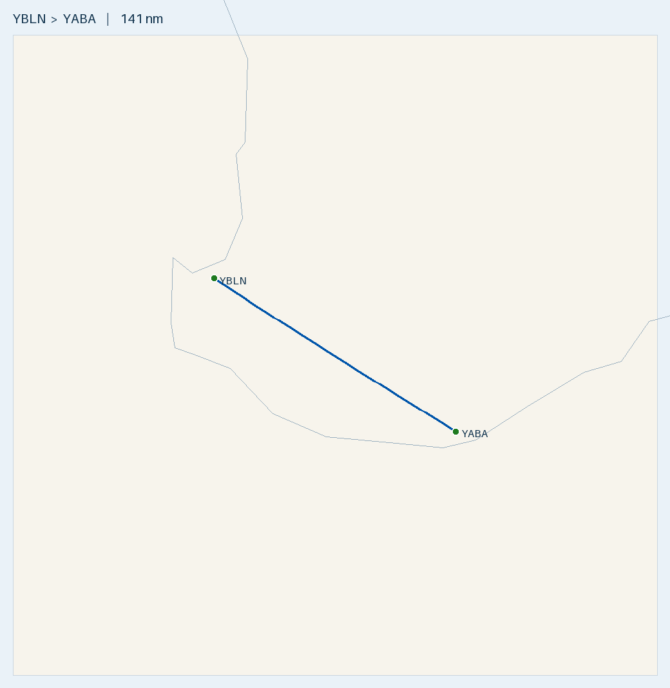

# Plan — Weekend return: Busselton ⇄ Albany

**Route:** YBLN → **YABA Albany** (Sat) · YABA → YBLN (Sun/Mon) · 2 POB, weekend away
**Aircraft:** [Cirrus SR20 G1 (s/n 1312)](../../aircraft/SR20.md) · 56 USG usable AVGAS · MTOW 3000 lb (1361 kg)
**Planning basis:** 150 KTAS · 12.5 USG/hr (11.6 book) · reserve 10.1 USG (45 min) · var 2.5°W (YBLN 3°W, YABA 2°W, ERSA) · **nil wind** (apply the forecast on the day)
**Loading:** 2 front-seat occupants **150 kg** + baggage 10 kg + equipment 5 kg = **165 kg** · **full fuel (56 USG) at Busselton**
**Data:** ERSA **03 SEP 2026** (current). The 26 NOV 2026 cycle is pending, so re-check both fields if you fly after 26 NOV.

> ✈️ **Bottom line:** **141 nm each way, ~1 h per leg**. **One fill at Busselton does the whole weekend.** The round trip burns
> ~25 of 56 USG, and you land back home with **~31 USG (+21 over reserve)**. Even a 20 kt headwind on both legs leaves +18 USG,
> so Albany fuel is optional. Two things to sort before you go: **Albany requires a current ASIC displayed airside** (ERSA),
> and ERSA warns of **windshear on approach to RWY 05** there. Watch for **wetland birds** at Busselton.

---

## Route Summary (nil wind)

Times include the **climb allowance of +1 min per 2,000 ft** (cruise level minus field elevation). Fuel is worked out on the total time. HDG °M = track + 2.5°W. Wind-correct each leg on the day.

| Leg | Segment | Dist (nm) | Track °T | HDG °M | Cruise alt | Time | Leg fuel (USG) | Cum. time | Fuel left (USG) |
|:---:|---------|----------:|:--------:|:------:|:----------:|-----:|---------------:|----------:|----------------:|
| 1 (Sat) | YBLN → YABA Albany | 141.3 | 123 | 125 | 5,500 | 60 m (incl. +3 climb) | 12.4 | 1 h 00 m | **43.6** |
| — | *Weekend at Albany (no fuel needed)* | — | — | — | — | — | — | — | 43.6 |
| 2 (Sun/Mon) | YABA Albany → YBLN | 141.3 | 302 | 304 | 4,500 (or 6,500) | 59 m (incl. +2 climb) | 12.2 | 1 h 59 m | **31.4** |
| **—** | **Round trip** | **283** | — | — | — | **~2 h flying** | **~24.6** | — | **~31.4** |

- **Cruise levels:** on a 1 h leg a climb to the 7,500/8,500 default takes ~4 min out of ~56 min of cruising, and you'd start down again ~25 nm later. So plan lower: **5,500 ft outbound** (mag track 125°, so odd thousands + 500) and **4,500 ft home** (mag 304°, so even thousands + 500). That leaves more room under any cloud and makes the descent into each field simpler. If the weather allows and you want more height, use **6,500 ft home** (same 12.4 USG, +1 min) or 7,500 out. **Read the LSALT off the ERC-L** for the track and check your chosen level clears it before you commit. Don't fly below LSALT in cloud-forced descents.
- **Track:** the straight line stays over land the whole way (inland of the south coast; see the map). No coastal waypoints needed.
- **The legs are a day or two apart**, so wind won't cancel out. Get a fresh forecast for the return day and recompute leg 2.
- **On the day:** work out the WCA from the forecast wind. THDG = track + WCA, MHDG = THDG + 2.5°W. Re-time (dist ÷ GS) and re-fuel (time × 12.5 USG/hr).
- **Runways:** Busselton has only **03/21** (2,460 m, grooved, 45 m wide). Albany has **14/32** (1,800 m) and **05/23** (1,096 m), both 30 m wide. Prefer 14/32 unless the crosswind says otherwise. If you land on **RWY 05**, be ready for windshear (ERSA).
- **Timezone:** all in WA (AWST, UTC+8). Each leg is ~1 h, so daylight isn't a constraint, but still check last light.

## Radio & en-route hazards

| Where | What | Action |
|-------|------|--------|
| Busselton (departure and arrival) | **Bird hazard** (ERSA): possibly large numbers of wetland birds around the aerodrome | Keep a lookout on takeoff, climb-out, approach and landing. Be ready to go around |
| Busselton | **CTAF 127.0** (shared with Bunbury), area **124.9** | Broadcast on 127.0. Change to 124.9 once clear |
| Mid-route, ~49 nm out of YBLN | **Manjimup (YMJM)** ~9 nm SW of track. No ERSA additional info. CTAF 126.7, area 124.9 | Nothing to avoid. It's your mid-route AVGAS diversion (H24 bowser) |
| Area-frequency change en route | YBLN and Manjimup are on **124.9**. Denmark and Albany are on **123.9** | Change from 124.9 to 123.9 at the boundary. **Read its position off the ERC-L** |
| ~17 nm out of Albany | **Denmark (YDEK)**, 10.8 nm SW of track (just outside the 10 nm search). ERSA: hills to the W, unlit; **forward base for water bombers during regional bushfires** | In fire season, check NOTAMs and listen on CTAF 127.85 for water-bomber traffic |
| Albany arrival and departure | **CTAF 127.85**, area **123.9** | Broadcast on 127.85 |
| Albany, ~0715 local (2315 UTC) | **Weather balloon launch** (ERSA) ~680 m ENE of the ARP. Launches may occur at other times | Avoid that sector around launch time and keep a lookout |
| Albany RWY 05 approach | **Windshear risk** from local weather (ERSA) | Prefer 14/32. If you use 05, fly a stable approach with a margin on speed, and be ready to go around |

- **No controlled airspace on the route (Class G).** Neither field is towered, and the Perth CTA is well north of the track.
- **No ERSA aerodrome within 10 nm of track publishes additional info.** The nearest fields are Manjimup (9.1 nm), Kin Kin Retreat (~11 nm) and Denmark (10.8 nm). Unregistered farm strips aren't charted, so keep a lookout.
- **Area frequencies (ERSA, per aerodrome):** Busselton and Manjimup **124.9**, Albany and Denmark **123.9**.

## Fuel Plan

**One fill at Busselton covers the weekend.** Fill AVGAS to full (56 USG) at Busselton, which is Air BP **Carnet only**. Albany has an H24 Air BP Carnet bowser, but you don't need it.

| Point | Expected on board | Needed from here to YBLN + 10.1 USG reserve | Spare | Endurance left (12.5 USG/hr) |
|-------|------------------:|--------------------------------------------:|------:|-----------------------------:|
| Depart YBLN (full) | **56.0 USG** | 34.7 USG | **+21.3** | ~4 h 29 m |
| Land Albany (**dip here**) | **~43.6 USG** | 22.3 USG | **+21.3** | ~3 h 29 m |
| Land YBLN | **~31.4 USG** | 10.1 USG (reserve) | **+21.3** | ~2 h 31 m |

- **Minimum to depart Albany for home: 22.3 USG** at the planned 4,500 ft (22.5 at 6,500). If your dip at Albany shows much less than ~43 USG, find out why before you go on.
- **Headwind stress test:** a **20 kt headwind on both legs** takes ~2 h 15 m flying and burns ~28.2 USG. You'd still land with ~27.8 USG, which is **+17.7 USG over reserve**.
- **Return leg on its own** (departing Albany with ~43.6 USG):

| Wind on the return day | Groundspeed | Leg time | Land YBLN with | Over reserve |
|------------------------|------------:|---------:|---------------:|-------------:|
| Nil wind | 150 kt | 59 m | ~31.4 USG | **+21.3 USG** |
| 15 kt headwind | 135 kt | 65 m | ~30.1 USG | +20.0 USG |
| 20 kt headwind | 130 kt | 67 m | ~29.6 USG | +19.5 USG |
| 25 kt headwind | 125 kt | 70 m | ~29.1 USG | +19.0 USG |

- **No wind on a 141 nm leg gets near the reserve,** so Albany fuel is never required. Top up there only if you want to come home full or plan extra flying.
- **The 12.5 USG/hr burn is conservative** (book cruise is ~11.6), so actual use should come in under plan.
- **If you need fuel:** **Manjimup (YMJM)**, ~9 nm off the track at the halfway point, has an Air BP H24 AVGAS card bowser (Carnet or cash/cheque).
- **Cost:** ~24.6 USG (~93 L) for the round trip, about **$280** at ~$3.00/L, paid when you refill at Busselton.

## Fuel cards & payment

| Field | AVGAS provider | Payment (ERSA) | Notes |
|-------|----------------|----------------|-------|
| [YBLN](../../aerodromes/YBLN.md) Busselton | Air BP / City of Busselton | ⚠️ **Air BP Carnet only** | JET A1 and AVGAS bowsers. Phone the AD OPR. Fill full here |
| [YABA](../../aerodromes/YABA.md) Albany | Air BP | **Air BP Carnet** (24H AVGAS bowser) | Staffed 2300–0900 UTC (JO) and 0000–0400 UTC Sat, AH call-out fee. Phone 08 6820 3781. Optional top-up only |
| [YMJM](../../aerodromes/YMJM.md) Manjimup *(diversion)* | Air BP | Carnet, or cash/cheque | H24 AVGAS card bowser. Phone 0428 711 269 |

**Carry an Air BP Carnet.** It covers every field on this trip, and Busselton accepts nothing else.

## Weight & Balance (2 front + 15 kg baggage/equipment, full fuel)

| Item | Mass | Arm (in) | Moment (lb·in) |
|------|-----:|---------:|---------------:|
| Empty (s/n 1312) | 973 kg (2145 lb) | ~140.5 *(assumed)* | 301,373 |
| Front seats (2 occupants) | 150 kg (331 lb) | 143.5 | 47,454 |
| Baggage + equipment | 15 kg (33 lb) | 208.0 | 6,878 |
| **Zero-fuel** | **1138 kg (2509 lb)** | **141.8** | **355,705** |
| Full fuel 56 USG | 152 kg (336 lb) | 153.95 | 51,727 |
| **Takeoff YBLN** | **1290 kg (2845 lb)** | **143.2** | **407,432** |
| Land YABA (43.6 USG) | 1257 kg (2770 lb) | 142.9 | 395,978 |
| Land YBLN (31.4 USG) | 1223 kg (2697 lb) | 142.6 | 384,709 |

**Takeoff 2845 lb is 155 lb (70 kg) under MTOW, and both landings are under 2900 lb** ✓. Baggage 33 lb is well under 130 lb ✓. **CG 143.2 in is inside the envelope but only ~0.7 in aft of the forward limit** (~142.5 in at 2845 lb). The margin grows as fuel burns (~1.6 in by landing). Keep the equipment in the baggage bay (arm 208), not on a seat. The empty arm is assumed, so confirm it from the aircraft's W&B record. The return leg is lighter (~43.6 USG on board); if you top up to full at Albany, it's the same as the outbound case.

## Route Map

🗺️ [Interactive `map.geojson`](map.geojson) · Regenerate: `.venv/bin/python scripts/route_map.py map YBLN YABA --out flightplans/SR20/YBLN-YABA`

---

## Aerodromes

| Aerodrome | Elev | Runway | Fuel | CTAF / area | Notes |
|-----------|-----:|--------|------|-------------|-------|
| **[YBLN](../../aerodromes/YBLN.md) Busselton** *(CERT)* | 56 ft | 03/21 grooved, 2460 × 45 m | AVGAS · Jet A1 (**Carnet only**) | **127.0** · 124.9 | Home base. Fill full here. **Bird hazard** (ERSA) |
| **[YABA](../../aerodromes/YABA.md) Albany** *(CERT)* | 233 ft | **14/32 1800 × 30 m** · 05/23 1096 × 30 m | AVGAS · Jet A1 (Carnet, 24H bowser) | **127.85** · 123.9 | Weekend stop. **ASIC airside**, **weather balloon**, **RWY 05 windshear** (ERSA) |
| [YMJM](../../aerodromes/YMJM.md) Manjimup *(diversion only)* | 942 ft | 12/30, 1224 × 18 m | AVGAS (Carnet or cash, H24) | 126.7 · 124.9 | ~9 nm off track at the halfway point. No ERSA additional info |

**YBLN Busselton** (-33.687, 115.400):
- Fill AVGAS to full (56 USG) with your **Air BP Carnet**, the only payment accepted. Phone the AD OPR to arrange.
- Only one runway (03/21), so check the crosswind for both departure and the return day.
- **⚠️ Bird hazard (ERSA):** there may be large numbers of wetland birds around the aerodrome. Keep a lookout on departure and arrival, and be ready to go around.

**YABA Albany** (-34.943, 117.809):
- **⚠️ ASIC (ERSA):** all pilots and operators must hold and display a **current ASIC when airside**. Carry yours. If you don't hold one, sort it out with the aerodrome operator before the trip.
- **⚠️ Weather balloon (ERSA):** launched around **2315 UTC (0715 local)** from ~680 m ENE of the ARP. Launches may happen at other times too, so keep a lookout on departure.
- **⚠️ RWY 05 windshear (ERSA):** aircraft approaching RWY 05 should expect a possible windshear risk from local weather. Prefer 14/32 when the wind allows.
- **Dip the tanks** on arrival (expect ~43.6 USG). You need 22.3 USG minimum to get home with the reserve.
- Air BP 24H Carnet bowser for an optional top-up. The staffed hours (and AH call-out fee) only matter if you need help.

**YMJM Manjimup** (-34.254, 116.143), diversion only: Air BP H24 AVGAS card bowser (Carnet or cash/cheque, phone 0428 711 269). Runway 12/30 is 1,224 m but only 18 m wide.

---

## Pre-Flight Checklist
- [ ] **Wind:** get the GAF and winds aloft for **each day separately**, then wind-correct HDG, GS, time and fuel for each leg.
- [ ] **NOTAMs and ERSA:** YBLN and YABA on both days. In fire season, also check for water-bomber activity at Denmark. Re-check ERSA if you fly after 26 NOV 2026.
- [ ] **ASIC:** carry your current ASIC for Albany airside (ERSA requirement).
- [ ] **Fuel:** full 56 USG at Busselton (Air BP Carnet). Dip to confirm and do a fuel drain/water check. You need **34.7 USG minimum** to depart for the round trip.
- [ ] **Air BP Carnet** in the aircraft (it covers Busselton, Albany and Manjimup).
- [ ] **W&B** with the real empty weight and arm. Planned takeoff is 2845 lb with the CG ~0.7 in aft of the forward limit. Bags in the baggage bay.
- [ ] **Cruise levels and LSALT:** read the **LSALT off the ERC-L** for the track and confirm 5,500 out and 4,500 (or 6,500) home clear it.
- [ ] **Area boundary:** mark the 124.9 → 123.9 boundary on the ERC-L for both directions.
- [ ] **Albany runway:** check the forecast wind against 14/32. If RWY 05 looks likely, brief the windshear go-around.
- [ ] **Daylight:** last light on both days, with your reserve.
- [ ] **SARTIME / flight notes** for each leg, as you prefer.

## In-Flight Checklist
- [ ] **Departing YBLN:** CTAF **127.0**, then area **124.9**. **Watch for wetland birds** on takeoff and climb-out (ERSA).
- [ ] **Level at 5,500 ft** (about 3 min after takeoff). Note the time and fuel.
- [ ] **Halfway (~49 nm out):** Manjimup is ~9 nm SW of track, your fuel/weather diversion. Check the gauges against plan (~51 USG).
- [ ] **At the area boundary (ERC-L):** change **124.9 → 123.9**.
- [ ] **~17 nm out of Albany:** Denmark is ~11 nm SW of track. In fire season, listen for water-bomber traffic.
- [ ] **Albany arrival:** CTAF **127.85**. Prefer **14/32**. If landing on **05**, be ready for windshear and a go-around. Keep a lookout for a **weather balloon** if arriving around 0715 local.
- [ ] **At Albany:** **dip the tanks** (expect ~43.6 USG, 22.3 USG minimum to get home). Display your **ASIC** airside.
- [ ] **Departing Albany (return day):** CTAF **127.85**, area **123.9**. Climb to **4,500** (or 6,500). Watch for the weather balloon around 0715 local.
- [ ] **At the area boundary:** change **123.9 → 124.9**.
- [ ] **Fuel log:** on each leg, note the time and gauge reading and check them against the plan (43.6 USG at Albany, 31.4 USG home).
- [ ] **Arriving YBLN:** CTAF **127.0**. **Watch for wetland birds** on approach and landing, and be ready to go around.

---
*Planning only. Cross-check current ERSA, NOTAMs, weather, daylight, W&B and the SR20 POH before flight.*
