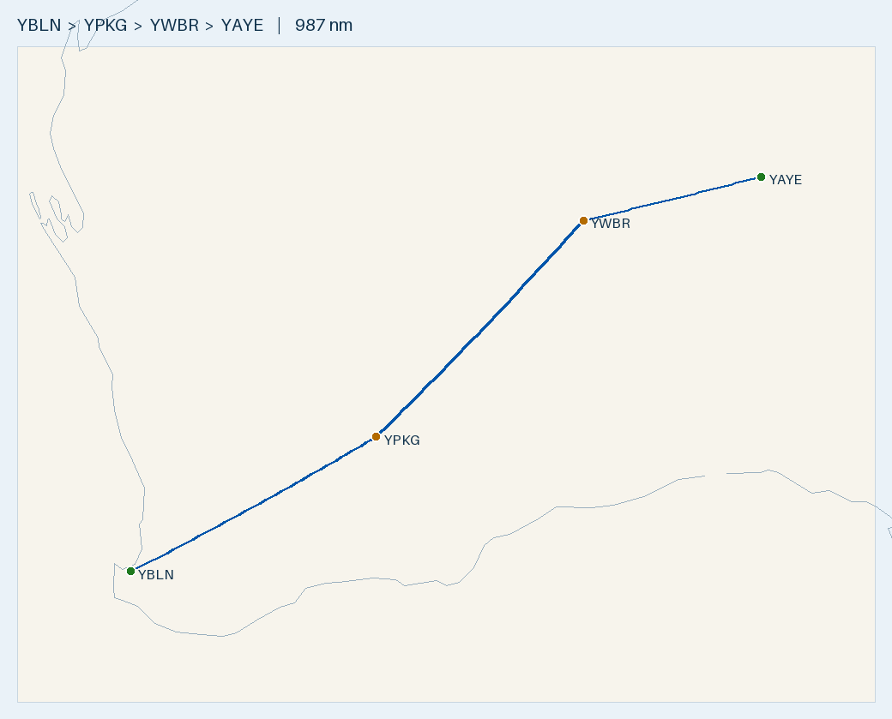

# Plan — Busselton to Uluru: Kalgoorlie · Warburton · Ayers Rock

**Route:** YBLN → **YPKG Kalgoorlie-Boulder** (fuel) → **YWBR Warburton** (fuel, remote community) → **YAYE Ayers Rock/Connellan** · 2 POB
**Aircraft:** [Cirrus SR20 G1 (s/n 1312)](../../aircraft/SR20.md) · 56 USG usable AVGAS · MTOW 3000 lb (1361 kg)
**Planning basis:** 150 KTAS · 12.5 USG/hr (11.6 book) · reserve 10.1 USG (45 min) · var per leg from ERSA · **nil wind** (apply the forecast on the day)
**Loading (planning assumption):** 2 front-seat occupants **150 kg** + **15 kg** baggage/equipment (165 kg incl. survival kit) · **full fuel (56 USG) at every departure**
**Data:** ERSA **03 SEP 2026** (current). The 26 NOV 2026 cycle is pending, so re-check every field if you fly after 26 NOV.

> ✈️ **Bottom line:** **987 nm, ~6 h 45 m flying** in three legs, filling to full at Kalgoorlie and Warburton.
> **Warburton fuel is the critical item.** ERSA requires **4 hr notice to the ARO** for AVGAS. You arrive with only ~23 USG,
> and the nearest other AVGAS is Ayers Rock itself (244 nm). So **confirm Warburton fuel before you leave Kalgoorlie.**
> Leg 2 (389 nm, Kalgoorlie → Warburton) is the long, remote one: +12.9 USG over reserve in nil wind, +7.9 with a 20 kt headwind,
> and it stops working if the average headwind exceeds ~42 kt. At Ayers Rock, ERSA warns of **sand-dune windshear landing RWY 13
> with an easterly crosswind** and year-round **dust devils**. The 1-stop Leonora option **doesn't work** (1.6 USG short of reserve even in nil wind).

---

## Route Summary (nil wind)

Times include the **climb allowance of +1 min per 2,000 ft** (7,500 ft minus field elevation) on every leg. Fuel is worked out on the total time. HDG °M = track corrected for variation only. Wind-correct each leg on the day.

| Leg | Segment | Dist (nm) | Track °T | HDG °M | Cruise alt | Time | Leg fuel (USG) | Cum. time | Fuel left (USG) |
|:---:|---------|----------:|:--------:|:------:|:----------:|-----:|---------------:|----------:|----------------:|
| 1 | YBLN → YPKG Kalgoorlie | 353.5 | 062 | 063 (var 1°W) | 7,500 | 2 h 25 m (incl. +4 climb) | 30.3 | 2 h 25 m | **25.7** → fill to 56 |
| 2 | YPKG → YWBR Warburton | 389.0 | 045 | 043 (var 2°E) | 7,500 | 2 h 39 m (incl. +3 climb) | 33.0 | 5 h 04 m | **23.0** → fill to 56 |
| 3 | YWBR → YAYE Ayers Rock | 244.3 | 078 | 074 (var 3.5°E) | 7,500 | 1 h 41 m (incl. +3 climb) | 21.0 | 6 h 45 m | **35.0** |
| **—** | **Total** | **987** | — | — | — | **6 h 45 m flying** | **84.3** | — | — |

- **Cruise level:** all three magnetic tracks are eastbound (043–074°), so plan **7,500 ft** (or 5,500/9,500 to suit the weather; nothing above 10,000 without oxygen). **Read the LSALT off the ERC-L** for each leg and check 7,500 clears it.
- **Leg 1 passes SE of Perth.** Check the **Perth CTA steps** along your track on the ERC-L/VNC. If a step base is at or below your level, descend under it or get a clearance.
- **The track is over land the whole way** (see the map), so no coastal routing is needed.
- **Longest leg:** 389 nm. Full tanks give ~543 nm still-air range with the 45 min reserve, so the leg uses ~72% of it.
- **On the day:** work out each leg's WCA from the forecast wind. THDG = track + WCA, then apply the variation in the table. Re-time (dist ÷ GS) and re-fuel (time × 12.5 USG/hr).
- **Runways:** Kalgoorlie **11/29** (2,000 × 45 m, preferred) or 18/36 (1,200 × 18 m). Warburton **18/36 only** (1,590 × 23 m). Ayers Rock **13/31 only** (2,599 × 30 m, grooved). One-runway fields, so check the crosswind at Warburton and Ayers Rock.
- **Timezone:** Ayers Rock is on **ACST (UTC+9:30)**, 1 h 30 m ahead of WA.

## Radio & en-route hazards

| Where | What | Action |
|-------|------|--------|
| Busselton (departure) | **Bird hazard** (ERSA): possibly large numbers of wetland birds | Lookout on takeoff and climb-out. Be ready to reject or go around |
| Busselton | CTAF **127.0** (shared with Bunbury), area **124.9** | Broadcast on 127.0, then 124.9 |
| Leg 1, ~14 nm out | **Bunbury (YBUN) model aircraft** (ERSA): within 500 m of a point ~4 nm NW of track, SFC–1,000 ft AGL | You'll be well above it in the climb. No action beyond a lookout |
| Leg 1, Perth CTA | Perth CTA steps SE of Perth | **Read the step bases off the ERC-L/VNC** and stay below (or get a clearance) |
| Leg 1, ~96 nm out | **Narrogin (YNRG) gliding** (ERSA), **0.1 nm off track**: aerotow and winch launches HJ, up to **3,500 ft AMSL** ("JF" as printed). "Narrogin Winch" | **Monitor Narrogin CTAF 134.0** passing overhead, and keep a lookout for gliders and tugs. Don't descend below 3,500 ft near the field |
| Area frequencies, leg 1 | YBLN **124.9** → Narrogin **125.4** → Kalgoorlie **125.75** | Change at the boundaries. **Read their positions off the ERC-L** |
| Kalgoorlie arrival and departure | **CTAF 126.6** (UNICOM 126.6), area **125.75**. **Bird hazard** (ERSA): pink and grey galahs and Australian ravens year-round | Lookout on approach, landing and takeoff |
| Kalgoorlie, ~0715 local (2315 UTC) | **Weather balloon launch** (ERSA), ~950 m WNW of the ARP. Launches may occur at other times | Keep a lookout, especially departing to the W |
| Leg 2, **~18 nm out of Kalgoorlie** | **Hang gliding at Lake Perkolilli** (ERSA, YPKG): the published position is **directly on track** (0.0 nm), 18.4 nm at 045°T from YPKG. ERSA gives no height | Check NOTAMs. You'll still be climbing here, so keep a sharp lookout, or offset a few nm either side |
| Leg 2, ~58 nm out | **Carosue Dam (YSCD)** ~7 nm off track: mine aerodrome, **nil fuel**. No ERSA additional info | Only a forced-landing option. After it, no ERSA field within ~25 nm until Warburton |
| Leg 2 → Warburton | Area **125.75 → 130.9**. Warburton **CTAF 127.1** | Change at the boundary (ERC-L). Broadcast on 127.1 |
| Leg 3, ~59 nm out of Warburton | **West Musgrave (YWMO)** quarry blasting (ERSA), 3.1 nm from its ARP on 185°M. YWMO is 8.7 nm off track. ERSA: blasting is prohibited during planned flight times, CTC the ARO to coordinate | You'll pass ~9 nm away at 7,500, so it's not a factor. If you divert there, call the ARO. YWMO has Jet A1 only, **no AVGAS** |
| Leg 3 → Ayers Rock | Area **130.9 → 121.85** (YAYE's on-ground FIA). Ayers Rock **CTAF 126.9** with a **CA/GRS** | Change at the boundary (ERC-L). Broadcast and talk to the CA/GRS on 126.9 |
| Ayers Rock, ~4.7 nm S of the ARP | **UA ops** (ERSA): drone swarm within 250 m of 25°15'51"S 130°58'57"E, **SFC–656 ft AGL**. The operator monitors the CTAF (ph 0423 616 440). That's ~4.6 nm off leg 3, near the end | Listen for them on 126.9. Stay above 656 ft AGL near that point if joining from the S |
| Ayers Rock RWY 13 | **Windshear and dust devils** (ERSA): see the aerodrome notes | Brief it before descent |

- **No towered field on the route.** All four are non-towered in ERSA (CTAF; UNICOM at Kalgoorlie; CA/GRS at Ayers Rock).
- **Restricted areas:** check the ERC-L for any PRD areas along all three legs. Don't assume there are none.
- **Kondinin (YKDN)**, ~5 nm off leg 1, publishes only a kangaroo hazard. That doesn't matter unless you land there.
- **Long legs with poor VHF coverage:** keep the area frequency, but expect gaps on leg 2 and leg 3. See the remote-ops section.

## Fuel Plan

**Fill to full (56 USG) at every stop.** Busselton is Air BP Carnet only. Kalgoorlie has an H24 AVGAS card bowser. **Warburton needs 4 hr notice to the ARO.** Ayers Rock has card-swipe bowsers.

| Point | Expected on board | Needed to next fuel + 10.1 USG reserve | Spare | Endurance left (12.5 USG/hr) |
|-------|------------------:|---------------------------------------:|------:|-----------------------------:|
| Depart YBLN (full) | **56.0 USG** | 40.4 USG (to YPKG) | **+15.6** | ~4 h 29 m |
| Land YPKG (**dip, fill to full**) | **~25.7 USG** | — | — | ~2 h 03 m |
| Depart YPKG (full) | **56.0 USG** | 43.1 USG (to YWBR) | **+12.9** | ~4 h 29 m |
| Land YWBR (**dip, fill to full**) | **~23.0 USG** | — | — | ~1 h 50 m |
| Depart YWBR (full) | **56.0 USG** | 31.1 USG (to YAYE) | **+24.9** | ~4 h 29 m |
| Land YAYE | **~35.0 USG** | 10.1 USG (reserve) | **+24.9** | ~2 h 48 m |

- **Fill full at Warburton** even though leg 3 needs only 31.1 USG. It's the most remote stop, and full tanks give you +24.9 USG of options at Ayers Rock.
- **Headwind stress test:** a **20 kt headwind on every leg** takes ~7 h 46 m flying and burns ~96.9 USG. You'd land at Kalgoorlie with ~21.2 USG (+11.1 over reserve), at Warburton with **~18.0 USG (+7.9)**, and at Ayers Rock with ~31.9 USG (+21.8). It still works, but leg 2 gets tight.
- **The 12.5 USG/hr burn is conservative** (book cruise is ~11.6), so actual use should come in under plan.
- **Cost:** ~84.3 USG (~319 L) for the trip, about **$960** at ~$3.00/L. Ask for the price when you phone each stop; remote fuel may cost more.

### Decision points (go/no-go)

| Leg | Max average headwind (full tanks, keeping the 10.1 USG reserve) | Minimum fuel to depart |
|-----|----------------------------------------------------------------:|-----------------------:|
| 1 YBLN → YPKG (353 nm) | ~52 kt | 40.4 USG |
| 2 YPKG → YWBR (389 nm) | **~42 kt** | **43.1 USG** |
| 3 YWBR → YAYE (244 nm) | ~82 kt | 31.1 USG |

- **Before leaving Kalgoorlie:** (1) confirm with the Warburton ARO that AVGAS will be there when you land (4 hr PN), and (2) check the leg 2 forecast headwind is well under ~42 kt. If either fails, stay at Kalgoorlie.
- **Why it matters:** you reach Warburton with ~23 USG. That's not enough to reach Ayers Rock with reserve (31.1 needed) or to go back to Kalgoorlie (43.1 needed), and there's no other AVGAS within 240 nm. If Warburton fuel falls through, you're on the ground there until it's sorted.
- **Leg 2 en route:** check fuel at the halfway point (~195 nm, about 1 h 21 m after takeoff; expect ~39 USG). If you're behind plan, you have to decide early. The only ERSA field en route is Carosue Dam (nil fuel), ~58 nm out, so turning back to Kalgoorlie is the real option in the first part of the leg.

## Fuel cards & payment

| Field | AVGAS provider | Payment (ERSA) | Notes |
|-------|----------------|----------------|-------|
| [YBLN](../../aerodromes/YBLN.md) Busselton | Air BP / City of Busselton | ⚠️ **Air BP Carnet only** | Phone the AD OPR. Fill full |
| [YPKG](../../aerodromes/YPKG.md) Kalgoorlie-Boulder | Air BP/Mobil | **H24 AVGAS card bowser.** ERSA doesn't say which card, so bring the Air BP Carnet and a credit card, and phone to confirm | Staffed 2300–1100 UTC (0700–1900 local). AH 30 min PN, call-out fees. Phone 0409 194 840. *(The "Fuel 2 Sky Carnet, V and MC" line is for the Viva Jet A1/F34 truck, not AVGAS)* |
| [YWBR](../../aerodromes/YWBR.md) Warburton | Via the ARO | ⚠️ **Not stated in ERSA**, so confirm when you book | **4 hr PN required, phone the ARO.** AH call-out fee 1600–0700 local |
| [YAYE](../../aerodromes/YAYE.md) Ayers Rock | Skyfuel (Viva Energy/Air BP JV) | **Visa, Mastercard, Viva Fuel2Sky or BP card** (AVGAS card-swipe bowsers) | Staffed 2130–0730 UTC (0700–1700 ACST), AH call-out fee. Phone 0417 632 763 or 0418 862 100, yulara@skyfuel.com.au |

**Carry an Air BP Carnet** (Busselton accepts nothing else) **plus a Visa/Mastercard and a BP card** (Kalgoorlie and Ayers Rock). **Warburton: phone the ARO at least 4 hr ahead** to book fuel and confirm how to pay.

## Weight & Balance (2 front + 15 kg baggage/equipment, full fuel)

| Item | Mass | Arm (in) | Moment (lb·in) |
|------|-----:|---------:|---------------:|
| Empty (s/n 1312) | 973 kg (2145 lb) | ~140.5 *(assumed)* | 301,373 |
| Front seats (2 occupants) | 150 kg (331 lb) | 143.5 | 47,454 |
| Baggage + equipment | 15 kg (33 lb) | 208.0 | 6,878 |
| **Zero-fuel** | **1138 kg (2509 lb)** | **141.8** | **355,705** |
| Full fuel 56 USG | 152 kg (336 lb) | 153.95 | 51,727 |
| **Takeoff (each leg, full)** | **1290 kg (2845 lb)** | **143.2** | **407,432** |
| Land YPKG (25.7 USG) | 1208 kg (2663 lb) | 142.5 | 379,444 |
| Land YWBR (23.0 USG) | 1201 kg (2647 lb) | 142.4 | 376,950 |
| Land YAYE (35.0 USG) | 1233 kg (2719 lb) | 142.7 | 388,034 |

**Takeoff 2845 lb is 155 lb (70 kg) under MTOW, and every landing is under 2900 lb** ✓. Baggage 33 lb is well under 130 lb ✓. **CG 143.2 in is inside the envelope but only ~0.7 in aft of the forward limit** (~142.5 in at 2845 lb); the margin grows to ~1.5 in by landing. Put the survival kit and water in the baggage bay (arm 208), not on the rear seat or floor up front. If the kit and water take you over 15 kg, recompute. **The empty arm is assumed**, so confirm it from the aircraft's W&B record. **Density altitude:** all three stops are 1,200–1,630 ft, and inland summer temperatures push DA well above that. Check takeoff distance at 2845 lb at Warburton (1,590 m) in particular.

## Timeline & daylight (example)

Assumes a 0700 AWST (2300 UTC) start and 45 min on the ground at each fuel stop.

| Event | AWST | UTC | Local |
|-------|-----:|----:|------:|
| Depart YBLN | 0700 | 2300 | 0700 AWST |
| Land YPKG | 0925 | 0125 | 0925 AWST |
| Depart YPKG | 1010 | 0210 | 1010 AWST |
| Land YWBR | 1249 | 0449 | 1249 AWST (inside ARO normal hours) |
| Depart YWBR | 1334 | 0534 | 1334 AWST |
| Land YAYE | 1515 | 0715 | **1645 ACST** (Skyfuel staffed until 1700 ACST) |

- **Ring Warburton by ~0830 AWST** (4 hr before arrival) at the latest. Better: book the day before and reconfirm from Kalgoorlie.
- **It's a long day:** ~8 h 15 m from start-up to shutdown. If you start late or the forecast leg 2 headwind is strong, **overnight at Kalgoorlie** and do legs 2 and 3 the next morning.
- **Check last light at YAYE in ACST** and keep your reserve in daylight. Arriving Warburton after 1600 local triggers the AH call-out fee.

## Remote-ops (legs 2 and 3)

- **Survival kit and water** for two people in the desert (in the baggage bay; include it in the W&B).
- **PLB/EPIRB** carried and registered, and worn or reachable from the seat.
- **SARTIME** with Airservices (or a trusted contact) for legs 2 and 3, and cancel it on arrival. At Ayers Rock, read the FAC on cancelling SARWATCH (the previous cycle said the CA/GRS can't, so use the FIA or phone).
- **Communications:** VHF coverage at 7,500 ft may have gaps on legs 2 and 3. Consider a satellite messenger or phone as backup.
- **Flight following:** make position reports or use the FIA on the area frequencies (ERSA, per aerodrome): Kalgoorlie 125.75, Warburton 130.9, Ayers Rock 121.85.

## Alternative considered: 1 stop via Leonora — **not viable**

| Leg | Dist (nm) | Track °T | Time (incl. climb) | Fuel (USG) | Needed incl. 10.1 reserve | vs 56 USG usable |
|-----|----------:|:--------:|-------------------:|-----------:|--------------------------:|-----------------:|
| YBLN → [YLEO](../../aerodromes/YLEO.md) Leonora | 418.7 | 048 | 2 h 51 m | 35.7 | 45.8 | +10.2 |
| YLEO → YAYE | 562.0 | 069 | 3 h 48 m | 47.5 | **57.6** | **−1.6 USG short** |

- **The YLEO → YAYE leg doesn't work even in nil wind.** It's 562 nm against a ~543 nm still-air range with reserve. You'd need an average tailwind of about 5 kt just to arrive on reserve. With a 20 kt headwind you'd land with ~1.3 USG.
- Leonora itself is fine as a stop: sealed 04/22 (2,018 × 30 m), Air BP H24 card bowser with AVGAS on PN (phone 08 9037 6044 or 0428 376 154; cash, EFTPOS or credit card), CTAF 126.8, area 118.4. ERSA publishes no additional info for it.
- **Stick with the 2-stop route.** It costs ~6 min more flying and gives you a usable reserve on every leg.

## Route Map

🗺️ [Interactive `map.geojson`](map.geojson) · Regenerate: `.venv/bin/python scripts/route_map.py map YBLN YPKG YWBR YAYE --out flightplans/SR20/YBLN-YAYE`

---

## Aerodromes

| Aerodrome | Elev | Runway | Fuel | CTAF / area | Notes |
|-----------|-----:|--------|------|-------------|-------|
| **[YBLN](../../aerodromes/YBLN.md) Busselton** *(CERT)* | 56 ft | 03/21 grooved, 2460 × 45 m | AVGAS · Jet A1 (**Carnet only**) | **127.0** · 124.9 | Departure. Fill full. **Bird hazard** (ERSA) |
| **[YPKG](../../aerodromes/YPKG.md) Kalgoorlie-Boulder** *(CERT)* | 1203 ft | **11/29 2000 × 45 m** · 18/36 1200 × 18 m | AVGAS (H24 card bowser) · Jet A1 · F34 | **126.6** (UNICOM 126.6) · 125.75 | Fuel stop 1. **Birds**, **hang gliding NE (on leg 2 track)**, **weather balloon** (ERSA) |
| **[YWBR](../../aerodromes/YWBR.md) Warburton** *(CERT)* | 1510 ft | **18/36 only**, 1590 × 23 m | AVGAS · Jet A1, **4 hr PN to ARO** | **127.1** · 130.9 | Fuel stop 2, remote community. No ERSA additional info |
| **[YAYE](../../aerodromes/YAYE.md) Ayers Rock/Connellan** *(CERT)* | 1626 ft | **13/31 only**, 2599 × 30 m grooved | AVGAS (card-swipe) · Jet A1 | **126.9** (CA/GRS) · 121.85 | Destination, ACST. **RWY 13 windshear**, **dust devils**, **UA ops**, **birds/animals** (ERSA) |
| [YLEO](../../aerodromes/YLEO.md) Leonora *(not used)* | 1217 ft | 04/22 sealed 2018 × 30 m · 12/30 gravel 1140 m | AVGAS on PN · Jet A1 | 126.8 · 118.4 | Only for the rejected 1-stop option |

**YBLN Busselton** (-33.687, 115.400):
- Fill AVGAS to full with the **Air BP Carnet** (the only payment accepted). Phone the AD OPR.
- **⚠️ Bird hazard (ERSA):** there may be large numbers of wetland birds around the aerodrome. Keep a lookout on takeoff and climb-out.

**YPKG Kalgoorlie-Boulder** (-30.789, 121.462):
- **Use 11/29** (2,000 m, 45 m wide). 18/36 is only 18 m wide.
- **⚠️ Bird hazard (ERSA):** pink and grey galahs and Australian ravens year-round. Lookout on approach, landing and takeoff.
- **⚠️ Hang gliding (ERSA):** operations NE of town at **Lake Perkolilli, Kunalpi** (30°34'23"S 121°42'51"E). That's 18.4 nm out **on the leg 2 track**. Check NOTAMs and keep a lookout as you climb out.
- **⚠️ Weather balloon (ERSA):** launched around **2315 UTC (0715 local)** from ~950 m WNW of the ARP. Launches may happen at other times too.
- **Dip on arrival** (expect ~25.7 USG) and fill to full. Air BP/Mobil is staffed 2300–1100 UTC. The AVGAS card bowser is H24.
- **Read the FAC REMARKS** for GA parking and airside security rules (they aren't in our parsed DB).

**YWBR Warburton** (-26.128, 126.583), remote community aerodrome:
- **Fuel (ERSA):** JET A1 and AVGAS available, **4 hr prior notice required. Phone the ARO.** AH call-out fee applies 1600–0700 local. ERSA doesn't state payment, so confirm when you book.
- **ARO phone:** it's in the FAC's AD OPR line, which our DB doesn't parse. The previous cycle listed **ARO 0499 885 088**. Confirm it on the current FAC before you rely on it.
- **PPR/permit:** the current ERSA record shows no PPR requirement, but this is a remote community aerodrome. When you phone the ARO, confirm that you're expected, the fuel and payment, and whether you need a community entry permit to leave the airfield. Read the current FAC REMARKS for any PPR.
- **18/36 only** (1,590 m, 23 m wide), so check the crosswind. At 1,510 ft on a hot day, check takeoff distance at 2845 lb.
- **ERSA publishes no ADDITIONAL INFORMATION for Warburton**, so no hazards are listed here. Check NOTAMs on the day.
- **Dip on arrival** (expect ~23.0 USG) and fill to full.

**YAYE Ayers Rock/Connellan** (-25.186, 130.976), ACST (UTC+9:30):
- **⚠️ RWY 13 windshear (ERSA):** landing on RWY 13 with an **easterly crosswind** is hazardous for light aircraft, because sand dunes run alongside the runway strip at the N end. **Windshear in both speed and direction** can occur. ERSA says to aim to touch down **"either in the first 400 of the RWY or beyond 800 FM the THR"**. Plan your touchdown point before the approach, and be ready to go around.
- **⚠️ Dust devils (ERSA):** common around the aerodrome **all year**. Watch for them on approach and takeoff.
- **⚠️ Bird and animal hazard (ERSA):** confirmed hazards are advised by NOTAM, so check NOTAMs before leg 3.
- **⚠️ UA ops (ERSA):** a drone swarm (each under 500 g) operates within 250 m of 25°15'51"S 130°58'57"E (~4.7 nm S of the ARP), **SFC–656 ft AGL**. The operator monitors the CTAF (ph 0423 616 440).
- **ERSA also notes** that the delicensed aerodrome 2 km NE of Ayers Rock **no longer exists** as a landing area. Don't plan to use it.
- **CTAF 126.9 with a CA/GRS.** Area 121.85 on the ground. **Read the FAC REMARKS and FLIGHT PROCEDURES** (not in our parsed DB) for PPR, GA parking slots, ASIC and the inbound call.
- AVGAS card-swipe bowsers: Visa, Mastercard, Fuel2Sky or BP card. Staffed 0700–1700 ACST.

---

## Pre-Flight Checklist
- [ ] **Wind:** get the GAF and winds aloft for all three legs, then wind-correct HDG, GS, time and fuel. **Leg 2 headwind must be well under ~42 kt.**
- [ ] **NOTAMs and ERSA:** YBLN, YPKG, YWBR, YAYE, plus Narrogin gliding, Lake Perkolilli hang gliding and YAYE bird/animal NOTAMs. Re-check ERSA if you fly after 26 NOV 2026.
- [ ] **Warburton:** phone the ARO (number from the current FAC) to **book AVGAS (4 hr PN minimum)**, confirm payment, confirm you're expected, and ask about any community entry permit. Reconfirm from Kalgoorlie.
- [ ] **Ayers Rock:** read the current FAC REMARKS for **PPR, GA parking slots and ASIC**, and arrange them. Note the **Skyfuel hours** (0700–1700 ACST).
- [ ] **Kalgoorlie:** read the FAC REMARKS for GA parking and airside access. Confirm which card the AVGAS bowser takes (0409 194 840).
- [ ] **Cards:** Air BP Carnet, Visa/Mastercard and a BP card. Carry your **ASIC**.
- [ ] **Fuel:** full 56 USG at Busselton (dip, fuel drain/water check). Minimum to depart: **40.4 / 43.1 / 31.1 USG** for legs 1 / 2 / 3.
- [ ] **W&B** with the real empty weight and arm, **including the survival kit and water**. Planned 2845 lb with the CG ~0.7 in aft of the forward limit.
- [ ] **Cruise level and LSALT:** read the **LSALT off the ERC-L** for each leg and confirm 7,500 clears it.
- [ ] **Airspace:** mark the **Perth CTA step bases** along leg 1, any **PRD areas** on all legs, and the **area-frequency boundaries** (124.9 → 125.4 → 125.75 → 130.9 → 121.85) on the ERC-L.
- [ ] **Density altitude and TODR** at YPKG (1,203 ft), YWBR (1,510 ft) and YAYE (1,626 ft) at 2845 lb and the forecast temperature.
- [ ] **Daylight:** last light at YAYE in ACST, with your reserve. Decide in advance whether to overnight at Kalgoorlie.
- [ ] **Remote ops:** survival kit and water, **PLB** checked, **SARTIME** for legs 2 and 3, satellite messenger or phone backup.

## In-Flight Checklist
- [ ] **Departing YBLN:** CTAF **127.0**, then area **124.9**. **Watch for wetland birds** on takeoff and climb-out (ERSA).
- [ ] **Leg 1 climb:** check the Perth CTA step bases against your level as you climb to 7,500.
- [ ] **~96 nm out:** **Narrogin is directly below.** Monitor **CTAF 134.0** for gliders, tugs and the "Narrogin Winch" (launches up to 3,500 ft AMSL). Change area frequency at the boundary (125.4).
- [ ] **Fuel log, leg 1:** halfway (~177 nm) expect ~40 USG. Change to area **125.75** at the boundary.
- [ ] **Kalgoorlie arrival:** CTAF **126.6**. **Watch for galahs and ravens.** Use 11/29. Dip (expect ~25.7 USG) and **fill to full**. **Confirm Warburton fuel by phone** and check the leg 2 wind before you go.
- [ ] **Departing Kalgoorlie:** CTAF **126.6**. **~18 nm out on track: Lake Perkolilli hang gliding.** Keep a sharp lookout or offset a few nm.
- [ ] **Leg 2:** SARTIME active. Halfway (~195 nm, ~1 h 21 m) expect ~39 USG. If you're behind plan, turn back to Kalgoorlie early. Change to area **130.9** at the boundary.
- [ ] **Warburton arrival:** CTAF **127.1**, 18/36 only. Dip (expect ~23.0 USG) and **fill to full**. Cancel or update SARTIME.
- [ ] **Leg 3:** SARTIME active. ~59 nm out, West Musgrave is ~9 nm off track (quarry blasting, not a factor at 7,500). Halfway (~122 nm) expect ~45 USG. Change to area **121.85** at the boundary.
- [ ] **Before descent to Ayers Rock:** brief **RWY 13 windshear** (easterly crosswind, sand dunes at the N end; touchdown in the first 400 or beyond 800 from the threshold) and **dust devils**. Check NOTAMs for bird/animal hazards.
- [ ] **Ayers Rock arrival:** CTAF **126.9**, talk to the **CA/GRS**. Listen for the **UA swarm** ~4.7 nm S (SFC–656 ft AGL). Expect **dust devils** on final. Land and **cancel SARTIME** (via the FIA or phone, not the CA/GRS).

---
*Planning only. Cross-check current ERSA, NOTAMs, weather, daylight, W&B and the SR20 POH before flight.*
