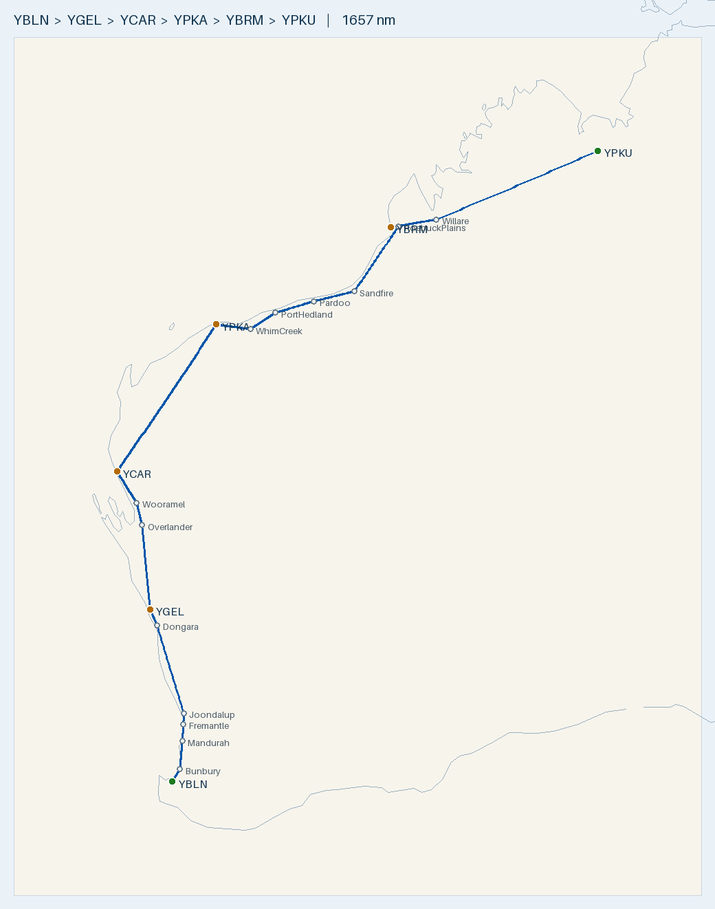

# Plan — 2-day coastal run to the Kimberley: Busselton · Geraldton · Carnarvon · Karratha (overnight) · Broome · Kununurra

**Route:** YBLN → *Bunbury · Mandurah · Fremantle · Joondalup · Dongara* → **YGEL Geraldton** → *Overlander · Wooramel* → **YCAR Carnarvon** → **YPKA Karratha (overnight)** → *Whim Creek · Port Hedland · Pardoo · Sandfire · Roebuck Plains* → **YBRM Broome** → *Willare Bridge* → **YPKU Kununurra**
**Aircraft:** [Cirrus SR20 G1 (s/n 1312)](../../aircraft/SR20.md) · AVGAS · 56 USG usable · MTOW 3000 lb (1361 kg)
**Planning basis:** 150 KTAS · 12.5 USG/hr · reserve 10.1 USG (45 min) · var per leg from ERSA · **nil wind** (apply the forecast on the day)
**Loading:** **250 kg cabin load** (your stated loading). That puts you at MTOW with **~50.7 USG**, so fill to ~50.7 USG at every stop, not full.
**Data:** ERSA **03 SEP 2026** (current) for every aerodrome. The 26 NOV 2026 cycle is pending, so re-check everything if you fly after 26 NOV.
**Season:** any. From about November the tropical wet season matters (see *Tropical weather & heat*). All of WA is AWST, so there's no time-zone change.

> ✈️ **Bottom line:** **~1,657 nm** over two days with four fuel stops. **Day 1** is Busselton → Karratha, **855 nm, 5 h 54 m flying / ~7 h 24 m** with two 45-min stops.
> **Day 2** is Karratha → Kununurra, **802 nm, 5 h 28 m flying / ~6 h 14 m** with one stop. Every leg works on 50.7 USG in nil wind, and **no Halls Creek stop is needed**.
> **But the coastal routing makes Day 2 tight.** The direct Karratha → Broome line runs up to ~55 nm out to sea, so the coastal line is 406 nm instead of 351.
> A **20 kt headwind leaves only +0.8 USG over reserve** at Broome, and the Broome → Kununurra leg leaves +1.7 USG.
> **Port Hedland (H24 AVGAS) is overhead on leg 4** and Derby (H24 AVGAS) is 22 nm off leg 5. Use them as go/no-go points.
> Leg 1 runs **under the Perth Class C / Jandakot Class D steps** from about Mandurah to Joondalup, unless you get a clearance through. It passes the **Murray Field parachute DZ (to FL150, 6 nm E)**. Jurien Bay's DZ (to FL150) is 11 nm W of track.

---

## Route Summary (nil wind)

Leg times include **+4 min climb on every leg** (1 min per 2,000 ft, from near-sea-level fields to 7,500/8,500 ft), and fuel is computed on the total time. HDG °M = track corrected for variation only. Fuel left assumes **50.7 USG at each takeoff**.

**Day 1: Busselton → Karratha (855 nm)**

| Leg | Segment | Dist (nm) | Track °T | HDG °M | Cruise alt | Time | Leg fuel (USG) | Cum. time | Fuel left (USG) |
|:---:|---------|----------:|:--------:|:------:|:----------:|-----:|---------------:|----------:|----------------:|
| 1a | YBLN → Bunbury | 24.6 | 029 | 032 | low, OCTA (see below) | 14 m | 2.9 | 0 h 14 m | 47.8 |
| 1b | Bunbury → Mandurah | 48.2 | 005 | 007 | low, OCTA | 19 m | 4.0 | 0 h 33 m | 43.8 |
| 1c | Mandurah → Fremantle | 28.3 | 003 | 005 | under the CTA steps (VTC) | 11 m | 2.4 | 0 h 44 m | 41.4 |
| 1d | Fremantle → Joondalup | 18.9 | 002 | 004 | under the CTA steps (VTC) | 8 m | 1.6 | 0 h 52 m | 39.9 |
| 1e | Joondalup → Dongara | 155.9 | 344 | 345 | 8,500 once clear of the steps | 62 m | 13.0 | 1 h 54 m | 26.9 |
| 1f | Dongara → **YGEL Geraldton** | 29.6 | 337 | 338 | 8,500 | 12 m | 2.5 | 2 h 06 m | **24.4** |
| — | *Geraldton fuel stop (fill to 50.7)* | — | — | — | — | *45 m* | — | 2 h 51 m | 50.7 |
| 2a | YGEL → Overlander RH | 143.9 | 355 | 356 | 8,500 | 62 m | 12.8 | 3 h 53 m | 37.9 |
| 2b | Overlander RH → Wooramel RH | 39.5 | 347 | 348 | 8,500 | 16 m | 3.3 | 4 h 09 m | 34.6 |
| 2c | Wooramel RH → **YCAR Carnarvon** | 63.1 | 328 | 328 | 8,500 | 25 m | 5.3 | 4 h 34 m | **29.3** |
| — | *Carnarvon fuel stop (fill to 50.7)* | — | — | — | — | *45 m* | — | 5 h 19 m | 50.7 |
| 3 | YCAR → **YPKA Karratha** | 303.4 | 035 | 035 | 7,500 | 125 m | 26.1 | 7 h 24 m | **24.6** |
| **—** | **Day 1 total** | **855** | — | — | — | **5 h 54 m flying · ~7 h 24 m total** | **73.8** | — | — |

**Day 2: Karratha → Kununurra (802 nm)**

| Leg | Segment | Dist (nm) | Track °T | HDG °M | Cruise alt | Time | Leg fuel (USG) | Cum. time | Fuel left (USG) |
|:---:|---------|----------:|:--------:|:------:|:----------:|-----:|---------------:|----------:|----------------:|
| 4a | YPKA → Whim Creek | 60.4 | 097 | 096 | 7,500 | 28 m | 5.9 | 0 h 28 m | 44.8 |
| 4b | Whim Creek → Port Hedland (YPPD) | 52.2 | 058 | 057 | 7,500 | 21 m | 4.4 | 0 h 49 m | **40.5** *(decision point)* |
| 4c | Port Hedland → Pardoo RH | 70.6 | 074 | 073 | 7,500 | 28 m | 5.9 | 1 h 17 m | 34.6 |
| 4d | Pardoo RH → Sandfire RH | 73.1 | 077 | 076 | 7,500 | 29 m | 6.1 | 1 h 47 m | 28.5 |
| 4e | Sandfire RH → Roebuck Plains | 135.5 | 036 | 035 | 7,500 | 54 m | 11.3 | 2 h 41 m | 17.2 |
| 4f | Roebuck Plains → **YBRM Broome** | 13.9 | 265 | 264 | descend | 6 m | 1.2 | 2 h 46 m | **16.1** |
| — | *Broome fuel stop (fill to 50.7)* | — | — | — | — | *45 m* | — | 3 h 31 m | 50.7 |
| 5a | YBRM → Willare Bridge | 82.3 | 081 | 080 | 7,500 | 37 m | 7.7 | 4 h 08 m | **43.0** *(decision point)* |
| 5b | Willare Bridge → **YPKU Kununurra** | 313.5 | 069 | 067 | 7,500 | 125 m | 26.1 | 6 h 14 m | **16.9** |
| **—** | **Day 2 total** | **802** | — | — | — | **5 h 28 m flying · ~6 h 14 m total** | **68.4** | — | — |

**Trip: ~1,657 nm · 11 h 23 m flying · ~142 USG (~538 L).**

- **Visual waypoints** (enter these in the GPS; "RH" = roadhouse):

  | Waypoint | Position | Why it's there |
  |----------|----------|----------------|
  | Bunbury · Mandurah · Fremantle · Joondalup · Dongara | -33.33,115.64 · -32.53,115.72 · -32.06,115.75 · -31.745,115.765 · -29.25,114.93 | Keeps leg 1 on the coast. The direct YBLN → YGEL line runs up to ~30 nm offshore west of Perth. Joondalup (city centre and lake, a few nm inland) and Dongara/Port Denison were added because the straight Fremantle → Geraldton line runs up to ~3 nm offshore off the northern Perth beaches and again near Dongara. Same leg 1 as the [Shark Bay plan](../YBLN-YSHK/plan.md) |
  | Overlander RH · Wooramel RH | -26.41,114.46 · -25.77,114.29 | On the North West Coastal Hwy. Keeps leg 2 east of Shark Bay. The direct line crosses ~10 nm of open water |
  | Whim Creek · Port Hedland · Pardoo RH · Sandfire RH · Roebuck Plains | -20.84,117.84 · -20.378,118.626 (YPPD) · -20.05,119.83 · -19.77,121.09 · -17.93,122.47 | Follows the Great Northern Hwy along Eighty Mile Beach. The direct YPKA → YBRM line goes up to **~55 nm out to sea** |
  | Willare Bridge | -17.73,123.65 (Fitzroy River bridge) | Keeps leg 5 south of the head of King Sound. It costs only 1.6 nm |

- **Routing changes from the old plan:** leg 1 is now 306 nm coastal (the old plan's table said 296 nm direct, but its W&B table used 306). Leg 2 grows by 5 nm. **Leg 4 grows by 55 nm**, from 351 to 406 nm. Leg 5 grows by 2 nm. Leg 3 (Carnarvon → Karratha) stays direct because it's over land the whole way, well inland of Exmouth Gulf.
- **Close to the beach, not over it:** elsewhere on leg 1 the track is never more than ~2 nm off the beach (Geographe Bay, the Binningup coast, Cockburn Sound). Sandfire → Roebuck Plains clips about 1 nm of the tidal flats at the eastern end of Roebuck Bay. If you want to stay strictly over land, dogleg via Roebuck Plains Roadhouse on the highway (-17.85,122.50), which adds ~9 nm.
- **Cruise altitudes:** 7,500 ft on northeasterly/easterly tracks and 8,500 ft on the northwesterly tracks, as shown. **Read the LSALT for each leg off the ERC-L** and check your level clears it, especially leg 5 across the Kimberley interior. Stay below 10,000 ft, since there's no oxygen.
- **Leg 1 under the Perth steps:** you'll fly the Mandurah → Fremantle → Joondalup stretch low, below the Perth Class C / Jandakot Class D steps, and climb to 8,500 once you're north of them. Read the step bases off the Perth VTC; this plan doesn't quote them. The total climb is the same ~8,450 ft whether you do it in one go or in two stages, so the +4 min charged out of Busselton still covers it. If you get a clearance through instead, the numbers don't change.
- **On the day:** for each leg, work out the WCA from the forecast wind. THDG = track + WCA, and MHDG = THDG − E var / + W var (the HDG column already includes the variation). Then re-time each leg (dist ÷ GS) and re-fuel it (time × 12.5 USG/hr). **Legs 4 and 5 are the ones the wind decides.** See the Fuel Plan.
- **Runways:** all the main runways are at least 1,619 m long (Carnarvon 04/22 is the shortest). Take the into-wind runway. At Broome, RWY 28 has a displaced landing distance (LDA 2,204 m) because of a blast embankment short of the threshold.

## Radio & en-route hazards

| Where | What | Action |
|-------|------|--------|
| Busselton departure | **Bird hazard** (ERSA): possibly large numbers of wetland birds around the aerodrome | Keep a lookout on takeoff and climb-out. CTAF **127.0**, area **124.9** |
| Leg 1, ~3 nm off at Bunbury (23 nm out) | **Searchlight display** 3.8 nm NW of Bunbury. **Model aircraft** within 500 m of a site 8.8 nm SSW of Bunbury, **SFC–1,000 ft AGL**, ~5 nm east of your track (ERSA YBUN) | You'll be well above it on the climb. Don't let the searchlight distract you if you're late. Bunbury shares CTAF 127.0 |
| Leg 1, Murray Field, ~6 nm off (73 nm out) | **Parachuting HJ to FL150** on the airfield, plus low-level aerobatics within 1 nm (ERSA) | Monitor Murray CTAF **119.1** and Perth Centre **135.25** for DZ status. Don't overfly the field |
| Leg 1, Serpentine, ~7 nm off (81 nm out) | **Low-level aerobatics** in the vicinity, **emergency services helicopters H24** (ERSA). Shares CTAF 119.1 with Murray Field | Lookout. ERSA says to refer to the Perth VTC and VNC |
| Mandurah → Joondalup (~70–130 nm) | **Perth Class C / Jandakot Class D** overlie the coast. Jandakot (towered, TWR 118.1) is 7 nm E. ERSA warns of **wake turbulence** in the Jandakot zone from heavies overhead in the Class C | Stay **OCTA under the steps** (read the bases off the Perth VTC), or get a clearance. Area **135.25**. The Perth APP frequency (123.6 / 132.95 in ERSA) is shown on the VTC by sector |
| Leg 1, ~120–135 nm, 10–14 nm E of track | **Gingin (YGIG)** (towered, TWR 118.5) and **RAAF Pearce (YPEA)** (towered, TWR 118.3) | Stay well clear of their control zones and any military restricted areas. Read the boundaries off the VTC / ERC-L and check NOTAMs for activation |
| Leg 1, ~213 nm (~93 nm before Geraldton), **11 nm W of track** | **Jurien Bay (YJUR)** (ERSA): **intense parachuting within 5 nm, 7 days/week, to FL150**. Jump aircraft broadcast on CTAF **126.7** and Melbourne Centre **121.2** | Monitor **121.2** (your area frequency here). Hold your track and don't drift W toward Jurien |
| Geraldton arrival | **Plume rise** from a power plant 0.43 nm WSW of the RWY 08 threshold. **Weather balloon** ~07:15 local (2315 UTC) Tue–Fri from 1.3 km SSW. On the ground, terrain and the terminal can **block CTAF calls** between the runway ends (ERSA) | CTAF **127.1**, area **121.2**. Avoid the plume. Make clear taxi calls and keep a good lookout on the ground |
| Carnarvon arrival | **Helicopter ops** in the vicinity. **Corellas** on RWY 04/22 and 18/36 by day. **Northern GA apron is rough** (ERSA) | CTAF **126.7**, area **122.1**. Lookout on final and be ready to go around. Taxi carefully on the north apron |
| Karratha arrival (end of Day 1) and departure (Day 2) | **Class D, towered.** **Bird and animal hazard.** **Unannounced high-velocity gas discharge** may occur within **D150** (~7.5 nm N, 002° M from the field). The **D157** Dampier firing range may be in use **without a NOTAM**, shown by flags. **Night-vision helicopter ops** within 40 nm, mostly over water, possibly unlit (ERSA) | ATIS **134.55**, Tower **127.35**, Ground **123.55**. Outside tower hours it's CTAF 127.35 (check the hours in ERSA). Area **122.4**. Locate D150 and D157 on the VNC and keep clear |
| Leg 4, overhead Port Hedland (113 nm out) | Non-towered, **Class G**, with an AFIS. **Corellas, ibis and gulls** SFC–100 ft, peaking at dawn and dusk. **Heliport (YHIP)** 4.7 nm NW, with **NVG helicopter ops within 30 nm**, mostly over water, possibly unlit. **Weather balloon** ~07:15 local (2315 UTC) (ERSA) | ATIS **133.65**. Talk to **Hedland Information / CTAF 119.9** (area **118.6**) before you get close, and overfly well above the circuit. **This is the leg 4 fuel decision point** |
| Leg 4, between Port Hedland and Broome | Area changes from **Melbourne Centre** (118.6 at Port Hedland) to **Brisbane Centre** (123.95 at Broome) | Read the boundary and frequency off the ERC-L |
| Broome arrival and departure | **Class D, towered.** **Bird and animal hazard.** **Flying foxes on final RWY 28** from 1 h before to 1 h after last light. **Blast embankment** 6 ft AGL, 230 m short of the RWY 28 threshold. **Weather balloon** ~07:15 local (2315 UTC) (ERSA) | ATIS **128.2**, Tower **126.0**, Ground **121.7**. Outside tower hours it's CTAF 126.0 and area **123.95**. Don't land short on 28 |
| Leg 5, Willare Bridge (82 nm out) | **Leg 5 fuel decision point.** Derby (YDBY) is 22 nm N with H24 AVGAS | Check the fuel against the table below |
| Leg 5, Curtin, ~5 nm off (95 nm out) | **Curtin is towered** (Tower **118.3** per ERSA). ERSA's only listed hazard is birds and kangaroos | Check the ERC-L and NOTAMs for Curtin's airspace and whether it's active. Get a clearance on 118.3 or route clear. Area **122.1** |
| Kununurra arrival (end of Day 2) | **High concentrations of birds** from 1 h before to 1½ h after sunrise, and from 1 h before to ½ h after sunset. They move from roosts 1 nm S of the field to feed N along the Ord River (ERSA) | CTAF **127.0**, area **122.4**. **Plan to land more than 1 h before sunset**. Lookout on final |

- **Controlled airspace:** Perth Class C and Jandakot Class D on leg 1 (with Gingin and Pearce off to the E). **Karratha and Broome are Class D towered fields** (DB: Karratha D/E/G, Broome D/G). Curtin is towered. Everything else on the route is Class G CTAF.
- **Don't take step altitudes or zone boundaries from this plan.** Read the Perth CTA steps, the Karratha and Broome CTR limits, the Melbourne/Brisbane boundary, and any PRD areas along the coast off the current **ERC-L, VNC and Perth VTC**.
- **Rottnest Island** (parachuting near the island, per ERSA) and **Perth airport** are both ~11–13 nm off track. You won't go near them on this routing.
- **Area frequencies at each aerodrome (ERSA):** Busselton 124.9 · Perth area (Murray Field, Serpentine, Jandakot, Gingin, Pearce) 135.25 (Perth Centre) · Jurien Bay, Geraldton 121.2 · Carnarvon 122.1 · Karratha 122.4 · Port Hedland 118.6 (all Melbourne Centre) · Broome 123.95 · Derby, Curtin 122.1 · Halls Creek 118.2 · Kununurra 122.4 (all Brisbane Centre).
- **Nothing published within 10 nm of legs 2 and 3.** Kalbarri drops out of range with the new leg 2 waypoints. Unregistered station strips aren't charted, so keep a lookout.

## Fuel Plan

**Fill to ~50.7 USG (not full) at Busselton and at every stop.** That's about 5.3 USG below full, which keeps you at MTOW with 250 kg aboard. Know how you'll measure a part-fill (dip or totaliser) before you leave. Every planned stop has AVGAS.

| Point | Expected on board | Needed to next fuel + 10.1 USG reserve | Spare | Endurance left (12.5 USG/hr) |
|-------|------------------:|---------------------------------------:|------:|-----------------------------:|
| Depart YBLN | **50.7** | 36.4 (leg 1) | **+14.3** | 4 h 03 m |
| Land YGEL, then fill to 50.7 | ~24.4 | 31.5 (leg 2) | **+19.2** | 1 h 57 m → 4 h 03 m |
| Land YCAR, then fill to 50.7 | ~29.3 | 36.2 (leg 3) | **+14.5** | 2 h 21 m → 4 h 03 m |
| Land YPKA (overnight), then fill to 50.7 | ~24.6 | 44.7 (leg 4) | **+6.0** | 1 h 58 m → 4 h 03 m |
| **Overhead Port Hedland** (decision point) | **~40.5** | 34.5 (to Broome) | **+6.0** | 3 h 14 m |
| Land YBRM, then fill to 50.7 | ~16.1 | 43.9 (leg 5) | **+6.8** | 1 h 17 m → 4 h 03 m |
| **Overhead Willare Bridge** (decision point) | **~43.0** | 36.2 (to Kununurra) | **+6.8** | 3 h 26 m |
| Land YPKU | ~16.9 | 10.1 (reserve) | **+6.8** | 1 h 21 m |

**Every leg works at 50.7 USG with no Halls Creek stop, but legs 4 and 5 have little headwind margin:**

| Leg | Dist (nm) | Nil wind: lands over reserve | 20 kt headwind on the leg: lands over reserve | Headwind that uses up the margin | Verdict |
|-----|----------:|-----------------------------:|----------------------------------------------:|---------------------------------:|---------|
| 1 YBLN → YGEL | 306 | +14.3 USG | +10.4 USG | ~54 kt | ✓ |
| 2 YGEL → YCAR | 246 | +19.2 USG | +16.1 USG | ~72 kt | ✓ |
| 3 YCAR → YPKA | 303 | +14.5 USG | +10.6 USG | ~55 kt | ✓ |
| **4 YPKA → YBRM** | **406** | **+6.0 USG** | **+0.8 USG** | **~22 kt** | ⚠️ **Marginal.** Decide at Port Hedland |
| **5 YBRM → YPKU** | **396** | **+6.8 USG** | **+1.7 USG** | **~26 kt** | ⚠️ **Tight.** Decide at Willare / Derby |

- **Headwind stress test:** a **20 kt headwind on every leg** takes the trip to ~13 h 05 m of flying and ~163 USG. Every leg still lands at or above the 10.1 USG reserve, but leg 4 lands with only **+0.8 USG** and leg 5 with **+1.7 USG**. Those margins don't include any taxi fuel.
- **Why leg 4 is marginal:** the old plan flew it direct (351 nm, +9.4 USG). That line runs up to ~55 nm off the Eighty Mile Beach coast. Following the coast adds 55 nm, which costs ~4.6 USG of margin.
- **Leg 4 go/no-go overhead Port Hedland.** Port Hedland is on track, 113 nm out, and has an **H24 Air BP AVGAS card bowser**. Use your groundspeed over the first 113 nm:

  | Groundspeed so far | Expect on board overhead YPPD | Minimum to continue to Broome | Spare |
  |--------------------|------------------------------:|------------------------------:|------:|
  | 150 kt (nil wind) | 40.5 USG | 34.5 USG | +6.0 |
  | 140 kt (10 kt HW) | 39.8 USG | 36.3 USG | +3.5 |
  | 130 kt (20 kt HW) | 39.0 USG | 38.3 USG | +0.7 |

  **If you're under the minimum for your groundspeed, or the forecast headwind for the rest of the leg is above ~10 kt, land at Port Hedland and top up.** It costs no extra distance, just a climb (~4 min) and the ground time.
- **Leg 5 go/no-go at Willare Bridge** (82 nm out). Derby is 22 nm N with an **H24 AVGAS bowser** (Recharge Fuels). Minimum on board to continue to Kununurra: **36.2 USG** at 150 kt, **38.1** at 140 kt, **40.2** at 130 kt. You expect 43.0 / 42.5 / 42.0. If you're short, divert to Derby. Derby → Kununurra is 306 nm.
- **Halls Creek isn't needed.** Broome → Halls Creek → Kununurra is 470 nm (311 + 159) against 396 nm on the planned line. Derby is the better fallback because it's almost on track.
- **The 12.5 USG/hr burn is conservative.** The POH gives 11.6 GPH at 75% power. If your logged burn comes in under plan, legs 4 and 5 gain margin. Don't count on it until you've seen it.
- **Cost:** ~142 USG (~538 L) at ~$3.00/L is about **$1,600**. Expect remote prices to be higher, plus after-hours call-out fees.

## Fuel cards & payment

| Stop | AVGAS supplier (ERSA) | Card | Hours / PN (local AWST) |
|------|-----------------------|------|-------------------------|
| YBLN Busselton | ABP / City of Busselton bowser | ⚠️ **Air BP Carnet card only** | Phone the aerodrome operator |
| YGEL Geraldton | World Fuel Services, H24 | **Not stated in ERSA.** Ask when you phone (0491 233 624) | 08:00–17:00 Mon–Fri with 30 min PN. After hours: 1 h PN and a service fee |
| YCAR Carnarvon | **WFS H24 bowser:** WFS cardswipe or **credit card via smartphone app**, PN essential (0418 911 465, H24). **Air BP H24 card bowser** (0429 923 227) | **Visa/MC (WFS app)** or WFS card, or an Air BP card | Air BP 07:00–18:00, then 60 min PN and a call-out fee |
| YPKA Karratha | **Air BP** (0499 747 727) | **Not stated in ERSA.** Take an Air BP card. ⚠️ **Viva Energy at Karratha is JET A1 only**, so its Visa/MC option won't buy AVGAS | Air BP 07:00–18:00 weekdays, 07:00–12:30 weekends. After hours: 1 h PN and a call-out fee |
| YPPD Port Hedland *(on track, optional)* | **Air BP H24 AVGAS card bowser** (0429 031 306) | **Air BP card** (the Aero Refuellers carnet/V/MC is JET A1 only) | 07:00–18:00, then 1 h PN and out-of-hours fees |
| YBRM Broome | **Air BP** (0436 412 616, radio 129.9) | **Not stated in ERSA.** Take an Air BP card. ⚠️ **Viva/Skyfuel at Broome is JET A1 and JetPlus only**, so its Fuel2Sky and V/MC options won't buy AVGAS | 06:00–18:00 daily. After hours: 1 h PN and a fee |
| YDBY Derby *(fallback)* | Recharge Fuels, **H24 AVGAS bowser** (0456 051 988) | **Not stated in ERSA.** Phone ahead | Call-out fees outside business hours |
| YPKU Kununurra | **Air BP H24 cardswipe bowser** (08 9168 1810, AH 0419 900 813). **Viva / Kimberley Aviation Refuellers** (08 9168 1210, 0418 847 269) | **Air BP card** at the bowser, or **Fuel2Sky / Visa / MC** with Viva | Air BP 07:00–18:00. Viva 06:30–17:30. After-hours call-out fees |
| YHLC Halls Creek *(not planned)* | Air BP, **H24 self-serve** | **AirBP Sterling card**. Credit card via the operator 06:00–16:00 Mon–Fri | Other times: $150 call-out and 1 h PN |

**Carry an Air BP carnet/card and a Visa/Mastercard.** Air BP is the only AVGAS supplier ERSA names at Busselton, Karratha, Broome and Port Hedland, and Busselton is carnet-only. The credit-card options at Karratha and Broome are Viva, which sells **JET A1 only**, so the old plan's "Visa/MC via Viva" won't work for AVGAS there. Visa/MC does work at Carnarvon (WFS app) and Kununurra (Viva). For Geraldton and Derby, ERSA doesn't say what's accepted, so ask when you phone ahead.

## Weight & Balance (250 kg cabin load, at MTOW)

ERSA and the POH don't fix the seat split, so this table uses an **illustrative split: 150 kg front, 70 kg rear, 30 kg baggage**. You've confirmed your intended distribution is within limits, so re-run this with your real numbers.

| Item | Mass (lb) | Arm (in) | Moment (lb·in) |
|------|----------:|---------:|---------------:|
| Empty (973 kg) | 2,145 | ~140.5 *(assumed)* | 301,372 |
| Front seats (150 kg) | 331 | 143.5 | 47,454 |
| Rear seat (70 kg) | 154 | 180.0 | 27,778 |
| Baggage (30 kg) | 66 | 208.0 | 13,757 |
| **Zero-fuel** | **2,696** | **144.8** | **390,361** |
| Fuel 50.7 USG | 304 | 153.95 | 46,832 |
| **Takeoff** | **3,000** | **145.7** | **437,193** |
| Landing, heaviest (Carnarvon, ~29.3 USG) | 2,872 | 145.4 | — |
| Landing, at reserve (10.1 USG) | 2,757 | 145.0 | — |

**Takeoff is at MTOW (3,000 lb) with the CG at 145.7 in, inside the 144.1–148 envelope** ✓. Every expected landing is under the 2,900 lb max landing weight. The worst is ~2,872 lb at Carnarvon. As fuel burns off, the CG moves forward to ~145.0 in, which is still well aft of the forward limit (141.6–142.8 in at those weights) ✓. Zero-fuel weight is 2,696 lb, so everything above 2,900 lb is fuel, as the POH requires. Baggage is 66 lb against the 130 lb limit ✓.

- ⚠️ **Don't put all 250 kg in the front.** At MTOW the forward limit is 144.1 in. With 250 kg in the front seats the takeoff CG is ~142.4 in, which is **forward of the limit**. With the assumed empty arm you need **at least ~65 kg in the rear seat** (or about 36 kg in the baggage bay instead) to stay in limits at takeoff.
- **The empty arm (~140.5 in) is assumed.** Confirm it from the aircraft's W&B record. The result is sensitive to it.
- Keep the fuel imbalance within the POH limit when you part-fill.

## Overnight, daylight & timing

- **Karratha overnight: book ahead.** Karratha is a mining and industrial town, so book accommodation and transport early, because rooms fill midweek. Order AVGAS for an early Day 2 departure. Air BP opens 07:00 weekdays and 07:00–12:30 weekends, and after-hours needs 1 h PN plus a call-out fee.
- **Day 1 is ~7 h 24 m** including two 45-min stops (the stop length is a planning allowance, so adjust to taste). Leave Busselton early so you reach Karratha with daylight and your reserve in hand.
- **Day 2 is ~6 h 14 m**, plus ~30–45 min if you take the Port Hedland or Derby fuel stop. **Aim to land at Kununurra more than 1 h before sunset**, before the ERSA bird concentration starts. That also keeps you well clear of the flying-fox window on Broome RWY 28 if you're delayed there.
- **Weather balloons** go up at about **07:15 local** at Geraldton (Tue–Fri), Port Hedland and Broome (ERSA). Expect one if you're nearby around then.

## Tropical weather & heat

- **Wet season (about Nov–Apr):** expect thunderstorms, tropical cyclones and heavy afternoon build-ups over the Pilbara and Kimberley. The dry season (about May–Sep) is far more benign. In the wet, plan morning flying, brief diversions on every leg, and have the Port Hedland and Derby stops ready.
- **Heat and density altitude:** the Pilbara and Kimberley get very hot, and you're departing at MTOW every time. Check takeoff and climb performance from the POH for the day's temperature, especially at Carnarvon (1,619 m, the shortest planned runway) and at Kununurra in the afternoon. Climb will be slower than the 1 min per 2,000 ft allowance on a hot day, so leave extra margin on legs 4 and 5.
- **Wind:** a headwind erodes legs 4 and 5 first. Recompute both against the forecast the night before and again at Broome.

## Alternatives considered

- **Old direct line (1,594 nm):** this was shorter, but leg 1 runs ~30 nm offshore west of Perth, leg 2 crosses ~10 nm of Shark Bay, and **leg 4 runs up to ~55 nm off Eighty Mile Beach**. It breaks your no-overwater preference, so it's not used.
- **Inland route (full tanks only):** YBLN → [YMEK](../../aerodromes/YMEK.md) Meekatharra → [YNWN](../../aerodromes/YNWN.md) Newman → [YFTZ](../../aerodromes/YFTZ.md) Fitzroy Crossing → YPKU is **1,341 nm, 4 legs, 9 h 10 m** (nav_log, with climb). The two long legs are **455 nm** (YBLN → YMEK, 38.8 USG) and **451 nm** (YNWN → YFTZ, 38.2 USG).
  - On 50.7 USG they land only **+1.8 and +2.4 USG over reserve in nil wind**, and **below reserve with a 20 kt headwind**. So the inland route needs full tanks and a lighter cabin, and it doesn't work with the 250 kg loading.
  - It's also remote, with fewer diversions and services. The YBLN → YMEK line passes ~10 nm east of Perth Airport through the Perth CTA.
  - Newman has **mine blasting** 4.8 nm N and 8 nm NW of the field daily at 11:00 and 15:00, and needs an ASIC/VIC for airside access (ERSA).
  - The coastal route stays as the primary.

## Route Map

🗺️ [Interactive `map.geojson`](map.geojson) · Regenerate: `.venv/bin/python scripts/route_map.py map YBLN Bunbury@-33.33,115.64 Mandurah@-32.53,115.72 Fremantle@-32.06,115.75 Joondalup@-31.745,115.765 Dongara@-29.25,114.93 YGEL Overlander@-26.41,114.46 Wooramel@-25.77,114.29 YCAR YPKA WhimCreek@-20.84,117.84 PortHedland@-20.3778,118.6264 Pardoo@-20.05,119.83 Sandfire@-19.77,121.09 RoebuckPlains@-17.93,122.47 YBRM Willare@-17.73,123.65 YPKU --out flightplans/SR20/YBLN-YPKU`

Nav log: `.venv/bin/python scripts/nav_log.py` with the same stops and `--alt 8500,8500,8500,8500,8500,8500,8500,8500,8500,7500,7500,7500,7500,7500,7500,7500,7500,7500` (leg 1 is entered at 8,500 so the full climb is charged out of Busselton; you actually fly the Perth stretch low).

---

## Aerodromes

| Aerodrome | Elev | Runway | Fuel | CTAF / area | Notes |
|-----------|-----:|--------|------|-------------|-------|
| **[YBLN](../../aerodromes/YBLN.md) Busselton** *(CERT)* | 56 ft | 03/21 grooved, 2,460 × 45 m | AVGAS · Jet A1 | **127.0** · 124.9 | Home. Fill to 50.7 USG. **Carnet only**. **Wetland birds** (ERSA) |
| **[YGEL](../../aerodromes/YGEL.md) Geraldton** *(CERT)* | 122 ft | 03/21 grooved, 2,389 × 45 m · 08/26 gravel 900 m · 14/32 844 m | AVGAS · Jet A1 (WFS) | **127.1** · 121.2 | Fuel stop 1. **Plume rise**, **weather balloon**, **CTAF shielding** (ERSA) |
| **[YCAR](../../aerodromes/YCAR.md) Carnarvon** *(CERT)* | 13 ft | 04/22, 1,619 × 30 m · 18/36, 1,140 × 30 m | AVGAS · Jet A1 (WFS, Air BP) | **126.7** · 122.1 | Fuel stop 2. **Corellas**, **helicopters**, **rough north apron** (ERSA) |
| **[YPKA](../../aerodromes/YPKA.md) Karratha** *(CERT, Class D)* | 33 ft | 08/26 grooved, 2,280 × 45 m | AVGAS (Air BP) · Jet A1 | TWR **127.35** · ATIS 134.55 · GND 123.55 · 122.4 | **Overnight.** **D150 gas discharge**, **D157 firing range**, **NVG helicopters**, birds and animals (ERSA) |
| **[YPPD](../../aerodromes/YPPD.md) Port Hedland** *(CERT, on track)* | 33 ft | 14/32 grooved, 2,500 × 45 m · 18/36, 1,000 m | **AVGAS H24 card bowser** (Air BP) · Jet A1 | AFIS/CTAF **119.9** · ATIS 133.65 · 118.6 | Leg 4 decision point and optional fuel. **Corellas, ibis, gulls**, **NVG helicopters** (ERSA) |
| **[YBRM](../../aerodromes/YBRM.md) Broome** *(CERT, Class D)* | 57 ft | 10/28 grooved, 45 m wide. TORA 2,404 / 2,324 m, LDA 2,270 / 2,204 m | AVGAS (Air BP) · Jet A1 | TWR **126.0** · ATIS 128.2 · GND 121.7 · 123.95 | Fuel stop 3. **Flying foxes on RWY 28 final** around last light, **blast embankment**, weather balloon (ERSA) |
| **[YDBY](../../aerodromes/YDBY.md) Derby** *(fallback)* | 24 ft | 11/29, 1,736 × 30 m · 05/23, 1,158 × 18 m | **AVGAS H24 bowser** (Recharge Fuels) | **126.7** · 122.1 | Leg 5 fallback, 22 nm N of Willare. Birds and animals (ERSA) |
| **[YPKU](../../aerodromes/YPKU.md) Kununurra** *(CERT)* | 145 ft | 12/30 grooved, 1,829 × 30 m | AVGAS (Air BP H24, Viva) · Jet A1 | **127.0** · 122.4 | Destination. **Birds** at dawn and dusk (ERSA) |
| **[YHLC](../../aerodromes/YHLC.md) Halls Creek** *(not needed)* | 1,346 ft | 04/22 sealed, 1,475 × 30 m · 08/26 gravel | AVGAS H24 self-serve (Air BP) | **126.7** · 118.2 | Not planned. **Black kites, corellas**, **wallabies** at night (ERSA) |

**YBLN Busselton** (-33.687, 115.400):
- AVGAS is the ABP / City of Busselton bowser, and it's **Air BP Carnet card only**, so phone the aerodrome operator. Fill to ~50.7 USG, not full.
- **⚠️ Bird hazard (ERSA):** there may be large numbers of wetland birds around the aerodrome. Keep a lookout on departure.

**YGEL Geraldton** (-28.796, 114.708):
- **⚠️ Plume rise (ERSA):** there's a power plant 0.43 nm WSW of the RWY 08 threshold. ERSA doesn't publish the plume height or velocity, so don't fly through it.
- **⚠️ Weather balloon (ERSA):** launched ~2315 UTC (07:15 local) Tue–Fri from 1.3 km SSW of the field, and sometimes at other times.
- **⚠️ CTAF shielding (ERSA):** the terminal and terrain can stop aircraft and vehicles at one end of the field hearing CTAF calls from the other end. Make full taxi calls and look.
- Fuel is World Fuel Services, H24. During business hours give 30 min PN. After hours give 1 h PN, and a fee applies. Use 03/21 (2,389 m). The gravel 08/26 and 14/32 are short.

**YCAR Carnarvon** (-24.881, 113.672):
- **⚠️ Bird hazard (ERSA):** flocks of corellas sit on RWY 04/22 and 18/36 by day.
- **⚠️ Helicopter ops (ERSA)** in the vicinity. **⚠️ The northern GA apron has a rough surface (ERSA).**
- There are two H24 AVGAS bowsers: WFS (card or credit card via the app, PN essential) and Air BP. Use 04/22 (1,619 m). 18/36 is 1,140 m.

**YPKA Karratha** (-20.712, 116.773), **overnight**:
- **Class D, towered.** ATIS 134.55, Tower 127.35, Ground 123.55. Outside tower hours it's CTAF 127.35. Check the tower hours and NOTAMs.
- **⚠️ Bird and animal hazard (ERSA).**
- **⚠️ Gas discharge (ERSA):** unannounced high-velocity gas discharge may occur within **D150**, about 7.5 nm N (002° M) of the field.
- **⚠️ Firing range (ERSA):** **D157 Karratha Dampier Firing Range** may be in use **without a NOTAM**, and flags lining the range show when it's active.
- **⚠️ NVG helicopter ops (ERSA):** within 40 nm, mainly over water in the area bounded by YSBY, YCLN, YCPL and YPKA. They may not show external lights.
- AVGAS is **Air BP only** (Viva is JET A1 only). Order it for an early Day 2 departure.

**YPPD Port Hedland** (-20.378, 118.626), overflown on leg 4:
- Non-towered, Class G, with **Hedland Information (AFIS) 119.9** and **ATIS 133.65**.
- **⚠️ Wildlife (ERSA):** significant numbers of corellas, ibis and gulls flock over the field from SFC to 100 ft AGL, peaking at dawn and dusk. This matters if you land.
- **⚠️ Heliport and NVG helicopters (ERSA):** the heliport (YHIP) is 4.7 nm NW (321° M). Helicopters using night-vision goggles operate within 30 nm, mostly over water, and may be unlit.
- **⚠️ Weather balloon (ERSA)** ~2315 UTC (07:15 local) from 240 m E of the RWY 18 threshold.
- The **H24 Air BP AVGAS card bowser** makes this the leg 4 fuel fallback. Use 14/32 (2,500 m).

**YBRM Broome** (-17.949, 122.228):
- **Class D, towered.** ATIS 128.2, Tower 126.0, Ground 121.7. Outside tower hours it's CTAF 126.0 and Brisbane Centre 123.95.
- **⚠️ Bird and animal hazard (ERSA).** **⚠️ Flying foxes (ERSA)** are active on final for RWY 28 from 1 h before to 1 h after last light.
- **⚠️ Blast embankment (ERSA):** it's 6 ft AGL, 230 m short of the RWY 28 threshold (2,568 m from the start of TORA on RWY 10). Hence the shorter landing distances: LDA 2,204 m on RWY 28 and 2,270 m on RWY 10.
- **⚠️ Weather balloon (ERSA)** ~2315 UTC (07:15 local).
- AVGAS is **Air BP only**, 06:00–18:00 daily (Viva/Skyfuel is JET A1/JetPlus only).

**YDBY Derby** (-17.37, 123.66), leg 5 fallback:
- **⚠️ Bird and animal hazard (ERSA).** Runway inspections are available with 60 min PN, and charges may apply.
- AVGAS is the Recharge Fuels H24 bowser. Use 11/29 (1,736 × 30 m).

**YPKU Kununurra** (-15.778, 128.708):
- **⚠️ Birds (ERSA):** there are high concentrations from 1 h before to 1½ h after sunrise and from 1 h before to ½ h after sunset. They move from roosting areas 1 nm S of the field to feeding areas N along the Ord River. Plan to land more than 1 h before sunset.
- There's an Air BP H24 cardswipe AVGAS bowser, and Viva takes Fuel2Sky or Visa/MC.

**YHLC Halls Creek** (-18.234, 127.670), not planned:
- **⚠️ Birds (ERSA):** black kites and corellas are active by day on and around the field. Call **126.7 for real-time info**. **⚠️ Wallabies (ERSA)** are on the field, more active at night.
- The field is at **1,346 ft**, so expect a higher density altitude than the coast.

---

## Pre-Flight Checklist
- [ ] **Wind:** get the GAF/ARFOR and winds aloft for every leg, then wind-correct HDG, GS, time and fuel. **Legs 4 and 5 decide the day.** If the forecast headwind on leg 4 is above ~10 kt, plan the Port Hedland fuel stop from the start.
- [ ] **NOTAMs and ERSA** (03 SEP 2026; **re-check if you fly after 26 NOV 2026**): all stops plus YPPD, YDBY, Jurien Bay and Murray Field parachuting, Karratha D150/D157, Curtin, and the Karratha and Broome tower hours.
- [ ] **Perth airspace:** plan to stay OCTA under the steps from Mandurah to Joondalup, or get a clearance. Read the step bases and boundaries off the **Perth VTC**, including the Gingin and Pearce zones. Note Perth Approach (123.6 / 132.95) and Jandakot (118.1 / 119.4, ATIS 128.65).
- [ ] **Charts:** read the **LSALT for every leg off the ERC-L** (especially leg 5 over the Kimberley). Mark the Melbourne/Brisbane Centre boundary, the Karratha and Broome CTRs, Curtin, D150/D157 and any PRDs on the VNC.
- [ ] **GPS:** load the visual waypoints (Bunbury, Mandurah, Fremantle, Joondalup, Dongara, Overlander RH, Wooramel RH, Whim Creek, Port Hedland, Pardoo RH, Sandfire RH, Roebuck Plains, Willare Bridge).
- [ ] **Fuel:** order AVGAS ahead at each stop. Carnarvon WFS needs PN. Karratha and Broome need PN after hours. Ask Geraldton and Derby what payment they take. Carry an **Air BP carnet/card and a Visa/MC**.
- [ ] **Fuel load:** fill to **~50.7 USG (not full)** at every stop, and know how you'll measure it. Do a water drain at each fill.
- [ ] **W&B** with your real seat split and the aircraft's actual empty arm. **Keep at least ~65 kg in the rear (or ~36 kg in baggage)**, since all 250 kg up front is forward of the limit at MTOW.
- [ ] **Performance:** POH takeoff and climb at MTOW for the day's temperature, especially Carnarvon (1,619 m) and the hot afternoon fields.
- [ ] **Karratha overnight:** accommodation and transport booked, and AVGAS ordered for the morning.
- [ ] **Daylight:** check last light at Karratha (Day 1) and Kununurra (Day 2). Aim to land at Kununurra more than 1 h before sunset.
- [ ] **Season:** if it's Nov–Apr, brief storms, cyclones and build-ups, and plan morning legs.

## In-Flight Checklist
- [ ] **Departing YBLN:** CTAF **127.0**, area **124.9**. **Watch for wetland birds** on takeoff and climb-out.
- [ ] **Leg 1, Bunbury → Mandurah:** monitor Murray Field CTAF **119.1** and Perth Centre **135.25** for parachuting (DZ to FL150, ~6 nm off track).
- [ ] **Leg 1, Mandurah → Fremantle → Joondalup:** stay low, under the Perth steps per the VTC (or get your clearance from **Perth Approach**). Area **135.25**. Climb to **8,500** once you're north of the steps past Joondalup, and stay clear of the Gingin and Pearce zones to the E.
- [ ] **~93 nm before Geraldton:** **Jurien Bay** parachuting to FL150 within 5 nm, 11 nm W of track. Monitor **121.2**, hold your track and don't drift W. Track via **Dongara** to Geraldton.
- [ ] **Geraldton:** CTAF **127.1**. Avoid the **power-station plume** WSW of RWY 08. Make full taxi calls (shielding). **Fuel log: expect ~24.4 USG**, then fill to 50.7.
- [ ] **Leg 2:** track via **Overlander RH** and **Wooramel RH**, staying east of Shark Bay. Area **121.2 → 122.1**.
- [ ] **Carnarvon:** CTAF **126.7**. Watch for **corellas** on the runway and **helicopters**, and taxi carefully on the north apron. **Expect ~29.3 USG**, then fill to 50.7.
- [ ] **Leg 3, approaching Karratha:** get the ATIS on **134.55**, then call Tower on **127.35** (CTAF outside hours). Keep clear of **D150 and D157** and watch for birds and animals. **Expect ~24.6 USG.** Order fuel for the morning.
- [ ] **Day 2, departing Karratha:** ATIS **134.55**, Ground **123.55**, Tower **127.35**. Head east to **Whim Creek**, then area **122.4**.
- [ ] **Overhead Port Hedland (113 nm):** call Hedland Information / CTAF **119.9** (ATIS 133.65) and overfly well above the circuit. **Go/no-go: you need 34.5 / 36.3 / 38.3 USG at 150 / 140 / 130 kt GS. If you're short, land and fill (H24 Air BP bowser).**
- [ ] **Pardoo → Sandfire → Roebuck Plains:** follow the highway along Eighty Mile Beach. Change from Melbourne to **Brisbane Centre** at the ERC-L boundary.
- [ ] **Broome:** get the ATIS on **128.2**, then Tower **126.0** and Ground **121.7**. Watch for birds and animals, and on RWY 28 the **blast embankment** short of the threshold (and flying foxes near last light). **Expect ~16.1 USG**, then fill to 50.7.
- [ ] **Overhead Willare Bridge (82 nm):** **go/no-go: you need 36.2 / 38.1 / 40.2 USG at 150 / 140 / 130 kt GS. If you're short, divert to Derby** (22 nm N, CTAF 126.7, H24 AVGAS).
- [ ] **~95 nm out (leg 5):** **Curtin** is towered and ~5 nm off track. Get a clearance on **118.3** if its airspace is active, or route clear. Area **122.1**.
- [ ] **Kununurra:** CTAF **127.0**, area **122.4**. Watch for **bird concentrations** moving between the roost 1 nm S and the Ord River to the N. **Expect ~16.9 USG.**

*Planning only. Cross-check current ERSA, NOTAMs, weather, daylight, W&B and the SR20 POH before flight.*
