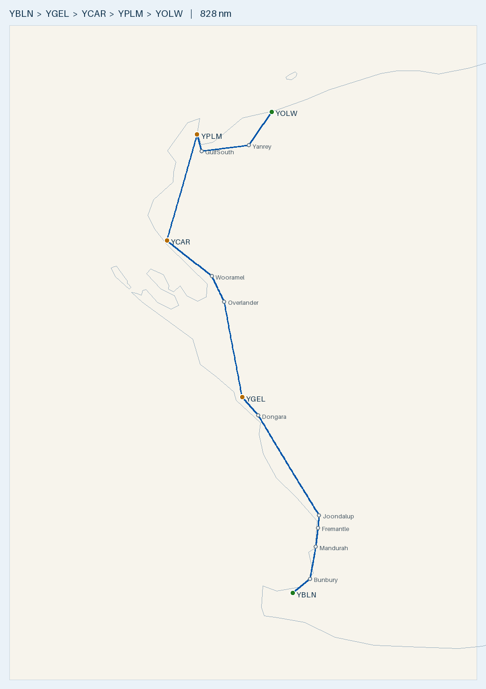

# Plan — Busselton to Exmouth (Learmonth) up the WA coast, fuel at Geraldton and Carnarvon

**Route:** YBLN → *Bunbury → Mandurah → Fremantle → Joondalup → Dongara* → **YGEL Geraldton** (fuel) → *Overlander → Wooramel roadhouses* → **YCAR Carnarvon** (fuel) → **YPLM Learmonth / Exmouth** (no AVGAS) · refuel on departure at **YOLW Onslow** via the south end of Exmouth Gulf
**Aircraft:** [Cirrus SR20 G1 (s/n 1312)](../../aircraft/SR20.md) · 56 USG usable AVGAS · MTOW 3,000 lb (1,361 kg) · max landing 2,900 lb
**Planning basis:** 150 KTAS · 12.5 USG/hr · reserve 10.1 USG (45 min) · var per leg from ERSA · **nil wind** (apply the forecast on the day)
**Loading:** **270 kg** (150 kg front / 75 kg rear / 45 kg baggage), so the max fuel at MTOW is **43.3 USG** (not the full 56)
**Data:** ERSA **03 SEP 2026** (current). The 26 NOV 2026 cycle is pending, so re-check every field if you fly after 26 NOV.

> ✈️ **Bottom line:** ~**712 nm** to Learmonth: **4 h 57 m flying / ~6 h 30 m total** with two 45-min fuel stops, all in one day.
> **Learmonth has no AVGAS** (Jet A1 and F34 only), so you refuel at **Onslow** on the way out (115 nm around the gulf).
> At 270 kg you can only carry 43.3 USG, so **leg 1 (306 nm to Geraldton) is the committed one**. You land there +6.9 USG
> over reserve, or +3.0 with a 20 kt headwind. **Don't fill to 43.3 at Carnarvon**: more than 40.8 USG puts you over the
> 2,900 lb max landing weight at Learmonth. Learmonth is a **RAAF joint-user towered field** (APP 120.5 / TWR 118.3), and ERSA warns of
> **bustards in the runway strips**. Leg 1 runs **under the Perth Class C / Jandakot Class D steps** and past the **Murray Field DZ (to FL150)**.

---

## Route Summary (nil wind)

| Leg | Segment | Dist (nm) | Track °T | HDG °M | Cruise alt | Time | Leg fuel (USG) | Cum. time | Fuel left (USG) |
|:---:|---------|----------:|:--------:|:------:|:----------:|-----:|---------------:|----------:|----------------:|
| 1 | YBLN → Bunbury | 24.6 | 029 | 032 | low, OCTA (see below) | 14 m | 2.9 | 14 m | 40.4 |
| 1 | Bunbury → Mandurah | 48.2 | 005 | 007 | low, OCTA | 19 m | 4.0 | 33 m | 36.4 |
| 1 | Mandurah → Fremantle | 28.3 | 003 | 005 | under the CTA steps (VTC) | 11 m | 2.4 | 44 m | 34.0 |
| 1 | Fremantle → Joondalup | 18.9 | 002 | 004 | under the CTA steps (VTC) | 8 m | 1.6 | 52 m | 32.5 |
| 1 | Joondalup → Dongara | 155.9 | 344 | 345 | 8,500 once clear of the steps | 62 m | 13.0 | 1 h 54 m | 19.5 |
| 1 | Dongara → YGEL Geraldton | 29.6 | 337 | 338 | 8,500 | 12 m | 2.5 | 2 h 06 m | **17.0** |
| — | *Geraldton fuel stop (fill to 43.3)* | — | — | — | — | *45 m* | — | 2 h 51 m | 43.3 |
| 2 | YGEL → Overlander Roadhouse | 143.9 | 355 | 356 | 8,500 | 62 m | 12.8 | 3 h 53 m | 30.5 |
| 2 | Overlander → Wooramel Roadhouse | 39.5 | 347 | 348 | 8,500 | 16 m | 3.3 | 4 h 09 m | 27.2 |
| 2 | Wooramel → YCAR Carnarvon | 63.1 | 328 | 328 | 8,500 | 25 m | 5.3 | 4 h 34 m | **21.9** |
| — | *Carnarvon fuel stop (load **40.0**, max 40.8)* | — | — | — | — | *45 m* | — | 5 h 19 m | 40.0 |
| 3 | YCAR → **YPLM Learmonth** | 160.5 | 008 | 008 | 7,500 | 68 m | 14.2 | 6 h 27 m | **25.8** |
| **—** | **Total to Learmonth** | **712** | — | — | — | **4 h 57 m flying · ~6 h 30 m total** | **61.9** | — | **25.8** |
| 4 *(departure day)* | YPLM → Gulf south end | 25.1 | 172 | 172 | 7,500 | 14 m | 2.9 | 14 m | 22.9 |
| 4 | Gulf south end → Yanrey Stn | 36.9 | 076 | 076 | 7,500 | 15 m | 3.1 | 29 m | 19.8 |
| 4 | Yanrey Stn → **YOLW Onslow** | 53.2 | 019 | 019 | 7,500 | 21 m | 4.4 | 50 m | **15.4** |

- **Climb:** times include **+1 min per 2,000 ft of climb** on each leg that starts with a takeoff (+4 min out of each of Busselton, Geraldton, Carnarvon and Learmonth). Fuel is worked on the total time.
- **Leg 1 under the Perth steps:** you'll fly the Mandurah → Fremantle → Joondalup stretch low, below the Perth Class C / Jandakot Class D steps, and climb to 8,500 once you're north of them. Read the step bases off the Perth VTC; this plan doesn't quote them. The total climb is the same ~8,450 ft whether you do it in one go or in two stages, so the +4 min charged out of Busselton still covers it. If you get a clearance through instead, the numbers don't change. *(Leg 1 is identical to the [Shark Bay plan](../YBLN-YSHK/plan.md).)*
- **Cruise levels:** VFR hemispherical. NW-bound (mag 180–359) is 8,500, and N/NE-bound (000–179) is 7,500. **Read the LSALT for each leg off the ERC-L.**
- **Waypoints:** all visual. Joondalup (city and lake, inland), Dongara/Port Denison, the **Overlander** and **Wooramel** roadhouses on the North West Coastal Hwy, the **south end of Exmouth Gulf**, and **Yanrey** homestead. Coordinates are in the map command below.
- **Coastal / no-overwater routing:**
  - Joondalup and Dongara were added because the straight Fremantle–Geraldton line runs up to ~3 nm offshore off the northern Perth beaches and again near Dongara.
  - The **straight Geraldton–Carnarvon line crosses ~80 nm of Shark Bay's eastern gulf**, up to ~15 nm offshore. The two roadhouses keep you over the highway instead, for only +4 nm.
  - **Carnarvon → Learmonth direct stays over land** (inland of Coral Bay, then up the W shore of Exmouth Gulf).
  - The **direct Learmonth–Onslow line (66 nm) crosses ~25 nm of Exmouth Gulf**, so this plan goes around the south end of the gulf (115 nm, +49 nm, +4 USG). The direct option is under the fuel plan.
- **On the day:** work out the WCA for each leg from the forecast wind. HDG °M = track + WCA + variation (2.5°W in the south, 0° north of Carnarvon). Then re-time the leg (dist ÷ GS) and re-fuel it (time × 12.5 USG/hr).
- **Runways:** Geraldton **03/21 (2,389 m)**, Carnarvon **04/22 (1,619 m)**, Learmonth **18/36 (3,047 m)**, Onslow **03/21 (1,900 m)**.

## Radio & en-route hazards

| Where | What | Action |
|-------|------|--------|
| Busselton (departure) | **Bird hazard** (ERSA): possibly large numbers of wetland birds around the aerodrome | Keep a lookout on takeoff and climb-out. CTAF **127.0**, area **124.9** |
| Leg 1, ~12 nm out, ~4 nm E of track | **Model aircraft** (ERSA, Bunbury): within 500 m of 33°30.8′S 115°36.7′E, **SFC–1,000 ft AGL** | You should be well above 1,000 ft AGL. If you're still low, keep a lookout |
| Bunbury waypoint | **Searchlight display** (ERSA) operates from 3.8 nm bearing 327°M from the Bunbury ARP | Night only, but know it's there. CTAF 127.0 |
| Leg 1, ~73 nm, 6 nm E of track | **Murray Field (YMUL)** (ERSA): **parachuting HJ on the airfield up to FL150**, and **low-level aerobatics within 1 nm** | Monitor CTAF **119.1** and ask Centre for the DZ status |
| Leg 1, ~80 nm, 7 nm E of track | **Serpentine (YSEN)** (ERSA): low-level aerobatics, emergency services **helicopter ops H24**. It shares CTAF 119.1 with Murray Field | Listen on 119.1 and keep a lookout for helicopters |
| Mandurah → Joondalup (~70–130 nm) | **Perth Class C / Jandakot Class D** overlie the coast. Jandakot (TWR 118.1) is 7 nm E. ERSA warns of **wake turbulence** in the Jandakot zone | Stay **OCTA under the steps** (read the bases off the Perth VTC), or get a clearance. Area **135.25**. The Perth APP frequency (123.6 / 132.95 in ERSA) is shown on the VTC by sector |
| Leg 1, ~120–135 nm, 10–14 nm E | **Gingin (YGIG)** (TWR 118.5) and **RAAF Pearce (YPEA)** (TWR 118.3), both towered | Stay clear of their zones and any military restricted areas. Read the boundaries off the VTC / ERC-L and check NOTAMs |
| Leg 1, ~213 nm, **11 nm W** | **Jurien Bay (YJUR)** (ERSA): **intense parachuting within 5 nm, 7 days/week, to FL150**. Jump aircraft broadcast on CTAF **126.7** and Melbourne Centre **121.2** | Monitor **121.2** and hold your track |
| North of Perth | Area **135.25 → 121.2** | Read the boundary off the ERC-L |
| Geraldton | (ERSA) **CTAF shielding** between the two ends of the field. **Weather balloon** 2315 UTC TUE–FRI (0715 local) from 1.3 km SSW of the ARP. **Power-station plume** 0.43 nm WSW of the RWY 08 threshold | CTAF **127.1**. Make full taxi calls and look before you enter the runway. Avoid the plume at low level |
| Leg 2, approaching Carnarvon | Area **121.2 → 122.1** | Read the boundary off the ERC-L |
| Carnarvon | (ERSA) **Helicopter ops** in the vicinity. **Corella flocks on RWY 04/22 and 18/36** in daylight. The **northern GA apron is rough** | CTAF **126.7**. Look out on final and the takeoff roll, and taxi slowly |
| Leg 3, approaching Learmonth | **Learmonth controlled airspace** (RAAF joint-user, towered) | Get the ATIS if one is published (none is in the parsed record). Call **Learmonth Approach 120.5** for a clearance before the boundary (read it off the ERC-L / VNC), then **Tower 118.3**. Area **125.9** |
| Learmonth | (ERSA) **Australian bustards in the runway strips**, with migratory birds around the field. **Weather balloon** launches ~2315 and 1115 UTC (0715 and 1915 local) from 1 km E of the ARP. **Erosion** in the runway strip on the E side of 18/36, N of TWY W. A **restraining-link pit** (10 ft square, 3 ft deep, with a 230 mm steel ring) on the N side of **TWY KILO** | Look out on final and the landing roll, and be ready to go around. Stay on the runway centreline. Taxi only where Tower clears you, and keep off the N edge of TWY K |
| Exmouth (YEXM), 12 nm N of Learmonth | (ERSA) **Helicopter ops H24**, **microlights**, unfenced field with animals. **Intensive aerial work along Ningaloo Reef from abeam Learmonth to Vlaming Head, 500–3,500 ft, March–October**. Its CTAF is **118.3** (the same frequency as Learmonth Tower) | It's not on your track, but expect this traffic around Learmonth. Don't wander W over the Cape Range toward the reef |
| Leg 4 (to Onslow) | Area **125.9 → 122.4** (Onslow and Minderoo are on 122.4). Minderoo station strip (YMDR) is 3 nm off track | Read the boundary off the ERC-L. Onslow CTAF **126.6** |

- **Controlled airspace:** Perth / Jandakot (and Gingin / Pearce to the E) on leg 1, and **Learmonth** at the destination. Everything else is Class G.
- **Area frequencies (ERSA FIA):** Busselton and Bunbury **124.9** · Perth area **135.25** · Jurien, Kalbarri and Geraldton **121.2** · Carnarvon **122.1** · Learmonth and Exmouth **125.9** · Onslow and Minderoo **122.4**.
- **No AVGAS between Perth and Geraldton.** Jurien Bay and Gingin list no fuel, and Pearce is military. If leg 1 goes badly, **Jandakot (YPJT)** has an Air BP H24 AVGAS card bowser (BP card), but it's inside Class D (TWR 118.1).
- **Remote legs 2–4:** station country only. Submit a flight note / SARTIME and carry a PLB, water and a survival kit.

## Fuel Plan

**Fill to 43.3 USG at Busselton and Geraldton (the most you can carry at MTOW with 270 kg), load ~40 USG at Carnarvon, and refuel at Onslow on the way out.** Learmonth has **no AVGAS**. ERSA handling says "AVGAS not AVBL" for the civil refueller (World Fuel Services, Jet A1 only), and the RAAF refueller is F34, for military movements only. *(The AVGAS flag in the parsed database is wrong; trust the handling text.)*

| Point | Expected on board | Needed to next fuel + 10.1 USG reserve | Spare | Endurance left (12.5 USG/hr) |
|-------|------------------:|----------------------------------------:|------:|-----------------------------:|
| Depart YBLN (43.3 = MTOW) | **43.3** | to YGEL 26.3 + 10.1 = **36.4** | **+6.9** | 3 h 28 m |
| Land YGEL (**fill to 43.3**) | **~17.0** | 10.1 (reserve) | **+6.9** | 1 h 22 m |
| Depart YGEL (43.3) | **43.3** | to YCAR 21.4 + 10.1 = **31.5** | **+11.8** | 3 h 28 m |
| Land YCAR (**load to ~40.0**) | **~21.9** | 10.1 (reserve) | **+11.8** | 1 h 45 m |
| Depart YCAR (**40.0, max 40.8**) | **40.0** | to YPLM and on to YOLW: 14.2 + 10.4 + 10.1 = **34.7** | **+5.3** | 3 h 12 m |
| Land YPLM (**no AVGAS**) | **~25.8** | to YOLW (gulf route) 10.4 + 10.1 = **20.5** | **+5.3** | 2 h 04 m |
| Land YOLW (**refuel**) | **~15.4** | 10.1 (reserve) | **+5.3** | 1 h 14 m |

- **Why 40 USG at Carnarvon, not 43.3?** Zero-fuel weight is 2,740 lb, so you can land with at most **26.6 USG** and stay under 2,900 lb. Leg 3 burns 14.2, so **don't depart Carnarvon with more than 40.8 USG**. Filling to 43.3 would put you on the ground at Learmonth at ~2,915 lb. The other landings are fine: Geraldton ~2,842 lb, Carnarvon ~2,871 lb, Onslow ~2,833 lb.
- **Minimum to leave Learmonth:** **20.5 USG** around the gulf, or **16.5 USG** for the direct crossing (66 nm, 31 m, 6.4 USG, with ~25 nm over Exmouth Gulf).

### Committed leg 1 — margin at your loading
There's no civil AVGAS on the coast between Perth and Geraldton, so once you're past Perth you're committed to Geraldton. The margin is fuel over the 10.1 USG reserve on landing at Geraldton, with the climb allowance included and 306 nm on the coastal route:

| YBLN → YGEL, 306 nm coastal | Max fuel at MTOW | Still air | 15 kt HW | 20 kt HW | 25 kt HW |
|---|---:|---:|---:|---:|---:|
| **260 kg** | 47.0 USG | +10.6 | +7.7 | +6.7 | +5.5 |
| **270 kg** *(planned)* | **43.3 USG** | **+6.9** | **+4.1** | **+3.0** | **+1.8** |
| 280 kg | 39.6 USG | +3.2 | +0.4 | −0.7 | −1.9 |

These figures include no taxi allowance, so take ~1 USG off every cell. **270 kg is fine in calm or moderate wind. If leg 1 forecasts a headwind of ≳ 20 kt, cut to 260 kg** (or plan a fuel stop at Jandakot). 280 kg is at reserve by ~15 kt.

- **Headwind stress test:** with a **20 kt headwind on every leg**:
  - Leg 1 takes 2 h 25 m and burns 30.2 USG, landing at Geraldton with **13.1 (+3.0)**.
  - Leg 2 takes 1 h 58 m and burns 24.5, landing at Carnarvon with **18.8 (+8.7)**.
  - Leg 3 takes 1 h 18 m and burns 16.3 from 40.0, landing at Learmonth with **23.7**.
  - Leg 4 around the gulf takes 57 m and burns 11.9, landing at Onslow with **11.8 (+1.7)**.
  - In that case, load the full 40.8 at Carnarvon. You'll land at Learmonth lighter anyway. Or take the direct gulf crossing (**+6.4**).
- **Burn:** 12.5 USG/hr is conservative (the book figure is ~11.6), so expect actual use to come in under plan.
- **Cost:** ~62 USG (~234 L) to Learmonth at ~$3.00/L ≈ **$700**, plus ~10 USG (~$120) for the Onslow hop.

## Fuel cards & payment

| Stop | AVGAS provider (ERSA handling) | Card / payment | Notes |
|------|-------------------------------|----------------|-------|
| YBLN Busselton | ABP / City of Busselton | ⚠️ **Carnet card only** | Phone the AD operator |
| YGEL Geraldton | World Fuel Services, **H24** | **Not stated in ERSA**, so ask when you phone | **30 min PN** 0800–1700 MON–FRI. **1 hr PN after hours**, with an AH fee. Phone **0491 233 624** |
| YCAR Carnarvon | **WFS** H24 AVGAS bowser · **Air BP** H24 AVGAS card bowser | WFS: **WFS cardswipe, or credit card via the app**. Air BP: **BP card** | WFS **PN essential** (0418 911 465, H24). Air BP 0700–1800 local, AH 60 min PN with a call-out fee (0429 923 227) |
| YPLM Learmonth | — | ❌ **No AVGAS** | Civil WFS is Jet A1 only (PN required, 0700–1600 local). RAAF is F34, military only |
| YOLW Onslow | **World Fuel Services** H24 AVGAS bowser | **WFS carnet card**, or **Visa / MC via the Compac Pay app** | Phone 0459 604 281. Skyfuel at Onslow is Jet A1 only |

**Carry an Air BP carnet** (Busselton), **a credit card with the WFS and Compac Pay apps set up** (Carnarvon, Onslow), and a **BP card** (backup at Carnarvon, and Jandakot if you divert). For Geraldton, ring WFS ahead and confirm what they take. *(Source: ERSA 03 SEP 2026 handling sections. Unchanged from 09 JUL.)*

## Weight & Balance (270 kg: 150 front / 75 rear / 45 baggage)

| Item | Mass | Arm (in) | Moment (lb·in) |
|------|-----:|---------:|---------------:|
| Empty (s/n 1312) | 973 kg (2,145 lb) | ~140.5 *(assumed)* | 301,373 |
| Front seats | 150 kg (331 lb) | 143.5 | 47,454 |
| Rear seats | 75 kg (165 lb) | 180.0 | 29,762 |
| Baggage | 45 kg (99 lb) | 208.0 | 20,635 |
| **Zero-fuel** | **1,243 kg (2,740 lb)** | **145.7** | **399,224** |
| Fuel 43.3 USG | 118 kg (260 lb) | 153.95 | 39,996 |
| **Takeoff (YBLN, YGEL)** | **1,361 kg (3,000 lb)** | **146.4** | **439,220** |
| Takeoff YCAR (40.0 USG) | 1,352 kg (2,980 lb) | 146.3 | 436,172 |
| Land YPLM (~25.8 USG) | 1,313 kg (2,895 lb) | 146.1 | 423,055 |

**You're at MTOW with 43.3 USG. Baggage is 99 lb (limit 130 lb).** Every landing is under 2,900 lb, provided you load ≤ 40.8 USG at Carnarvon. The CG is in limits at takeoff and landing. With this much weight in the rear and the baggage bay, it sits **toward the aft limit, not mid-envelope**. At takeoff, the CG of 146.4 is ~2.3 in aft of the forward limit (144.1) and **~1.6 in forward of the ~148 aft limit**. That aft margin shrinks to ~1.2 in if the empty arm is 141.0. The empty arm is assumed, and the aft limit is the data card's approximate figure. **Confirm both from the W&B record and the POH envelope.** If it's tight, move baggage forward into the cabin.

## Daylight
It's a ~6 h 30 m day to Learmonth with two fuel stops. Work back from last light at Learmonth, allowing for the 45 min reserve and a possible hold for traffic at the tower. If you leave Carnarvon late, staying the night there is the safe option (fuel, PN).

## Route Map

🗺️ [Interactive `map.geojson`](map.geojson) · Regenerate: `.venv/bin/python scripts/route_map.py map YBLN Bunbury@-33.33,115.64 Mandurah@-32.53,115.72 Fremantle@-32.06,115.75 Joondalup@-31.745,115.765 Dongara@-29.25,114.93 YGEL Overlander@-26.41,114.46 Wooramel@-25.77,114.29 YCAR YPLM GulfSouth@-22.65,114.15 Yanrey@-22.505,114.796 YOLW --out flightplans/SR20/YBLN-YPLM`

The map's coastline is coarse. The over-water checks above were done against the OpenStreetMap coastline.

---

## Aerodromes

| Aerodrome | Elev | Runway | Fuel | CTAF / area | Notes |
|-----------|-----:|--------|------|-------------|-------|
| **[YBLN](../../aerodromes/YBLN.md) Busselton** *(CERT)* | 56 ft | 03/21 grooved, 2,460 × 45 m | AVGAS · Jet A1 (**carnet only**) | **127.0** · 124.9 | Fill to 43.3. **Bird hazard** (ERSA) |
| **[YGEL](../../aerodromes/YGEL.md) Geraldton** | 122 ft | **03/21 grooved 2,389 × 45 m** · 08/26 red gravel 900 m · 14/32 844 m | AVGAS · Jet A1 (WFS H24, PN) | **127.1** · 121.2 | Fuel stop. CTAF shielding, balloon, plume (ERSA) |
| **[YCAR](../../aerodromes/YCAR.md) Carnarvon** *(CERT)* | 13 ft | 04/22 1,619 × 30 m · 18/36 1,140 × 30 m | AVGAS · Jet A1 (WFS + Air BP, H24 bowsers) | **126.7** · 122.1 | Fuel stop, **≤ 40.8 USG**. Helicopters, **corellas**, rough GA apron (ERSA) |
| **[YPLM](../../aerodromes/YPLM.md) Learmonth** *(MIL, towered)* | 19 ft | 18/36 3,047 × 45 m | ❌ **No AVGAS** (Jet A1 civil, F34 RAAF) | **TWR 118.3** · APP 120.5 · 125.9 | Destination. **Bustards**, balloon, strip erosion, TWY K pit (ERSA) |
| **[YOLW](../../aerodromes/YOLW.md) Onslow** *(CERT)* | 23 ft | 03/21 grooved, 1,900 × 30 m | AVGAS (WFS H24 bowser) · Jet A1 | **126.6** · 122.4 | Refuel on departure, 115 nm around the gulf. No ADDITIONAL INFO published |

**YBLN Busselton** (-33.687, 115.400):
- AVGAS is through the Air BP / City of Busselton bowser, **carnet card only**. Load **43.3 USG**, not full.
- **⚠️ Bird hazard (ERSA):** there may be large numbers of wetland birds around the aerodrome.

**YGEL Geraldton** (-28.796, 114.707):
- Use the sealed **03/21 (2,389 m)**.
- **⚠️ CTAF shielding (ERSA):** aircraft and vehicles at one end of the field may not hear CTAF calls from the other end.
- **⚠️ Weather balloon (ERSA):** launches at 2315 UTC TUE–FRI (0715 local) from 1.3 km SSW of the ARP, and possibly at other times.
- **⚠️ Plume rise (ERSA):** there's a power plant 0.43 nm WSW of the RWY 08 threshold (height and velocity not published).
- Fuel: WFS, 30 min PN in business hours, 1 hr PN after hours. Phone 0491 233 624.

**YCAR Carnarvon** (-24.881, 113.672):
- Use **04/22 (1,619 m)**. **Load ≤ 40.8 USG** to stay under the max landing weight at Learmonth.
- **⚠️ Helicopter ops (ERSA)** in the vicinity.
- **⚠️ Bird hazard (ERSA):** in daylight, flocks of corellas on **RWY 04/22 and 18/36**.
- **⚠️ The northern GA apron has a rough surface (ERSA).**
- Fuel: WFS H24 bowser (cardswipe, or credit card via the app; **PN essential**, 0418 911 465), or the Air BP H24 card bowser (0429 923 227).

**YPLM Learmonth** (-22.236, 114.089), MIL-certified RAAF joint-user field:
- **Procedures:** it's **towered**. Call **Learmonth Approach 120.5** for a clearance before you enter its controlled airspace, then **Tower 118.3**. Area 125.9.
- **PPR:** the current ERSA ADDITIONAL INFO and handling sections **don't publish a civil PPR requirement** (the old plan's "PPR applies" isn't supported by the 03 SEP record). The parsed record doesn't cover every FAC section, though. **Read the full Learmonth FAC and NOTAMs** for PPR, tower hours and military activity before you go, and ring RAAF Learmonth if in doubt (Duty Mobile 0429 450 662, listed under the RAAF refueller).
- **⚠️ Animals and birds (ERSA):** **Australian bustards within the runway strips**, plus migratory birds around the aerodrome. Look out on final and the landing roll.
- **⚠️ Weather balloon (ERSA):** launches ~2315 and 1115 UTC (0715 and 1915 local) from 1 km E of the ARP, and at other times.
- **⚠️ Erosion (ERSA)** within the runway strip on the E side of 18/36, N of TWY W. Stay on the centreline.
- **⚠️ Restraining link (ERSA):** a 10 ft square, 3 ft deep pit with a 230 mm steel ring on the **N side of TWY KILO**. Keep to the taxiway centreline.
- **Fuel:** ❌ **No AVGAS.** WFS civil is Jet A1 only (08 9949 1590 / 0417 955 167), and RAAF is F34 for military only. Arrive with ≥ 20.5 USG for Onslow.

**YOLW Onslow** (-21.668, 115.113):
- Use 03/21 (1,900 m grooved). CTAF **126.6**, area 122.4. ERSA publishes **no ADDITIONAL INFO** for Onslow.
- Fuel: WFS **H24 AVGAS bowser**, with a WFS carnet card or Visa/MC via the **Compac Pay** app (0459 604 281). Ground handling is by arrangement (Minres Air).

---

## Pre-Flight Checklist
- [ ] **Wind:** get the GAF/ARFOR and winds aloft. **If leg 1 forecasts a headwind of ≳ 20 kt, reduce the load to 260 kg** (or plan Jandakot fuel). Wind-correct HDG, GS, time and fuel for every leg.
- [ ] **NOTAMs and ERSA** for YBLN, YGEL, YCAR, YPLM and YOLW. Check Murray Field and Jurien Bay parachuting, Pearce / Gingin military airspace, and **Learmonth military activity, tower hours and any PPR** (read the full FAC). If you fly after **26 NOV 2026**, re-check against the new cycle.
- [ ] **Perth airspace:** decide between OCTA under the steps and a clearance. Mark the step bases on the Perth VTC for Mandurah → Joondalup.
- [ ] **Learmonth airspace:** mark the control boundary on the ERC-L / VNC, and note APP 120.5 / TWR 118.3.
- [ ] **LSALT:** read it off the ERC-L for each leg and check your cruise level against it.
- [ ] **Area boundaries:** mark 124.9 → 135.25 → 121.2 → 122.1 → 125.9 → 122.4 on the ERC-L.
- [ ] **GPS:** load the user waypoints and check the route draws over land.
- [ ] **Fuel:** 43.3 USG at Busselton (carnet). Phone **WFS Geraldton** (0491 233 624) and **WFS Carnarvon** (0418 911 465, PN essential) with your ETAs, and set up the WFS / Compac Pay apps. **Plan only ≤ 40.8 USG at Carnarvon.**
- [ ] **W&B** with the real empty weight and arm. Check the aft margin (~1.6 in planned) and that baggage ≤ 130 lb.
- [ ] **Density altitude:** at MTOW in NW heat, check takeoff and climb performance at each stop.
- [ ] **Flight note / SARTIME**, PLB, water and survival kit for legs 2–4.
- [ ] **Daylight:** last light at Learmonth, allowing for two 45-min stops.

## In-Flight Checklist
- [ ] **Departing YBLN:** CTAF 127.0, area 124.9. **Watch for wetland birds.**
- [ ] **Bunbury → Mandurah:** stay low and OCTA. Monitor **119.1** abeam Murray Field / Serpentine (**parachuting to FL150**, aerobatics, helicopters). Area **135.25**.
- [ ] **Mandurah → Joondalup:** stay **under the Perth / Jandakot steps** (or follow your clearance), and watch for Jandakot wake turbulence.
- [ ] **North of Joondalup:** climb to **8,500** once clear of the steps. Keep clear of Gingin / Pearce to the E.
- [ ] **Abeam Jurien Bay (11 nm W):** listen on **121.2** for jump calls.
- [ ] **Fuel log, leg 1:** expect ~32.5 USG at Joondalup and ~19.5 at Dongara. **You need ≥ 12.6 at Dongara** (Geraldton + reserve). Otherwise divert to Jandakot early, while you're still near Perth.
- [ ] **Geraldton:** CTAF **127.1**. Make full calls (shielding), and look out for the balloon (0715 local TUE–FRI) and the plume WSW of 08. **Fill to 43.3.**
- [ ] **Leg 2:** follow the North West Coastal Hwy via the Overlander and Wooramel roadhouses, **not** direct across Shark Bay. Area **121.2 → 122.1**. Expect ~30.5 USG at Overlander.
- [ ] **Carnarvon:** CTAF **126.7**. Watch for **corellas** and **helicopters**, and taxi slowly on the rough GA apron. **Load ~40 USG (≤ 40.8).**
- [ ] **Leg 3:** expect ~33 USG halfway. Before the Learmonth boundary, call **Approach 120.5** for a clearance, then **Tower 118.3**. Area 125.9.
- [ ] **Learmonth:** watch for **bustards in the runway strips** and migratory birds, and the balloon (0715 / 1915 local). Stay on the centreline (strip erosion E side) and keep off the N edge of **TWY K**. Expect ~25.8 USG on landing, with **20.5 minimum** to reach Onslow.
- [ ] **Departure day, Learmonth → Onslow:** get a clearance from Tower 118.3, then track S along the W shore of the gulf, E past the gulf's south end, and N via Yanrey. Area **125.9 → 122.4**, then Onslow CTAF **126.6**. Expect ~15.4 USG on landing, then **refuel** (WFS, carnet / Compac Pay).

*Planning only. Cross-check current ERSA, NOTAMs, weather, daylight, W&B and the SR20 POH before flight.*
