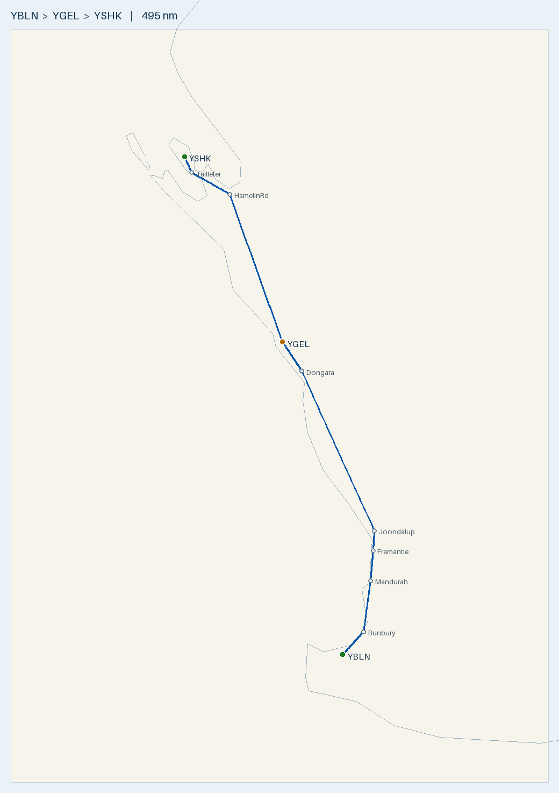

# Plan — Busselton to Shark Bay up the WA coast (fuel stop Geraldton)

**Route:** YBLN → *Bunbury → Mandurah → Fremantle → Joondalup → Dongara* → **YGEL Geraldton** (fuel) → direct → **YSHK Shark Bay / Denham** (no fuel) · onward refuel at **YCAR Carnarvon**
**Aircraft:** [Cirrus SR20 G1 (s/n 1312)](../../aircraft/SR20.md) · 56 USG usable AVGAS · MTOW 3,000 lb (1,361 kg)
**Planning basis:** 150 KTAS · 12.5 USG/hr · reserve 10.1 USG (45 min) · var per leg from ERSA · **nil wind** (apply the forecast on the day)
**Loading:** **2 front-seat occupants 150 kg + 30–40 kg baggage, full fuel**. The W&B is worked at 40 kg, the heavy end.
**Data:** ERSA **03 SEP 2026** (current). The 26 NOV 2026 cycle is pending, so re-check every field if you fly after 26 NOV.

> ✈️ **Bottom line:** ~**490 nm**, **3 h 24 m flying / ~4 h 09 m total** with a 45-min fuel stop at Geraldton. Fill at both
> Busselton and Geraldton. You reach Shark Bay with **~40 USG**, and **there is no fuel at YSHK**: the nearest AVGAS is
> Carnarvon, 61 nm N direct (but ~43 nm of that is open Shark Bay water) or 169 nm by the land route. Leg 1 follows
> the coast, and leg 2 is direct from Geraldton. Leg 1 runs **under the Perth Class C / Jandakot Class D steps** from about Mandurah to
> Joondalup, and passes the **Murray Field parachute DZ (to FL150, 6 nm E)**. Jurien Bay's DZ (to FL150) is 11 nm W of track.

---

## Route Summary (nil wind)

| Leg | Segment | Dist (nm) | Track °T | HDG °M | Cruise alt | Time | Leg fuel (USG) | Cum. time | Fuel left (USG) |
|:---:|---------|----------:|:--------:|:------:|:----------:|-----:|---------------:|----------:|----------------:|
| 1 | YBLN → Bunbury | 24.6 | 029 | 032 | low, OCTA (see below) | 14 m | 2.9 | 14 m | 53.1 |
| 1 | Bunbury → Mandurah | 48.2 | 005 | 007 | low, OCTA | 19 m | 4.0 | 33 m | 49.1 |
| 1 | Mandurah → Fremantle | 28.3 | 003 | 005 | under the CTA steps (VTC) | 11 m | 2.4 | 44 m | 46.7 |
| 1 | Fremantle → Joondalup | 18.9 | 002 | 004 | under the CTA steps (VTC) | 8 m | 1.6 | 52 m | 45.2 |
| 1 | Joondalup → Dongara | 155.9 | 344 | 345 | 8,500 once clear of the steps | 62 m | 13.0 | 1 h 54 m | 32.2 |
| 1 | Dongara → YGEL Geraldton | 29.6 | 337 | 338 | 8,500 | 12 m | 2.5 | 2 h 06 m | **29.7** |
| — | *Geraldton fuel stop (fill to 56)* | — | — | — | — | *45 m* | — | 2 h 51 m | 56.0 |
| 2 | YGEL → YSHK Shark Bay (direct) | 184.4 | 341 | 342 | 8,500 | 78 m | 16.2 | 4 h 09 m | **39.8** |
| **—** | **Total** | **490** | — | — | — | **3 h 24 m flying · ~4 h 09 m total** | **42.5** | — | **39.8** |

- **Climb:** times include **+1 min per 2,000 ft of climb** on each leg that starts with a takeoff (+4 min out of Busselton, +4 min out of Geraldton). Fuel is worked on the total time.
- **Leg 1 under the Perth steps:** you'll fly the Mandurah → Fremantle → Joondalup stretch low, below the Perth Class C / Jandakot Class D steps, and climb to 8,500 once you're north of them. Read the step bases off the Perth VTC; this plan doesn't quote them. The total climb is the same ~8,450 ft whether you do it in one go or in two stages, so the +4 min charged out of Busselton still covers it. If you get a clearance through instead, the numbers don't change.
- **Cruise levels:** VFR hemispherical. Northbound (mag 000–179) is 7,500 and NW-bound (180–359) is 8,500, so most of the trip is at 8,500. **Read the LSALT for each leg off the ERC-L** and check it against your level.
- **Waypoints:** all visual. Bunbury (town), Mandurah (estuary mouth), Fremantle (port), **Joondalup** (city centre and lake, a few nm inland) and **Dongara**/Port Denison. Load them as GPS user waypoints (coordinates in the map command below). Leg 2 is direct, with no waypoints.
- **Coastal routing (leg 1):**
  - Joondalup and Dongara were added because the straight Fremantle–Geraldton line runs up to ~3 nm offshore off the northern Perth beaches and again near Dongara.
  - Elsewhere on leg 1 the track is never more than ~2 nm off the beach (Geographe Bay, the Binningup coast, Cockburn Sound).
- **On the day:** work out the WCA for each leg from the forecast wind. HDG °M = track + WCA + variation (2.5–1°W). Then re-time the leg (dist ÷ GS) and re-fuel it (time × 12.5 USG/hr).
- **Runways:** take the into-wind runway. Geraldton's sealed **03/21 (2,389 m)** is the main runway, and the gravel 08/26 and 14/32 are short. Shark Bay has **only 18/36**, so check the crosswind before you commit. Note that it's **sloped, lowest in the middle** (see the Shark Bay notes).

## Radio & en-route hazards

| Where | What | Action |
|-------|------|--------|
| Busselton (departure) | **Bird hazard** (ERSA): possibly large numbers of wetland birds around the aerodrome | Keep a lookout on takeoff and climb-out. CTAF **127.0**, area **124.9** |
| Leg 1, ~12 nm out, ~4 nm E of track | **Model aircraft** (ERSA, Bunbury): within 500 m of 33°30.8′S 115°36.7′E, **SFC–1,000 ft AGL** | You should be well above 1,000 ft AGL by then. If you're still low, keep a lookout |
| Bunbury waypoint | **Searchlight display** (ERSA) operates from 3.8 nm bearing 327°M from the Bunbury ARP, i.e. near the town | Night only, but know it's there. Bunbury shares **CTAF 127.0** with Busselton |
| Leg 1, ~73 nm, 6 nm E of track | **Murray Field (YMUL)** (ERSA): **parachuting HJ on the airfield up to FL150**, and **low-level aerobatics within 1 nm** | Monitor CTAF **119.1** and ask Centre for the DZ status. Don't drift inland of Mandurah |
| Leg 1, ~80 nm, 7 nm E of track | **Serpentine (YSEN)** (ERSA): low-level aerobatics in the vicinity, emergency services **helicopter ops H24**. It shares CTAF **119.1** and runway designators with Murray Field | Listen on 119.1 and keep a lookout for helicopters |
| Mandurah → Joondalup (~70–130 nm) | **Perth Class C / Jandakot Class D** overlie the coast. Jandakot (towered, TWR 118.1) is 7 nm E. ERSA warns of **wake turbulence** in the Jandakot zone from heavies overhead in the Class C | Stay **OCTA under the steps** (read the bases off the Perth VTC), or get a clearance. Area **135.25**. The Perth APP frequency (123.6 / 132.95 in ERSA) is shown on the VTC by sector |
| Leg 1, ~120–135 nm, 10–14 nm E of track | **Gingin (YGIG)** (towered, TWR 118.5) and **RAAF Pearce (YPEA)** (towered, TWR 118.3) | Stay well clear of their control zones and any military restricted areas. Read the boundaries off the VTC / ERC-L and check NOTAMs for activation |
| Leg 1, ~213 nm, **11 nm W of track** | **Jurien Bay (YJUR)** (ERSA): **intense parachuting within 5 nm, 7 days/week, to FL150**. Jump aircraft broadcast on CTAF **126.7** and Melbourne Centre **121.2** | Monitor **121.2** (your area frequency here). Hold your track and don't drift W toward Jurien |
| Leg 1, somewhere north of Perth | Area **135.25 → 121.2** (Jurien Bay and Geraldton are on 121.2) | Read the boundary off the ERC-L |
| Geraldton arrival and departure | (ERSA) **CTAF shielding**: aircraft and vehicles at one end may not hear CTAF calls from the other end. **Weather balloon** launches 2315 UTC TUE–FRI (0715 local) from 1.3 km SSW of the ARP, and at other times. **Power-station plume** 0.43 nm WSW of the RWY 08 threshold (height and velocity not available) | CTAF **127.1**. Make clear taxi calls and look before you enter the runway. Avoid flying over the power plant at low level |
| Leg 2, ~70 nm, **overhead** (0.5 nm off track) | **Kalbarri (YKBR)** (ERSA): kangaroos in the aerodrome vicinity, and power is by generator. No fuel | Listen on CTAF **126.7** as you pass overhead. It's a diversion option only |
| Leg 2, approaching Shark Bay | Area **121.2 → 122.1** (Shark Bay and Carnarvon are on 122.1) | Read the boundary off the ERC-L |
| Shark Bay arrival | (ERSA) **Local dust in high winds**, and **numerous kangaroos airside** | CTAF **126.7**. Do an inspection pass if roos are about, and expect poor visibility in strong wind |
| Shark Bay runway | **Runway slope** (ERSA RDS): S end 0.2% down to the N, N end 0.1% down to the S. It dips to a low point mid-runway | Whichever way you land, the first part runs **downhill** and the far end rises. Fly a normal aim point and speed, don't chase the picture, and go around if you float past your touchdown point |

- **Controlled airspace:** only Perth / Jandakot (and Gingin / Pearce off to the E). Everything north of Perth is Class G. **No towered field** on this route needs a clearance unless you choose to go through Perth.
- **Area frequencies (ERSA FIA):** Busselton and Bunbury **124.9** · Perth area (Murray Field, Serpentine, Jandakot, Gingin, Pearce) **135.25** · Jurien Bay, Kalbarri and Geraldton **121.2** · Shark Bay and Carnarvon **122.1**.
- **Rottnest Island** (parachuting near the island, per ERSA) and **Perth airport** are both ~11–13 nm off track. You won't go near them on this routing.
- **Remote leg 2:** north of Kalbarri there's nothing but station country and the highway. Submit a flight note / SARTIME and carry a PLB.

## Fuel Plan

**Fill at Busselton and again at Geraldton. There is no fuel at Shark Bay.** The onward refuel is **Carnarvon (YCAR)**: 61 nm direct, or 169 nm by the land route around the bay (see below).

| Point | Expected on board | Needed to next fuel + 10.1 USG reserve | Spare | Endurance left (12.5 USG/hr) |
|-------|------------------:|----------------------------------------:|------:|-----------------------------:|
| Depart YBLN (full) | **56.0** | to YGEL 26.3 + 10.1 = **36.4** | **+19.6** | 4 h 29 m |
| Land YGEL (**fill here**) | **~29.7** | 10.1 (reserve) | **+19.6** | 2 h 23 m |
| Depart YGEL (full) | **56.0** | to YSHK and on to YCAR by land: 16.2 + 14.9 + 10.1 = **41.2** | **+14.8** | 4 h 29 m |
| Land YSHK (**no fuel**) | **~39.8** | to YCAR by land 14.9 + 10.1 = **25.0** | **+14.8** | 3 h 11 m |
| Land YCAR via the land route (**refuel**) | **~24.9** | 10.1 (reserve) | **+14.8** | 2 h 00 m |

- **Minimum to leave Shark Bay:** **25.0 USG** for Carnarvon by land, **16.0 USG** for Carnarvon direct (5.9 + reserve), or **26.3 USG** to go back to Geraldton (16.2 + reserve). Landing with ~40 USG covers any of these.
- **Shark Bay → Carnarvon options:**
  - **Direct, 61 nm (28 m, 5.9 USG):** track 005°T. About **43 nm of it is over open Shark Bay water**, from the north end of the Peron Peninsula to the Carnarvon coast.
  - **Land route, 169 nm (1 h 12 m, 14.9 USG):** back down the Taillefer Isthmus, along the Shark Bay Road to the Overlander Roadhouse, then up the North West Coastal Hwy via the Wooramel Roadhouse. It's all over land.
  - Your choice. The plan fuels for the land route.
- **Headwind stress test:** with a **20 kt headwind on every leg**:
  - Leg 1 takes 2 h 25 m and burns 30.2 USG. You land at Geraldton with **25.8 (+15.7 over reserve)**.
  - Leg 2 takes 1 h 29 m and burns 18.5 USG. You land at Shark Bay with **37.5**.
  - The land route on to Carnarvon then takes 1 h 22 m and burns 17.1 USG, leaving **20.4 (+10.3 over reserve)**.
- **Burn:** 12.5 USG/hr is conservative (the book figure is ~11.6), so expect actual use to come in under plan. Add ~1 USG for taxi and run-up when you uplift.
- **Cost:** ~42.5 USG (~161 L) for YBLN → YSHK at ~$3.00/L ≈ **$480**. Add ~15 USG (~$170) for the land-route hop to Carnarvon.
- **Spare AVGAS near home:** Bunbury (YBUN) has an Air BP **H24 card bowser** (phone 08 9725 4377, **AH 0460 031 288**; the AH number changed in the 03 SEP cycle).

### Why stop at Geraldton rather than fly direct?
Flying **nonstop YBLN → YSHK** (the coastal leg 1 to Dongara, then direct) is 490 nm, **3 h 20 m and 41.7 USG**. With full tanks you'd land at Shark Bay with **~14.3 USG, only +4.2 over reserve**, and then you're stuck. You couldn't fly on to Carnarvon by land (25.0 needed), or even direct (16.0 needed), without eating into reserve. With a 20 kt headwind, the nonstop lands with **~8.0 USG, which is below reserve**. Topping up at **Geraldton** means you land at Shark Bay with ~40 USG, which is enough to reach Carnarvon (either way) or go back to Geraldton with reserves intact.

## Fuel cards & payment

| Stop | AVGAS provider (ERSA handling) | Card / payment | Notes |
|------|-------------------------------|----------------|-------|
| YBLN Busselton | ABP / City of Busselton (AVGAS and Jet A1 bowsers) | ⚠️ **Carnet card only** | Phone the AD operator. Ground handling: MRBTA 0437 372 074 |
| YGEL Geraldton | World Fuel Services, **H24** | **Not stated in ERSA**, so ask when you phone | **30 min PN** 0800–1700 MON–FRI. **1 hr PN after hours**, with an AH service fee. Phone **0491 233 624** |
| YSHK Shark Bay | — | ❌ **NO FUEL** | ERSA lists no fuel or handling |
| YCAR Carnarvon | **WFS** H24 AVGAS bowser · **Air BP** H24 AVGAS card bowser | WFS: **WFS cardswipe, or credit card via the smartphone app**. Air BP: **BP card** | WFS **PN essential** (0418 911 465, H24). Air BP 0700–1800 local, **AH 60 min PN** with a call-out fee (0429 923 227) |

**Carry an Air BP carnet** (Busselton accepts nothing else), **a credit card with the WFS app set up** (Carnarvon), and a **BP card** as a backup at Carnarvon. For Geraldton, ring WFS ahead and confirm what they take. *(Source: ERSA 03 SEP 2026 handling sections. Unchanged from 09 JUL apart from Bunbury's AH phone.)*

## Weight & Balance (2 front + 40 kg baggage, full fuel)

| Item | Mass | Arm (in) | Moment (lb·in) |
|------|-----:|---------:|---------------:|
| Empty (s/n 1312) | 973 kg (2,145 lb) | ~140.5 *(assumed)* | 301,373 |
| Front seats (2) | 150 kg (331 lb) | 143.5 | 47,454 |
| Baggage (bay) | 40 kg (88 lb) | 208.0 | 18,342 |
| **Zero-fuel** | **1,163 kg (2,564 lb)** | **143.2** | **367,169** |
| Full fuel 56 USG | 152 kg (336 lb) | 153.95 | 51,727 |
| **Takeoff** | **1,315 kg (2,900 lb)** | **144.5** | **418,897** |
| Land YGEL (~29.7 USG) | 1,244 kg (2,742 lb) | 143.9 | 394,603 |
| Land YSHK (~39.8 USG) | 1,271 kg (2,803 lb) | 144.1 | 403,933 |

**Takeoff is 2,900 lb: 100 lb (45 kg) under MTOW** ✓. Baggage of 88 lb is under the 130 lb (59 kg) limit ✓. Every landing is under the 2,900 lb max landing weight ✓. Takeoff itself sits right at 2,900 lb, so an immediate return after takeoff is still within the landing limit.

**CG:** the bags in the baggage bay move the CG aft, so the forward-limit problem from the lighter loading goes away.
- At takeoff, the CG of 144.5 is **1.4 in aft of the forward limit** (143.1 at this weight). Landings sit 2.0–2.4 in aft of the limit.
- The aft limit (~148) is never close.

| Bags | Takeoff | CG margin to fwd limit (empty arm 140.5 / 139.5) |
|-----:|--------:|-------------------------------------------------:|
| 30 kg | 2,878 lb (1,305 kg) | +1.1 / +0.4 in |
| 40 kg | 2,900 lb (1,315 kg) | +1.4 / +0.6 in |

The empty arm of 140.5 is **assumed**. Even at 139.5, both loadings stay inside the envelope. Confirm the arm from the W&B record anyway, and **keep the bags in the baggage bay, not on the rear seats**, because the bay is what keeps the CG aft.

## Alternatives considered
- **Nonstop YBLN → YSHK (490 nm):** within the ~600 nm range on paper, but you'd land with only +4.2 USG over reserve at a field with no fuel (see above). Not recommended.
- **Via Carnarvon:** YBLN → YGEL → **YCAR** (fuel) → YSHK, so you arrive at Shark Bay with near-full tanks.
  - YGEL → YCAR is **246 nm, 1 h 43 m, 21.4 USG** via the Overlander and Wooramel roadhouses. The straight Geraldton–Carnarvon line crosses **~80 nm of Shark Bay's eastern gulf**, so don't fly it direct.
  - Then YCAR → YSHK is either 61 nm direct, ~43 nm of it over water, or 169 nm by land.
  - This adds 123–231 nm overall. It's only worth it if you plan to stay at Shark Bay and fly local flights there without refuelling.

## Route Map

🗺️ [Interactive `map.geojson`](map.geojson) · Regenerate: `.venv/bin/python scripts/route_map.py map YBLN Bunbury@-33.33,115.64 Mandurah@-32.53,115.72 Fremantle@-32.06,115.75 Joondalup@-31.745,115.765 Dongara@-29.25,114.93 YGEL YSHK --out flightplans/SR20/YBLN-YSHK`

The map's coastline is coarse. The over-water checks above were done against the OpenStreetMap coastline.

---

## Aerodromes

| Aerodrome | Elev | Runway | Fuel | CTAF / area | Notes |
|-----------|-----:|--------|------|-------------|-------|
| **[YBLN](../../aerodromes/YBLN.md) Busselton** *(CERT)* | 56 ft | 03/21 grooved, 2,460 × 45 m | AVGAS · Jet A1 (**carnet only**) | **127.0** · 124.9 | Fill here. **Bird hazard** (ERSA) |
| **[YGEL](../../aerodromes/YGEL.md) Geraldton** | 122 ft | **03/21 grooved 2,389 × 45 m** · 08/26 red gravel 900 × 18 m · 14/32 844 × 18 m | AVGAS · Jet A1 (WFS H24, PN) | **127.1** · 121.2 | Fuel stop. CTAF shielding, weather balloon, power-plant plume (ERSA) |
| **[YSHK](../../aerodromes/YSHK.md) Shark Bay** *(CERT)* | 129 ft | **18/36 only**, 1,690 × 30 m | ❌ **None** | **126.7** · 122.1 | Destination. **Sloped runway, dips mid-length** (RDS). Dust in high winds, **kangaroos airside** (ERSA) |
| **[YCAR](../../aerodromes/YCAR.md) Carnarvon** *(CERT)* | 13 ft | 04/22 1,619 × 30 m · 18/36 1,140 × 30 m | AVGAS · Jet A1 (WFS + Air BP, H24 bowsers) | **126.7** · 122.1 | Onward refuel. Helicopter ops, **corellas on both runways** (ERSA) |
| [YBUN](../../aerodromes/YBUN.md) Bunbury | 53 ft | — | AVGAS (Air BP H24 card bowser) | 127.0 · 124.9 | Fuel option near home. Model aircraft, searchlight (ERSA) |

**YBLN Busselton** (-33.687, 115.400):
- AVGAS is through the Air BP / City of Busselton bowser, **carnet card only**. Phone the AD operator.
- **⚠️ Bird hazard (ERSA):** there may be large numbers of wetland birds around the aerodrome. Keep a lookout on departure.

**YGEL Geraldton** (-28.796, 114.707):
- Use the sealed **03/21 (2,389 m, 0.3% down to the S)**. 08/26 (900 m red gravel) and 14/32 (844 m) are short crosswind options.
- **⚠️ CTAF shielding (ERSA):** the terminal and the terrain block radio, so aircraft and vehicles at one end of the airfield may not hear CTAF calls from the other end. Make full taxi and line-up calls, and look before entering the runway.
- **⚠️ Weather balloon (ERSA):** launches at **2315 UTC TUE–FRI (0715 local)** from 1.3 km SSW of the ARP, and possibly at other times.
- **⚠️ Plume rise (ERSA):** there's a power plant **0.43 nm WSW of the RWY 08 threshold**. Plume height and velocity aren't published, so avoid it at low level.
- Fuel: World Fuel Services H24. 30 min PN in business hours, 1 hr PN after hours (fee applies). Phone 0491 233 624. Ground handling: North West Aviation Services, 08 9923 3745.

**YSHK Shark Bay / Denham** (-25.894, 113.577):
- **There's no fuel.** Arrive with at least 25 USG (land route to Carnarvon + reserve). Planned arrival is ~40.
- **One runway, 18/36** (1,690 m × 30 m; the surface isn't in the parsed record, so check the FAC). Check the crosswind before you leave Geraldton. Carnarvon is the alternate.
- **⚠️ Runway slope (ERSA RDS): it catches people out.** The S end slopes 0.2% down to the N, and the N end 0.1% down to the S, so the runway **dips to a low point in the middle**.
  - **Landing either way, the touchdown zone slopes downhill** away from you. A down-sloping runway can make the approach look low, which tempts you to fly it high and float long. Hold your normal aim point and speed, and if you float past your touchdown point, go around. Don't force it on.
  - **On the rollout and takeoff, the far end rises.** From the threshold, the dip can hide part of the runway, including kangaroos. That's another reason for the inspection pass.
  - **18 vs 36:** the S end has the steeper slope (0.2%). So landing on **36** starts with the steeper downhill, and landing on **18** starts with the gentler one. Wind decides the runway; the slope is just what to expect.
- **⚠️ Dust (ERSA):** local dust in high winds.
- **⚠️ Kangaroos (ERSA):** increased animal hazard, with numerous kangaroos observed airside. Do an inspection pass if needed, and be ready to go around.

**YCAR Carnarvon** (-24.881, 113.672):
- Use **04/22 (1,619 m)**. 18/36 is 1,140 m.
- **⚠️ Helicopter ops (ERSA)** in the vicinity.
- **⚠️ Bird hazard (ERSA):** in daylight, flocks of corellas on **RWY 04/22 and 18/36**. Keep a lookout on final and the takeoff roll.
- **⚠️ The northern GA apron has a rough surface (ERSA).** Taxi slowly.
- Fuel: WFS H24 AVGAS bowser (WFS cardswipe, or credit card via the app; **PN essential**, 0418 911 465), or the Air BP H24 card bowser (0429 923 227).

---

## Pre-Flight Checklist
- [ ] **Wind:** get the GAF/ARFOR and winds aloft, then wind-correct HDG, GS, time and fuel for every leg.
- [ ] **NOTAMs and ERSA** for YBLN, YGEL, YSHK and YCAR. Also check Murray Field and Jurien Bay parachute activity, and any activation of Pearce / Gingin military airspace. If you fly after **26 NOV 2026**, re-check against the new cycle.
- [ ] **Perth airspace:** decide between OCTA under the steps and a clearance. Mark the Class C / D step bases on the Perth VTC for Mandurah → Joondalup, and note the APP frequency for your sector.
- [ ] **LSALT:** read it off the ERC-L for each leg and check your cruise level against it.
- [ ] **Area boundaries:** mark the 124.9 → 135.25 → 121.2 → 122.1 changes on the ERC-L.
- [ ] **GPS:** load the user waypoints (Bunbury, Mandurah, Fremantle, Joondalup, Dongara) and check leg 1 draws along the coast.
- [ ] **Fuel:** full 56 USG at Busselton (carnet). **Phone WFS Geraldton** (0491 233 624) with your ETA, at least 30 min ahead, and confirm payment. Have a plan for Carnarvon fuel (WFS app set up, or a BP card).
- [ ] **No fuel at Shark Bay:** decide on the Carnarvon routing now (land route 25.0 USG minimum, direct 16.0 USG minimum).
- [ ] **W&B** using the real empty weight and arm, and **weigh the bags**: 40 kg max planned (59 kg bay limit). Stow them in the baggage bay.
- [ ] **Flight note / SARTIME**, PLB, water and survival kit for the remote coast north of Geraldton.
- [ ] **Shark Bay runway:** brief the **slope** (dips to a low point mid-runway; touchdown zone downhill either way), the crosswind on the single 18/36, and the kangaroo inspection pass.
- [ ] **Daylight:** last light at Shark Bay, allowing for the Geraldton stop.

## In-Flight Checklist
- [ ] **Departing YBLN:** CTAF 127.0, area 124.9. **Watch for wetland birds** on takeoff and climb-out.
- [ ] **~12 nm out:** model aircraft field 4 nm E (SFC–1,000 ft AGL). Be above it.
- [ ] **Bunbury → Mandurah:** stay low and OCTA. Monitor **119.1** abeam Murray Field / Serpentine (**parachuting to FL150**, aerobatics, helicopters), and ask Centre for the DZ status. Area **135.25**.
- [ ] **Mandurah → Joondalup:** stay **under the Perth / Jandakot steps** (or follow your clearance). Hug the coast, and watch for Jandakot wake turbulence.
- [ ] **North of Joondalup, once clear of the steps:** climb to **8,500**. Keep clear of the Gingin / Pearce zones to the E.
- [ ] **~213 nm (abeam Jurien Bay, 11 nm W):** listen on **121.2** for jump calls, and hold your track.
- [ ] **Fuel log:** check the gauges against the plan: ~45 USG at Joondalup, ~32 at Dongara, **~30 at Geraldton**.
- [ ] **Geraldton:** CTAF **127.1**. Make full calls (shielding), and look out for the balloon (0715 local TUE–FRI) and the power-plant plume WSW of 08. **Fill to 56 USG.**
- [ ] **Leg 2:** direct to Shark Bay, **342°M**. You pass **overhead Kalbarri** at ~70 nm, so listen on CTAF **126.7**. Area **121.2 → 122.1**.
- [ ] **Fuel log, leg 2:** expect ~43 USG at Shark Bay Rd and **~39 at Shark Bay**. You need **25.0 minimum** for the land route to Carnarvon.
- [ ] **Shark Bay:** CTAF **126.7**. Watch for **kangaroos airside** and **dust** in strong wind. Land on 18/36 into wind. **Expect the slope:** the touchdown zone runs downhill and the runway dips mid-length. Fly a normal aim point and speed, and don't float.
- [ ] **Onward to Carnarvon:** CTAF **126.7**, area 122.1. Watch for **corellas** on both runways and **helicopters**. Taxi slowly on the rough northern GA apron.

*Planning only. Cross-check current ERSA, NOTAMs, weather, daylight, W&B and the SR20 POH before flight.*
