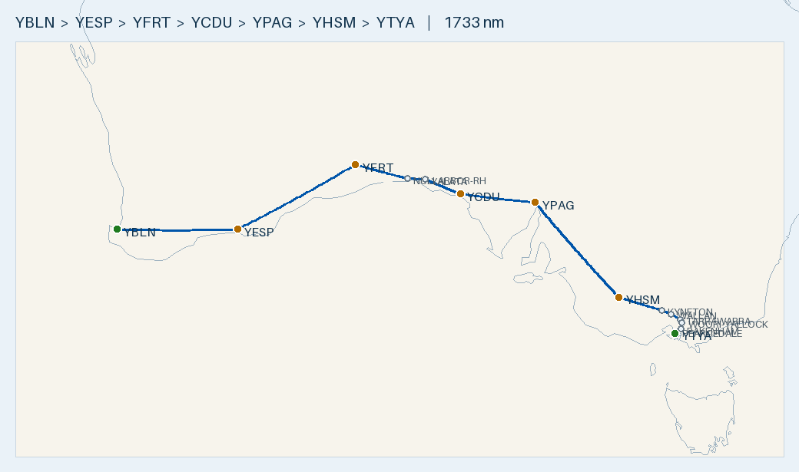

# Plan — 2-day Nullarbor crossing: Busselton → Tyabb

**Route:** YBLN → YESP Esperance → **YFRT Forrest (overnight)** → YCDU Ceduna → YPAG Port Augusta → **YHSM Horsham (decision point)** → YTYA Tyabb
**Aircraft:** [Cirrus SR20 G1 (s/n 1312)](../../aircraft/SR20.md) · AVGAS · 56 USG usable · MTOW 3000 lb (1361 kg)
**Planning basis:** 150 KTAS · 12.5 USG/hr · reserve 10.1 USG (45 min) · var per leg from ERSA · **nil wind** (apply the forecast on the day)
**Loading:** planning default: 2 front-seat occupants (150 kg) + 15 kg baggage/equipment (165 kg), full fuel at every stop
**Season:** planned for **April**. VFR, no overwater: inland to Esperance, the Eyre Hwy across the Nullarbor, around the top of Spencer Gulf, then over land into Victoria and north-about around Melbourne to Tyabb.
**Data:** ERSA **03 SEP 2026** (current). The 26 NOV 2026 cycle is pending, and an April flight will be several cycles later, so re-check every field against the ERSA current on the day.

> ✈️ **Bottom line:** ~**1,733 nm** and **~11 h 55 m flying** over two days, with fuel stops at Esperance, Forrest,
> Ceduna, Port Augusta and Horsham. Fill to full tanks at every stop. Each leg lands with at least 25 USG (+14.9 over reserve).
> **Day 2 is the constraint, not fuel.** It's 9 h 30 m door to door against a 10 h 06 m sunrise-to-sunset window in mid-April, so leave Forrest at first light.
> **The straight line from Horsham to Tyabb crosses ~20 nm of Port Phillip Bay**, so the last leg loops north of Melbourne (+42 nm), under the Melbourne CTA steps.
> **Fuel cards:** Forrest takes **no carnet** (Visa/MC/EFTPOS/cash) and Tyabb is **IOR tag / Fuelcharge app only**.
> ERSA hazards to watch: a **weather balloon launch at Ceduna ~2315 UTC** (about when you arrive) and **parachuting at Lilydale**, ~4 nm off the last leg.

---

## Route Summary (nil wind)

Times include the **climb allowance of +1 min per 2,000 ft** (cruise level − departure elevation) on every leg that starts with a takeoff. Fuel is worked out on that total time. HDG °M = track °T corrected for each leg's ERSA variation only. Fuel left is on landing, and you fill to full (56 USG) at every stop.

### Day 1 — Busselton → Forrest

| Leg | Segment | Dist (nm) | Track °T | HDG °M | Cruise alt | Time | Leg fuel (USG) | Cum. time | Fuel left (USG) |
|:---:|---------|----------:|:--------:|:------:|:----------:|-----:|---------------:|----------:|----------------:|
| 1 | YBLN → YESP Esperance | 321 | 092 | 093 | 7,500 | 2 h 12 m | 27.6 | 2 h 12 m | 28.4 |
| — | *Esperance fuel stop* | — | — | — | — | *60 m* | — | 3 h 12 m | 56 |
| 2 | YESP → **YFRT Forrest** | 362 | 064 | 062 | 7,500 | 2 h 29 m | 31.0 | 5 h 41 m | 25.0 |
| **—** | **Day 1** | **683** | — | — | — | **4 h 41 m flying · 5 h 41 m total** | **58.6** | — | — |

### Day 2 — Forrest → Tyabb (dawn departure)

| Leg | Segment | Dist (nm) | Track °T | HDG °M | Cruise alt | Time | Leg fuel (USG) | Cum. time | Fuel left (USG) |
|:---:|---------|----------:|:--------:|:------:|:----------:|-----:|---------------:|----------:|----------------:|
| 3a | YFRT → Nullarbor Roadhouse | 148 | 105 | 102 | 7,500 | 62 m | 12.9 | | |
| 3b | Nullarbor RH → Yalata | 48 | 092 | 088 | 7,500 | 19 m | 4.0 | | |
| 3c | Yalata → YCDU Ceduna | 103 | 113 | 107 | 7,500 | 41 m | 8.6 | | |
| **3** | **YFRT → YCDU** | **299** | | | | **2 h 03 m** | **25.5** | 2 h 03 m | 30.5 |
| — | *Ceduna fuel stop* | — | — | — | — | *45 m* | — | 2 h 48 m | 56 |
| 4 | YCDU → YPAG Port Augusta | 205 | 097 | 091 | 7,500 | 1 h 26 m | 17.9 | 4 h 14 m | 38.1 |
| — | *Port Augusta fuel + lunch* | — | — | — | — | *60 m* | — | 5 h 14 m | 56 |
| 5 | YPAG → **YHSM Horsham** | 333 | 140 | 131 | 7,500 | 2 h 17 m | 28.6 | 7 h 31 m | 27.4 |
| — | *Horsham splash and go* | — | — | — | — | *30 m* | — | 8 h 01 m | 56 |
| 6a | YHSM → Kyneton | 115 | 108 | 098 | 5,500 | 49 m | 10.2 | | |
| 6b | Kyneton → Wallan | 27 | 112 | 101 | 5,500 | 11 m | 2.3 | | |
| 6c | Wallan → Tarrawarra | 27 | 123 | 111 | 3,500 | 11 m | 2.2 | | |
| 6d | Tarrawarra → Woori Yallock | 8 | 149 | 137 | 3,500 | 3 m | 0.7 | | |
| 6e | Woori Yallock → Pakenham | 18 | 188 | 176 | 3,500 | 7 m | 1.5 | | |
| 6f | Pakenham → Pearcedale | 15 | 237 | 225 | 1,500 | 6 m | 1.2 | | |
| 6g | Pearcedale → YTYA Tyabb | 5 | 213 | 201 | 1,500 | 2 m | 0.4 | | |
| **6** | **YHSM → YTYA** | **214** | | | | **1 h 29 m** | **18.4** | 9 h 30 m | 37.6 |
| **—** | **Day 2** | **1,050** | — | — | — | **7 h 15 m flying · 9 h 30 m total** | **90.4** | — | — |

**Trip total: ~1,733 nm · 11 h 55 m flying · ~149 USG (~564 L, ~$1,690 at ~$3.00/L).**

- **Visual waypoints:** Nullarbor Roadhouse (-31.45, 130.90), Yalata (-31.48, 131.84), Kyneton (-37.25, 144.45), Wallan (-37.42, 144.98), Tarrawarra (-37.66, 145.45), Woori Yallock (-37.78, 145.54), Pakenham (-38.07, 145.49) and Pearcedale (-38.20, 145.23).
- **Routing:**
  - **Busselton → Esperance stays direct.** The straight line runs inland the whole way, at least ~8 nm north of the south coast (more like 15–20 nm through the middle), so there's no coast to track. The old "track the south coast" wording is gone.
  - **Forrest → Ceduna goes via Nullarbor Roadhouse and Yalata.** The straight line cut ~5 nm out over the Head of Bight. The two waypoints keep you over the Eyre Hwy for +2 nm.
  - **Ceduna → Port Augusta stays direct.** It runs over land into Port Augusta, which sits at the very top of Spencer Gulf, so it never crosses the gulf.
  - **Port Augusta → Horsham stays direct.** It only crosses the ~1 km-wide head of Spencer Gulf at Port Augusta town on the climb-out. It passes ~65 nm east of the top of Gulf St Vincent, so there's no gulf crossing.
  - **Horsham → Tyabb loops north of Melbourne.** The straight line (172 nm) crosses ~20 nm of open water over Port Phillip Bay (Werribee South to Mornington) and passes ~6 nm from Avalon and Point Cook. The loop passes north of Melbourne Airport, down the Yarra Valley east of Lilydale, then via Pakenham and Pearcedale. That's 214 nm (+42 nm, +16 min), all over land.
- **Cruise levels:**
  - **Legs 1–5:** 7,500 eastbound (the default VFR level). Read the LSALT for each leg off the ERC-L.
  - **Leg 6 levels are a lower choice** for flying under the Melbourne CTA steps:
    - 5,500 to Kyneton, so the later descent is short.
    - 3,500 from Wallan to Pakenham.
    - 1,500 from Pakenham into Tyabb.
  - **Treat these as starting points.** Read each step's lower limit off the **Melbourne VTC/VNC**. Then either sit below every step with VFR terrain clearance, or get a clearance. Check the VNC terrain against 3,500 ft from Wallan to Pakenham, because the segments cross the hills north and east of Melbourne.
- **Ground times are assumptions:** 60 min at Esperance, 45 min at Ceduna (H24 carnet bowser), 60 min at Port Augusta and 30 min at Horsham. Every extra minute on the ground on Day 2 comes off the daylight margin.
- **On the day:** work out the WCA for each leg from the forecast wind. THDG = track + WCA, then apply that leg's variation (the difference between the Track °T and HDG °M columns) to get MHDG. Re-time each leg (dist ÷ GS) and re-fuel it (time × 12.5 USG/hr).
- **Runways:**
  - **Esperance:** use **11/29 (1,800 m)**. 03/21 is 1,178 m gravel.
  - **Forrest:** 18/36 (1,519 m) or 09/27 (1,349 m).
  - **Ceduna:** use the **sealed 11/29 (1,740 m)**. 17/35 is 1,014 m gravel.
  - **Port Augusta:** 15/33 only (1,650 m).
  - **Horsham:** 08/26 (1,322 m) or 17/35 (999 m).
  - **Tyabb:** 17/35, 1,000 m, unrated sealed with grass shoulders. 08/26 is 600 m grass.

## Radio & en-route hazards

| Where | What | Action |
|-------|------|--------|
| Busselton (departure) | **Bird hazard** (ERSA): possibly large numbers of wetland birds around the aerodrome | Keep a lookout on takeoff and climb-out. CTAF **127.0**, area **124.9** |
| Esperance arrival and departure | **Myrup (YMYU)**, 10 nm SE of Esperance, ~9 nm off track. ERSA: **"Caution: ultralight flight training OPS"**. It shares CTAF **126.7** with Esperance | Listen on 126.7 for Myrup traffic. Esperance CTAF **126.7**, area **133.2** |
| Forrest | No ADDITIONAL INFORMATION in ERSA | CTAF/UNICOM **126.7**, area **134.2** |
| Leg 3, waypoint Nullarbor Roadhouse (148 nm out) | **Nullarbor Motel (YNUB)**, 0.5 nm off track. ERSA: the **sealed road between the buildings is not a landing area**. AVGAS is available in daylight hours (phone 08 8625 6271) | It's an en-route fuel or diversion option, but use the published strip only. Area here is **132.7** (ERSA). Remote leg: carry survival gear and a PLB, and hold SARTIME or flight following |
| Ceduna arrival (~2350 UTC with a sunrise departure) | **Weather balloon launch ~2315 UTC** (ERSA). Launches may occur at other times. **Bird hazard**, particularly August–February (ERSA) | Listen on CTAF **126.7** and look out for a balloon on arrival. Keep a bird lookout. Area **123.5** |
| Port Augusta | **Bird and animal hazard** (ERSA) | CTAF is **126.9** (not 126.7). Area **123.9** |
| Leg 5, ~33 nm before Horsham | **Nhill (YNHL)**, 4 nm off track. **Bird hazard** (ERSA) | Your first alternate (see Aerodromes). CTAF **126.7**, area **125.8** |
| Horsham | **"Gliding OPS HJ JF"** and **seasonal aerial spraying operations** (ERSA) | Listen on CTAF/UNICOM **118.8** for gliders and ag aircraft. Area **125.8** |
| Leg 6, Kyneton waypoint | **Kyneton (YKTN)** aerodrome, 1.4 nm off track | Listen on CTAF **119.0** passing overhead. Area **126.8** |
| Leg 6, Kyneton → Pakenham | **Melbourne CTA steps** overhead. Wallan is ~16 nm NNE of Melbourne Airport (Class C) | **Stay OCTA under the steps** (read the lower limits off the VTC) **or get a clearance** on the sector frequency from the VTC/ERC. Don't enter the CTR |
| Leg 6, Tarrawarra → Woori Yallock | **Lilydale (YLIL)**, ~4 nm W of track. ERSA: **parachuting (PJE) at Lilydale**, drop zone immediately E of the runways (toward your track). Coldstream (YCEM), ~4.5 nm W, carries the same warning | Check NOTAMs, monitor CTAF **119.1** (Lilydale and Coldstream) and listen for jump calls. Widen east if jumps are active. Area **135.7** |
| Leg 6, Pakenham → Tyabb | **Moorabbin Class D** (TWR 118.1 / 123.0): Pearcedale is ~15 nm and Tyabb ~18 nm SE of Moorabbin | Stay outside the Moorabbin zone and under the steps |
| Tyabb | No published hazard. ERSA notes that local weather can be viewed at www.pac.asn.au | Check the PAC weather page before the last leg. CTAF/UNICOM **128.0**, area **135.7** |

- **Controlled airspace:** the only controlled airspace on the route is around Melbourne, on leg 6. All of the stops are non-towered. The straight Horsham → Tyabb line would cross Port Phillip Bay ~6 nm from Avalon and Point Cook. The north-about loop avoids that, but it's still under the steps from about Kyneton to Tyabb.
- **Area frequencies at each aerodrome (ERSA):**

  | Aerodrome | Area |
  |-----------|------|
  | Busselton | 124.9 |
  | Esperance | 133.2 |
  | Forrest | 134.2 |
  | Nullarbor | 132.7 |
  | Ceduna | 123.5 |
  | Port Augusta | 123.9 |
  | Nhill, Horsham | 125.8 |
  | Kyneton | 126.8 |
  | Lilydale, Tyabb | 135.7 |

  The boundaries between these aren't in the DB, so mark them off the ERC-L before you go.
- **ERSA fields within 10 nm that aren't in the table:**
  - Ravensthorpe (leg 1) and Maryborough (leg 6) only publish bird or animal hazards.
  - Riddell (leg 6, 8 nm off) publishes animal hazard and windshear.
  - None of these matter unless you divert there.

## Fuel Plan

**Fill to full (56 USG) at every stop.** The legs are long enough that you want the full load out of each field. Each stop needs a different card, so see the next section.

| Point | Expected on board (USG) | Needed to next fuel + 10.1 USG reserve | Spare | Endurance left (at 12.5 USG/hr) |
|-------|------------------------:|----------------------------------------:|------:|--------------------------------:|
| Depart YBLN | 56 | 27.6 + 10.1 = 37.7 | **+18.3** | 4 h 29 m |
| Land YESP | 28.4 | — | +18.3 over reserve | 2 h 16 m |
| Depart YESP | 56 | 31.0 + 10.1 = 41.1 | **+14.9** | 4 h 29 m |
| Land YFRT | 25.0 | — | +14.9 over reserve | 2 h 00 m |
| Depart YFRT | 56 | 25.5 + 10.1 = 35.6 | **+20.4** | 4 h 29 m |
| Land YCDU | 30.5 | — | +20.4 over reserve | 2 h 26 m |
| Depart YCDU | 56 | 17.9 + 10.1 = 28.0 | **+28.0** | 4 h 29 m |
| Land YPAG | 38.1 | — | +28.0 over reserve | 3 h 03 m |
| Depart YPAG | 56 | 28.6 + 10.1 = 38.7 | **+17.3** | 4 h 29 m |
| Land YHSM | 27.4 | — | +17.3 over reserve | 2 h 12 m |
| Depart YHSM | 56 | 18.4 + 10.1 = 28.5 | **+27.5** | 4 h 29 m |
| Land YTYA | 37.6 | — | +27.5 over reserve | 3 h 00 m |

- **The tightest leg is Esperance → Forrest (362 nm)**, at +14.9 USG over reserve.
- **Headwind stress test:** with a **20 kt headwind on every leg**, the worst case is still Esperance → Forrest. It takes 2 h 51 m, burns 35.7 USG and lands with 20.3 USG, **+10.2 over reserve**. Every other leg lands with at least +13 over reserve. The reserve-bust headwind is ~50 kt on that leg and 58 kt or more on the others, so **fuel isn't the limit. Daylight is.** A 20 kt headwind adds ~64 min of flying to Day 2, which takes it past sunset (see Daylight).
- **The 12.5 USG/hr burn is conservative.** The POH gives 11.6 GPH at 75% power and 10.5 GPH at 65%. Log your real burn on Day 1.
- **En-route fuel if you need it:**
  - **Nullarbor Roadhouse (YNUB)** has ERSA-listed AVGAS in daylight hours (phone ahead), right on leg 3.
  - **Nhill (YNHL)** and **Warracknabeal (YWKB)** have AVGAS near Horsham.
  - Payment and PN details are in the next section.

### The Port Augusta → Tyabb decision: default to the Horsham stop

Horsham sits ~2 nm off the old straight line, so it's in track. Overflying it gives a **547 nm direct leg** from Port Augusta to Tyabb via the north-about arrival. That's 3 h 43 m at plan speed. **At the 12.5 USG/hr planning burn, it lands 0.5 USG *under* reserve even with nil wind.** The direct leg only works at book power settings, and only with light winds.

Fuel on landing at Tyabb after the 547 nm direct leg, at book flow. It includes the 4-min climb allowance, and the spare over the 10.1 USG reserve is in brackets:

| Headwind | 65% (145 KTAS, 10.5 GPH) | 75% (152 KTAS, 11.6 GPH) | Planning (150 KTAS, 12.5 USG/hr) |
|---:|---|---|---|
| 0 kt | 15.7 USG (**+5.6**) ✓ | 13.5 USG (+3.4) ✓ | 9.6 USG (**−0.5 BUST**) |
| 5 kt | 14.3 USG (+4.2) ✓ | 12.1 USG (+2.0) ✓ | 8.0 USG (−2.1 BUST) |
| 10 kt | 12.8 USG (+2.7) ✓ | 10.6 USG (+0.5) ✓ | 6.3 USG (−3.8 BUST) |
| 15 kt | 11.1 USG (+1.0) ✓ | 8.9 USG (**−1.2 BUST**) | 4.5 USG (−5.6 BUST) |
| 20 kt | 9.4 USG (**−0.7 BUST**) | 7.2 USG (−2.9 BUST) | 2.6 USG (−7.5 BUST) |

**Reserve-bust headwind: ~11 kt at 75% power · ~18 kt at 65% power** (and none at the 12.5 USG/hr planning burn).

**Go/no-go rule for flying direct (overflying Horsham):**
- **Only consider it if all of these hold:**
  - Forecast **and** observed headwind is **under 10 kt**.
  - Full tanks out of Port Augusta.
  - The fuel log overhead Horsham projects **more than 10.1 USG** at Tyabb.
- **Fly it at 65% power** (145 KTAS / 10.5 GPH). That lands ~2 USG heavier than 75% and buys ~7 kt more headwind tolerance.
- **Any doubt → land at Horsham.** That includes any headwind of 10 kt or more, any weather or airspace delay, or any reason to stretch the Melbourne arrival. Take on fuel and continue. It costs ~30 min of ground time, ~3 min extra flying (the second climb) and no extra distance.
- **Decide on the observed wind overhead Horsham,** not on what you hoped the forecast would be. 65% power is also slower, so a headwind stretches the leg and eats the Day 2 daylight margin. A real headwind means "stop at Horsham", not "power through".

## Fuel cards & payment

From the current ERSA handling sections:

| Stop | AVGAS provider | Card needed | Notes |
|------|----------------|-------------|-------|
| YBLN Busselton | ABP / City of Busselton | ⚠️ **Air BP Carnet only** | Phone the AD operator |
| YESP Esperance | Air BP | **Air BP Carnet** (H24 swipe bowser). Credit card or cash needs **60 min PN** | Attended 0000–0900 UTC Mon–Fri and 0000–0200 UTC Sat/Sun/PH. Call-out fee outside those hours. Mobile 0428 935 618, **phone calls only, SMS isn't monitored** |
| YFRT Forrest | AD Manager | Cash, EFTPOS, **MC, Visa** or cheque. ❌ **No Amex, no carnet** | ⚠️ **PN required**. Contact the AD Manager (H24). Invoice by arrangement |
| YCDU Ceduna | Air BP | ⚠️ **Air BP Carnet** (H24 swipe bowsers) | Assisted refuelling 0700–1530 local Mon–Fri, or with 24 h PN on public holidays. Call-out fees apply. Contact the ARO. ERSA doesn't give payment for assisted refuelling |
| YPAG Port Augusta | Flying Fuels | **Credit card** or carnet card (24 h swipe bowsers) | Call-out fee for anything else. Phone 0429 695 728, or 0412 602 447 if unanswered |
| YHSM Horsham | BP – Horsham Aero Club | **BP card** at the H24 swipe bowser. ERSA also says **"Cash or BP carnet only"** | ⚠️ **1 h PN required**, and a call-out fee applies. Attended 2200–0700 UTC Mon–Fri. Phone 0418 811 737 |
| YTYA Tyabb | IOR Aviation | ⚠️ **IOR tag (account holders) or the Fuelcharge app only** | H24 self-serve. AVGAS 100LL, AVPULP and Jet A1. Phone 1300 457 467 |

**Carry all of these:**
- **Air BP Carnet** for Busselton, Esperance and Ceduna.
- **Visa or Mastercard** for Forrest, which takes no carnet, and for Port Augusta.
- **A BP card** for Horsham. Phone the aero club to confirm your card works at the bowser.
- **An IOR tag or the Fuelcharge app** for Tyabb. Set up the app **before you leave**, because Tyabb is the destination and has no other payment option.

**Alternates:**
- **Nhill:** cash, cheque or EFTPOS. 1 h PN in daylight hours, 8 h PN after hours.
- **Warracknabeal:** aero club, H24 with 2 h PN. ERSA doesn't state the payment method.
- **Naracoorte:** the **Compac Pay app is required for all credit card transactions**. A Flying Fuels local card is also accepted.
- **Nullarbor Motel:** AVGAS in daylight hours by phone. ERSA doesn't state the payment method.

Expect call-out fees after hours, so phone each stop ahead.

## Weight & Balance (2 front seats 150 kg + 15 kg baggage, full fuel)

| Item | Mass | Arm (FS in) | Moment (lb·in) |
|------|-----:|------------:|---------------:|
| Empty (s/n 1312) | 973 kg (2145 lb) | ~140.5 *(assumed)* | 301,373 |
| Front seats (2 occupants) | 150 kg (331 lb) | 143.5 | 47,499 |
| Baggage + equipment | 15 kg (33 lb) | 208.0 | 6,864 |
| **Zero-fuel** | **1138 kg (2509 lb)** | **141.8** | **355,736** |
| Full usable fuel 56 USG | 152 kg (336 lb) | 153.95 | 51,727 |
| **Takeoff** | **1290 kg (2845 lb)** | **143.2** | **407,463** |
| Lightest landing (Forrest, 25.0 USG) | 1206 kg (2659 lb) | 142.5 | 378,829 |

**Takeoff is 155 lb under MTOW and already under the 2900 lb max landing weight**, so an immediate return is fine. The **CG of 143.2 in sits ~0.7 in aft of the forward limit** (142.5 in at 2845 lb) ✓. As fuel burns off, the CG moves aft, but the forward limit drops faster. At the lightest landing (2659 lb) the CG is 142.5 in against a 140.9 in limit, and at zero fuel it's 141.8 against 140.3 ✓. The aft limit (~148) is never close. The empty arm is assumed, so **confirm it from the airframe's W&B record**. Two people up front with full fuel puts the takeoff CG near the forward limit.

## Daylight: the real constraint (timezone-free)

What matters is the **physical daylight window from dawn at Forrest to dusk at Tyabb**, not clock or timezone arithmetic. Flying **south-east squeezes the day**: Tyabb is ~17° further east, so the sun sets ~68 min earlier in absolute time. It's also ~7° further south, where autumn days are shorter.

| Date | Forrest sunrise → Tyabb sunset | Forrest first light → Tyabb last light |
|---|---:|---:|
| 1 April | 10 h 35 m | 11 h 26 m |
| **15 April** | **10 h 06 m** (2147 → 0753 UTC) | **10 h 57 m** (2123 → 0820 UTC) |
| 30 April | 9 h 37 m | 10 h 29 m |

Day 2 elapsed time against the mid-April window:

| Day 2 route | Flying + ground | Needs | Margin (sunrise→sunset) | Margin (first→last light) |
|---|---|---:|---:|---:|
| **4 stops** (via Horsham) | 7 h 15 m + 2 h 15 m | **9 h 30 m** | **+36 min** | +87 min |
| **3 stops** (Port Augusta → Tyabb direct) | 7 h 12 m + 1 h 45 m | 8 h 57 m | +69 min | +120 min |
| 4 stops, **20 kt headwind on every leg** | 8 h 19 m + 2 h 15 m | 10 h 34 m | **−28 min** | +23 min |

**What this means:**
- **Day 2 is a genuine dawn-to-dusk day.** Leave Forrest at first light, and don't plan a leisurely start.
- **The margins are smaller than in the old plan.** It said +21 / +72 min, but that was without the climb allowance or the 42 nm loop around Port Phillip. The ground times here (45 / 60 / 30 min) are also tighter than it assumed.
- **Late April is tight.** By 30 April the 4-stop margin to sunset is only ~7 min.
- **A real headwind takes the day past sunset.** In that case, plan the night at Horsham, or stop short at Port Augusta. Don't press into dusk under the Melbourne steps.
- **The direct leg buys ~33 min of daylight,** but only in light winds (see the go/no-go above).
- Check the AIP last-light planning rule for VFR and leave that buffer in hand.

## Alternatives considered

- **Caiguna instead of Forrest:** shorter, but Caiguna is a tiny roadhouse strip with no RDS and call-ahead fuel. Forrest was chosen for reliable fuel and accommodation, and better-balanced legs (longest 362 nm vs 418 nm).
- **Via Adelaide (YPAD):** has major-airport services, but adds Class C and gulf water crossings near Adelaide. Rejected for the no-overwater preference.
- **Straight Horsham → Tyabb (172 nm):** crosses ~20 nm of Port Phillip Bay. Rejected.
- **South-about via Geelong and Port Phillip Heads:** roughly the same distance as the north-about loop, but it includes a ~1.7 nm water crossing at the Rip, under the Avalon/Melbourne steps. Rejected for the no-overwater preference. It's an option if you'd accept a crossing within gliding distance of land.

## Route Map

🗺️ [Interactive `map.geojson`](map.geojson) · Regenerate: `.venv/bin/python scripts/route_map.py map YBLN YESP YFRT "NULLARBOR-RH@-31.45,130.90" "YALATA@-31.48,131.84" YCDU YPAG YHSM "KYNETON@-37.25,144.45" "WALLAN@-37.42,144.98" "TARRAWARRA@-37.66,145.45" "WOORI-YALLOCK@-37.78,145.54" "PAKENHAM@-38.07,145.49" "PEARCEDALE@-38.20,145.23" YTYA --out flightplans/SR20/YBLN-YTYA`

---

## Aerodromes

| Aerodrome | Elev | Runway | Fuel | CTAF / area | Notes |
|-----------|-----:|--------|------|-------------|-------|
| **[YBLN](../../aerodromes/YBLN.md) Busselton** *(CERT)* | 56 ft | 03/21 grooved, 2460 × 45 m | AVGAS · Jet A1 | **127.0** · 124.9 | Home base. **Carnet only**. **Bird hazard** (ERSA) |
| **[YESP](../../aerodromes/YESP.md) Esperance** *(CERT)* | 471 ft | **11/29 1800 × 30 m** · 03/21 1178 m gravel | AVGAS · Jet A1 | **126.7** · 133.2 | Fuel stop. Myrup ultralight training 10 nm SE |
| **[YFRT](../../aerodromes/YFRT.md) Forrest** *(CERT)* | 511 ft | 18/36 1519 × 45 m · 09/27 1349 × 30 m | AVGAS · Jet A1 | **126.7** (UNICOM) · 134.2 | **Overnight**. **Fuel PN required**. **No carnet** |
| **[YCDU](../../aerodromes/YCDU.md) Ceduna** *(CERT)* | 77 ft | **11/29 sealed 1740 m** · 17/35 gravel 1014 m | AVGAS · Jet A1 | **126.7** · 123.5 | **Weather balloon ~2315 UTC**. **Bird hazard** (ERSA) |
| **[YPAG](../../aerodromes/YPAG.md) Port Augusta** *(CERT)* | 56 ft | 15/33 1650 × 30 m | AVGAS · Jet A1 | **126.9** · 123.9 | **Bird and animal hazard** (ERSA) |
| **[YHSM](../../aerodromes/YHSM.md) Horsham** *(CERT)* | 445 ft | 08/26 1322 × 30 m · 17/35 999 × 24 m | AVGAS · Jet A1 | **118.8** (UNICOM) · 125.8 | Decision point. **1 h PN**. **Gliding, aerial spraying** (ERSA) |
| **[YTYA](../../aerodromes/YTYA.md) Tyabb** | 88 ft | **17/35 1000 m** sealed, grass shoulders · 08/26 600 m grass | AVGAS · AVPULP · Jet A1 | **128.0** (UNICOM) · 135.7 | Destination. **IOR / Fuelcharge only**. Under the Melbourne steps |
| [YNHL](../../aerodromes/YNHL.md) Nhill *(alternate)* | 455 ft | 09/27 1000 × 18 m · 18/36 1102 m grassed sand | AVGAS | **126.7** · 125.8 | 4 nm off leg 5. **1 h PN**. **Bird hazard** (ERSA) |
| [YWKB](../../aerodromes/YWKB.md) Warracknabeal *(alternate)* | 397 ft | 08/26 1372 × 30 m · 17/35 763 m grassed sand | AVGAS · Mogas | **126.7** · 125.8 | 23 nm N of leg 5. **2 h PN**. **Model aircraft** (ERSA) |
| [YNRC](../../aerodromes/YNRC.md) Naracoorte *(alternate)* | 169 ft | 02/20 1337 m gravel · 08/26 1048 m sealed | AVGAS · Jet A1 | **126.7** · 125.8 | ~64 nm SW of leg 5 (weather alternate only). **Compac Pay app** |

**YBLN Busselton** (-33.687, 115.400):
- AVGAS is Air BP / City of Busselton, **carnet card only**. Phone the AD operator. Use whichever of 03/21 is into wind.
- **⚠️ Bird hazard (ERSA):** there may be large numbers of wetland birds around the aerodrome. Keep a lookout on departure.

**YESP Esperance** (-33.684, 121.823):
- **Use 11/29 (1,800 m).** 03/21 is 1,178 m gravel. ERSA publishes no ADDITIONAL INFORMATION here.
- **Myrup (YMYU), 10 nm SE, publishes a caution for ultralight flight training** on the same CTAF (126.7), so listen for it on arrival and departure.
- **AVGAS is H24 at the Air BP carnet bowser.** Credit card or cash needs 60 min PN (0428 935 618, **phone only**).

**YFRT Forrest** (-30.838, 128.115), the overnight:
- **⚠️ PN is required for fuel.** Contact the AD Manager (H24). They take cash, EFTPOS, MC, Visa or cheque, but **no Amex and no carnet**.
- ERSA publishes no ADDITIONAL INFORMATION here. 18/36 is the longer runway (1,519 m).
- Arrange the fuel the evening before so you can leave at first light.

**YCDU Ceduna** (-32.131, 133.710):
- **⚠️ Weather balloon launch at about 2315 UTC (ERSA), and launches may also happen at other times.** With a sunrise departure from Forrest you arrive at ~2350 UTC. Listen on CTAF 126.7 and look out for a balloon.
- **⚠️ Bird hazard (ERSA),** particularly August–February.
- **Use the sealed 11/29 (1,740 m).** Avoid the 17/35 gravel.
- The Air BP carnet bowsers are H24. Assisted refuelling is 0700–1530 local Mon–Fri.

**YPAG Port Augusta** (-32.507, 137.717):
- **⚠️ Bird and animal hazard (ERSA).** Look out on final and on the takeoff roll.
- **The CTAF is 126.9**, not the 126.7 used at Esperance and Ceduna.
- Flying Fuels runs 24 h credit card and carnet swipe bowsers.
- For the direct option, top up to **full tanks** here.

**YHSM Horsham** (-36.670, 142.173), the decision point:
- **⚠️ Gliding ops (ERSA, published as "Gliding OPS HJ JF")** and **⚠️ seasonal aerial spraying operations (ERSA).** Listen on CTAF/UNICOM **118.8** and look out for gliders, tugs and low-level ag aircraft.
- **⚠️ Fuel needs 1 h PN** (0418 811 737), and a call-out fee applies. Use a BP card at the H24 bowser, or cash or BP carnet.
- Use 08/26 (1,322 m) where the wind allows.

**YTYA Tyabb** (-38.267, 145.175):
- **CTAF/UNICOM 128.0** and area **135.7**. ERSA publishes no hazard. ERSA notes that local weather can be viewed at **www.pac.asn.au**.
- **17/35 is 1,000 m, unrated sealed with grass shoulders.** 08/26 is 600 m grass, so use 17/35 unless the crosswind rules it out.
- **Tyabb sits under the Melbourne CTA steps**, ~18 nm SE of Moorabbin (Class D). Arrive from Pakenham and Pearcedale below the step on the VTC.
- Fuel is H24 self-serve through IOR Aviation, **IOR tag or Fuelcharge app only**.

**Alternates:**
- **YNHL Nhill** (-36.311, 141.644), 4 nm off leg 5 and 33 nm before Horsham:
  - **⚠️ Bird hazard (ERSA).**
  - AVGAS daily in daylight hours with 1 h PN (8 h PN after hours). Cash, cheque or EFTPOS.
- **YWKB Warracknabeal** (-36.321, 142.419), 23 nm N of the leg abeam Horsham:
  - **⚠️ Model aircraft (ERSA)** within **0.5 nm of the ARP, SFC–1,500 ft AGL**. The operator monitors the CTAF (126.7), phone 0483 847 314.
  - **⚠️ Bird and animal hazard (ERSA).**
  - Aero club AVGAS, Mogas 98, H24 with 2 h PN.
- **YNRC Naracoorte** (-36.985, 140.725), ~64 nm SW of leg 5:
  - Only useful if weather closes the Wimmera. ERSA publishes no ADDITIONAL INFORMATION here.
  - AVGAS is H24. All credit cards go through the **Compac Pay app**.

---

## Pre-Flight Checklist

### Forrest (the overnight): book ahead
- [ ] **Fuel PN:** phone the Forrest AD Manager. Confirm AVGAS availability, fees and payment (no carnet, no Amex). Book accommodation.
- [ ] **Early checkout:** arrange to settle the night before, because Day 2 needs a first-light start.
- [ ] **Runways:** confirm their condition on the current ERSA/NOTAMs.

### Fuel & aircraft
- [ ] **Cards:**
  - Air BP Carnet.
  - Visa/MC.
  - BP card. Phone the Horsham aero club to confirm it works at the bowser.
  - **Fuelcharge app set up** (or IOR tag) for Tyabb.
- [ ] **PN calls:**
  - Horsham, 1 h before arrival.
  - Esperance, only if not using the carnet.
  - Alternates: Nhill 1 h, Warracknabeal 2 h.
- [ ] **Full tanks** out of every stop, especially Port Augusta if you're considering the direct leg.
- [ ] **Fuel minimums:** you need at least 37.7 / 41.1 / 35.6 / 28.0 / 38.7 / 28.5 USG on departure for legs 1–6. Recompute each against the forecast wind.
- [ ] **W&B** using the real empty weight and arm (planned takeoff weight ~2845 lb, CG near the forward limit).

### Daylight & weather (day of)
- [ ] **Daylight:** get the **actual Forrest first light and sunrise, and Tyabb sunset and last light** for the date. Confirm Day 2 (9 h 30 m planned) fits with a buffer, and apply the AIP last-light planning rule.
- [ ] **Winds:** get the GAF/ARFOR, TAFs and winds aloft. Wind-correct HDG, GS, time and fuel for every leg. The **wind decides Day 2**: with a headwind of 15 kt or more, plan to night-stop at Horsham or Port Augusta.
- [ ] **NOTAMs:**
  - Every stop and alternate.
  - The Nullarbor.
  - Horsham gliding and spraying.
  - **Lilydale parachuting**.
  - Melbourne airspace.
- [ ] **Nullarbor leg:** carry survival gear, a PLB and water, and hold SARTIME or flight following. Note **Nullarbor Roadhouse AVGAS** (in daylight, phone 08 8625 6271) as the en-route option.

### Navigation & airspace
- [ ] **Charts and data:** current ERSA/AIP, ERC-L, VNCs, the **Melbourne VTC**, and a current GPS database.
- [ ] **Waypoints:** load the visual waypoints in this plan into the GPS. Check on the VNC that each track stays over land.
- [ ] **Leg 3:** fly via **Nullarbor Roadhouse and Yalata**, not the straight line across the Head of Bight.
- [ ] **Leg 6 Melbourne brief:**
  - Read the **CTA step lower limits** from Kyneton to Tyabb off the VTC/VNC.
  - Plan to stay OCTA beneath them with VFR terrain clearance (the hills north and east of Melbourne), **or** plan to request a clearance. Note the sector frequency from the VTC/ERC.
  - Mark Melbourne Airport (~16 nm from Wallan) and Moorabbin (~15 nm from Pearcedale) so you stay clear of both.
- [ ] **LSALT** for every leg, read off the ERC-L.
- [ ] **Area boundaries:** mark the area-frequency boundaries on the ERC-L (the DB only gives the frequency at each aerodrome).
- [ ] **Tyabb:** check the PAC weather page (www.pac.asn.au), plus any NOTAMs for fly-ins or events.

## In-Flight Checklist

**Day 1**
- [ ] **Departing YBLN:** CTAF 127.0, area 124.9. **Watch for wetland birds** on takeoff and climb-out (ERSA). Climb to 7,500.
- [ ] **Leg 1 fuel log:** note the time and gauge reading, and check them against the plan (28.4 USG on landing).
- [ ] **Esperance arrival:** CTAF **126.7**, area 133.2. Listen for **Myrup ultralight training** traffic, 10 nm SE. Land on **11/29**. Fill at the carnet bowser (expect ~28 USG on board before the fill).
- [ ] **Leg 2 (the longest, 362 nm):** check fuel against the plan (25.0 USG at Forrest, 41.1 USG needed at departure).
- [ ] **Forrest arrival:** CTAF/UNICOM **126.7**, area 134.2. Refuel tonight (PN, Visa/MC), not in the morning.

**Day 2**
- [ ] **Depart Forrest at first light:** CTAF 126.7, area 134.2. Climb to 7,500 and start the SARTIME.
- [ ] **Nullarbor Roadhouse waypoint (~1 h out):** turn for Yalata. Area **132.7**. Fuel check: ~43 USG on board.
- [ ] **Ceduna arrival (~2 h 03 m out, ~2350 UTC):** CTAF **126.7**, area 123.5. **Look out for a weather balloon** (launched ~2315 UTC) and **birds**. Use the sealed **11/29** and the carnet bowser. Expect 30.5 USG on board before the fill.
- [ ] **Leg 4 to Port Augusta:** **CTAF 126.9** (not 126.7), area 123.9. Look out for **birds and animals**. Expect 38.1 USG on landing. Fill to **full**.
- [ ] **Leg 5:** climbing out of Port Augusta you cross the narrow head of Spencer Gulf at the town. Area **125.8** by the Wimmera. Monitor Nhill (126.7, bird hazard) passing 4 nm off.
- [ ] **Decision overhead Horsham:**
  - Note the fuel and the observed wind.
  - **Default: land.** Fly direct only if the headwind is under 10 kt, you're at 65% power, and you project more than 10.1 USG at Tyabb.
  - If you land: CTAF/UNICOM **118.8**. Look out for **gliders and spraying aircraft**. You need 28.5 USG minimum to continue.
- [ ] **Leg 6, Kyneton:** cruise at 5,500 and monitor Kyneton CTAF **119.0** passing overhead. From here on you're under the **Melbourne CTA steps**: check each step on the VTC and descend to stay below, or get a clearance.
- [ ] **By Wallan:** be at or below 3,500 (or lower, per the VTC). Keep Melbourne Airport ~16 nm to the SSW and watch the terrain.
- [ ] **Tarrawarra → Woori Yallock:** monitor **119.1** for **Lilydale parachuting** (drop zone east of the Lilydale runways, ~4 nm W of you). Widen east if jumps are active. Area 135.7.
- [ ] **Pakenham:** descend to ~1,500 (below the step). Stay well clear of the **Moorabbin** zone to the NW.
- [ ] **Tyabb arrival:** CTAF/UNICOM **128.0**. Check the fuel against the plan (37.6 USG) and land on **17/35**. Refuel with the IOR tag or Fuelcharge app.

*Planning only. Cross-check current ERSA, NOTAMs, weather, daylight, W&B and the SR20 POH before flight.*
