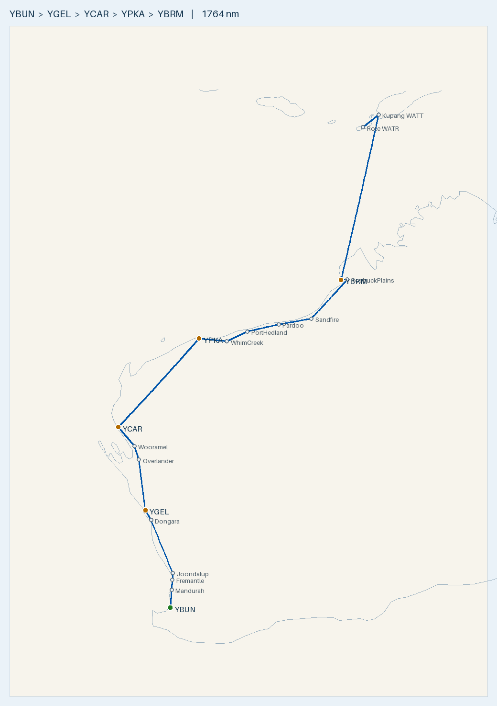

# Plan — Bunbury to Rote, Indonesia: Bunbury · Geraldton · Carnarvon · Karratha · Broome (clear out) · Kupang El Tari (clear in) · Rote D.C. Saudale

**Route:** YBUN → *Mandurah · Fremantle · Joondalup · Dongara* → **YGEL Geraldton** → *Overlander · Wooramel* → **YCAR Carnarvon** → **YPKA Karratha (overnight)** → *Whim Creek · Port Hedland · Pardoo · Sandfire · Roebuck Plains* → **YBRM Broome (overnight, clear out of Australia)** → **WATT Kupang/El Tari (clear into Indonesia, refuel)** → **WATR Rote/D.C. Saudale**
**Aircraft:** [Cirrus SR20 G1 **VH-SRA** (s/n 1312)](../../aircraft/SR20.md) · AVGAS · 56 USG usable · MTOW 3000 lb (1361 kg) · empty 973 kg @ FS 140.9
**Planning basis:** domestic legs 150 KTAS · 12.5 USG/hr (repo standard). **Timor Sea crossing at 55% power, best economy** (POH Fig. 5-16; see below) · reserve 10.1 USG (45 min) · **nil wind** (apply the forecast on the day) · climb +1 min / 2,000 ft
**Loading (your figures):** pilot 85 kg + passenger 65 kg (front), luggage 40 kg, plus survival kit (life raft, jackets, grab bag; **~17 kg assumed**) → **full tanks at every stop, takeoff 2,937 lb**, 63 lb under MTOW.
**Data:** ERSA **03 SEP 2026** for the Australian fields. **The 26 NOV 2026 cycle takes effect in 5 days**, so re-check every Australian field after that. The Indonesian data comes from secondary sources (no free AIP Indonesia), so **treat it as unverified until your Indonesian handling agent and the NOTAMs confirm it.**

> ✈️ **Bottom line:** **Yes, Broome → El Tari is the right gateway.** Rote isn't an entry point, so you clear in at Kupang and then hop 50 nm to Rote.
> The flying works. **The Timor Sea leg is 474 nm**, ~3 h 36 m at 55% power. It lands with **+8.4 USG over reserve in nil wind** and still has a margin with a **~27 kt headwind**.
> At the repo's usual 75% / 12.5 USG/hr it **does not**: a 9 kt headwind uses up the margin. **Fly it at economy power.**
> **Four things would stop the trip. Sort them before anything else:**
> 1. **Licence and medical.** You need a **PPL (not an RPL), English Language Proficiency, and a full Class 2 medical** (not Basic Class 2). An RPL isn't an ICAO licence and isn't valid outside Australia.
> 2. **AVGAS in Indonesia.** There's no confirmed 100LL at Kupang and none at Rote, and VH-SRA **can't get back to Australia without refuelling in Indonesia**. Have your agent **pre-order and confirm sealed Pertamina drums at El Tari** before you leave.
> 3. **Indonesian clearances.** You need **diplomatic clearance → security clearance → flight approval**, in that order, through a registered Indonesian agent. The Kupang → Rote leg must be included. Allow 2–3 weeks.
> 4. **Insurance.** Get a **written extension covering Indonesia** for hull and third-party liability. Indonesia requires proof of the liability cover.

---

## Route Summary (nil wind)

Domestic legs reuse the shared coastal waypoints from the [Kununurra plan](../YBLN-YPKU/2day.md). Leg 1 starts at Bunbury instead of Busselton, so it's 284 nm instead of 306. With your load you can **fill to full (56 USG) at every stop** and stay under MTOW.

**Day 1: Bunbury → Karratha (833 nm, 5 h 45 m flying, ~7 h 15 m with two 45-min stops)**

| Leg | Segment | Dist (nm) | Track °T | HDG °M | Cruise alt | Time | Leg fuel (USG) | Lands with (USG) |
|:---:|---------|----------:|:--------:|:------:|:----------:|-----:|---------------:|-----------------:|
| 1a | YBUN → Mandurah | 51.0 | 002 | 004 | low, OCTA | 24 m | 5.1 | 50.9 |
| 1b | Mandurah → Fremantle → Joondalup | 47.2 | 003 | 005 | under the Perth steps (VTC) | 19 m | 4.0 | 46.9 |
| 1c | Joondalup → Dongara → **YGEL** | 185.5 | 344→337 | 345→338 | 8,500 once clear of the steps | 74 m | 15.5 | **31.4** |
| 2 | YGEL → Overlander → Wooramel → **YCAR** | 246.5 | 355→328 | 356→328 | 8,500 | 103 m | 21.4 | **34.6** |
| 3 | YCAR → **YPKA Karratha** | 303.4 | 035 | 035 | 7,500 | 125 m | 26.1 | **29.9** |

**Day 2: Karratha → Broome (406 nm, 2 h 46 m)**, then refuel, do the paperwork and overnight in Broome

| Leg | Segment | Dist (nm) | Track °T | HDG °M | Cruise alt | Time | Leg fuel (USG) | Lands with (USG) |
|:---:|---------|----------:|:--------:|:------:|:----------:|-----:|---------------:|-----------------:|
| 4 | YPKA → Whim Creek → Port Hedland → Pardoo → Sandfire → Roebuck Plains → **YBRM** | 406 | 097→036 | — | 7,500 | 166 m | 34.6 | **21.4** (+11.3 over reserve) |

With full tanks, **no Port Hedland stop is needed** (the 50.7 USG / 250 kg Kununurra plan was marginal here, but you aren't). Port Hedland (H24 AVGAS) stays on track as your fallback if there's a strong headwind.

**Day 3: Broome → Kupang → Rote (international)**

| Leg | Segment | Dist (nm) | Track °T | HDG °M | Cruise | Time | Leg fuel (USG) | Lands with (USG) |
|:---:|---------|----------:|:--------:|:------:|:------:|-----:|---------------:|-----------------:|
| 5 | **YBRM → WATT Kupang/El Tari** | **474.5** | 010 | 009 | **7,500 / 9,500** (see the hemispherical note below) · **55% best economy** | **3 h 36 m** | **36.5** (incl. 2.9 climb) + 1 taxi | **18.5** (+8.4 over reserve) |
| — | *Kupang: CIQ, fill to full from pre-ordered drums* | — | — | — | — | *2–3 h?* | — | 56 |
| 6 | WATT → **WATR Rote** | 50.1 | 224 | 223 | low (Indonesian ATC) | ~24 m | ~5 | ~51 |

**Return (reverse):** WATR → WATT (50 nm; clear out of Indonesia, top up to full) → **YBRM** (474 nm; clear in to Australia) → home on the coastal route. **Indonesian AVGAS needed: about 37.5 USG on arrival plus ~10 USG before the return ≈ 48 USG ≈ 180 L. That's one 200 L drum, so order two for headwind margin.**

**Trip (one way, YBUN → WATR): ~1,764 nm · ~12 h 30 m flying.**

- **You'll be out of sight of land for most of this leg.** Navigate on the IFR GPS, keep a second GPS (iPad/EFB) on its own battery, and carry the paper ERC/ICAO chart.
- **Cruise levels:** Australian VFR hemispherical rules apply until the FIR boundary. In Indonesia, ICAO Annex 2 VFR semicircular levels and Indonesian ATC instructions apply. **Your agent and the flight plan acceptance confirm the level**; this plan doesn't assume one beyond the FIR boundary. Below 10,000 ft (no oxygen).
- **The direct line passes ~8–10 nm east of Rote's eastern tip** (the airport is ~28 nm west of track there), then crosses Semau/Timor about 40 nm before Kupang. Rote is also your alternate (see Fuel Plan).

## The Timor Sea crossing (YBRM → WATT, 474 nm)

**Why 55% power?** At the repo's normal 12.5 USG/hr, this leg doesn't hold up:

| Power setting (8,000 ft) | TAS / planning burn | Nil wind: lands over reserve | 10 kt HW | 20 kt HW | Headwind that uses up the margin |
|--------------------------|---------------------|-----------------------------:|---------:|---------:|---------------------------------:|
| 75% best power (repo standard) | 150 kt / 12.5 GPH | +2.5 USG | −0.4 ❌ | −3.6 ❌ | **~9 kt** |
| 65% best power | 145 kt / 11.3 GPH *(POH 10.5 + 8%)* | +5.0 USG | +2.3 | −0.9 ❌ | ~17 kt |
| **55% best economy** | **134 kt / 9.5 GPH** *(POH 136 kt / 8.4 GPH, derated for heat and margin)* | **+8.4 USG** | **+5.6** | **+2.5** | **~27 kt** |

*Assumptions: full 56 USG; 1 USG taxi; POH climb fuel to 8,000 ft = 2.9 USG; reserve 10.1 USG. The 55% row uses the POH 55%-best-power fuel flow (9.5 GPH) as a margin over the 8.4 GPH best-economy figure, and 2 kt less TAS for tropical ISA+.* **Log VH-SRA's actual 55% fuel flow on a domestic leg (e.g. Karratha → Broome) and confirm it before you commit.**

- **Point of no return (back to Broome): ~290 nm** at 55% (295 nm nil wind, 290 nm with a 20 kt headwind on the way out). There's **no land and no alternate in between**, so decide before the PNR.
- **Fuel decision point at 200 nm out** (about 1 h 30 m after takeoff). Check groundspeed and fuel against this:

  | Groundspeed so far | Expect on board at 200 nm | Minimum to continue to WATT + reserve | Spare |
  |-------------------:|-------------------------:|--------------------------------------:|------:|
  | 134 kt (nil wind) | 37.9 | 29.6 | +8.4 |
  | 124 kt (10 kt HW) | 36.8 | 31.1 | +5.6 |
  | 114 kt (20 kt HW) | 35.4 | 33.0 | +2.5 |

  **If you're under the minimum, or the forecast for the rest of the leg is worse, turn back to Broome.** You're still short of the PNR.
- **Alternate:** Rote (WATR) is 50 nm from Kupang, which costs ~5 USG. Nil-wind arrival at Kupang leaves +8.4 USG over reserve, so you can afford it. **If Indonesia requires a destination alternate for your flight plan, nominate WATR and have the agent include it in the flight approval.** Kupang is also a **TNI-AU air base**, so closures can happen at short notice. Check the NOTAMs.
- **Weather is the real risk.** You're flying in **late November**, which is the start of the wet season. The monsoon trough brings **thunderstorm lines and embedded convection over the Timor Sea**, the NW monsoon flow (from ~Dec) is a **headwind on the outbound leg**, and it's **tropical cyclone season** (Nov–Apr). **Depart at first light, before the afternoon build-ups.** Have a hard go/no-go on the TAF/SIGMETs for both Broome and Kupang, and the BoM tropical cyclone outlook. **The dry season (May–Oct) is far better:** SE trades give a tailwind north and only a small headwind on the return.

## Radio, flight plan & the FIR boundary

- **Flight plan:** file an ICAO flight plan with an **EET to the FIR boundary** (AIP ENR 1.10). Brisbane FIR (Broome is Brisbane Centre 123.95) → Ujung Pandang (Makassar) FIR. ATSB has reported that **the Australia–Indonesia boundary accounts for most of Australia's international coordination breakdowns**. Confirm your boundary estimate with both sides and don't assume they've passed it on.
- **VFR or IFR: not confirmed.** AIP Indonesia wasn't accessible, and there's a first-hand report of a light aircraft flying **VFR** Lombok → Broome (AOPA NZ, 2023). **Ask your agent to confirm Indonesia will accept your flight rules** for both international legs and the Kupang → Rote hop. If they need IFR, that needs an instrument rating and an IFR-equipped VH-SRA.
- **Radio coverage gap:** at 7,500–9,500 ft, VHF reaches ~110–120 nm from each end, so you'll have **~230–250 nm in the middle with no VHF to ATC**. Part 91 MOS **26.18** requires radio equipment able to meet the reporting and listening-watch requirements **"from any point on the route"**. That points to **HF** (pilot reports also say Indonesian HF can be poor). **Confirm with CASA/Airservices how you'll comply.** In practice, plan to relay via airliners on **123.45**, monitor **121.5**, and carry a **satphone** with the Brisbane Centre and Makassar ACC numbers.
- **Kupang frequencies (unverified, sources conflict):** TWR/APP **118.3**, **120.55**, ATIS **127.55**; another database gives APP **122.2**. **Rote:** "Information" on **123.4**. Get the current frequencies from the agent or AIP Indonesia.

## Paperwork & approvals

Allow **3–4 weeks** in total, starting with the licence and medical check.

**Pilot, passengers, aircraft**
- [ ] **PPL + ELP (level 4+) + full Class 2 medical.** An RPL, or any licence on a Basic Class 2, is "within Australian territory" only (CASA EX11/25). CASA will issue a **paper licence for international ops** ($25), so ask for one.
- [ ] Passports (6+ months' validity) for both of you. **Get an Indonesian visa before you go:** El Tari is **not** an e-VoA entry airport.
- [ ] Aircraft documents in the aircraft: Certificate of Registration, **Certificate of Airworthiness** (standard CofA, which VH-SRA has), maintenance release, **W&B record**, radio licence, noise certificate if held, and the POH.
- [ ] **Insurance:** a written territorial extension to Indonesia (hull **and** third-party liability), plus a liability certificate in English for the Indonesian applications.
- [ ] **CAPS:** confirm the parachute repack and rocket service dates are current for the whole trip. Brief CAPS deployment as your ditching option.

**Indonesia (through a registered Indonesian handling agent; the regulations require one)**
- [ ] **Diplomatic clearance** (Kemenlu, Permenlu 14/2019): at least **3 working days** before entering Indonesian airspace. Its number is needed before the next two can be issued.
- [ ] **Security clearance** (Kemenhan/TNI, Permenhan 3/2024).
- [ ] **Flight approval** (DGCA, PM 109/2016): **3+ working days**, one flight. **Include Kupang → Rote → Kupang** (domestic legs by a foreign aircraft need a **DGCA special permit**). First landing must be at a CIQ airport, which is Kupang.
- [ ] Ask the agent to confirm: **CIQ attendance for a GA arrival at El Tari** (it was re-designated international in Aug 2025 but had no international routes as of mid-2026); **AVGAS drums** (see Fuel); **Rote's operating hours and handling**; **VFR flight plan acceptance**; any **customs bond / temporary import** for the aircraft; landing, parking and handling fees.

**Australia (Broome)**
- [ ] **Notify Broome Airport (AD OPR) of the international departure and the return arrival** before ops. ERSA YBRM: *"All International arrivals and departures must be notified to AD OPR prior to OPS"* (see broomeair.com.au).
- [ ] **ABF Broome:** with fewer than 10 people aboard, Broome doesn't need NPPC approval, but contact **ABF Broome (BroomeAviation@abf.gov.au, 08 9193 6999)** and **biosecurity (biosecurity.broome@aff.gov.au)** **at least 72 hours** before the departure and the return. Confirm the departure and arrival reporting forms with them.
- [ ] **Return biosecurity:** expect a pre-arrival report and **aircraft disinsection** on arrival from Indonesia. Don't bring food, plant or animal material back.

## Overwater equipment (Part 91 MOS, Chapter 26)

The rules below are from the **Part 91 MOS (compilation 6, 1 Mar 2025)**:

| Requirement | Rule | What it means for VH-SRA on this trip |
|-------------|------|---------------------------------------|
| **Life jackets: carry and WEAR** | **26.58:** each person must wear one when the flight is over water further than the engine-out gliding distance to land | **Wear them for the whole Timor Sea leg** (and Kupang ↔ Rote, which crosses ~50 nm of strait). Use constant-wear inflatable vests that suit the seat belts and harness, plus a spray hood and light |
| **Life raft** | **26.60:** a place for **each person** when further from land than **the shorter of 30 min at normal cruise or 100 nm**. For VH-SRA, 30 min at 150 kt = **75 nm** | **Required:** you're up to ~200 nm from land. Use the **manufacturer's rated capacity** (not overload). A **4-person aviation raft** gives room for two plus kit |
| **Raft stowage** | **26.61:** stowed so it can be **readily deployed** if you ditch, and marked if it's in a container | **Belt it into the rear seat, not the baggage bay.** The SR20's baggage door is hard to reach after a ditching |
| **Survival + signalling** | **26.62:** survival equipment "as appropriate for the overwater area", and signalling for the ICAO Annex 2 distress signals | Grab bag tied to the raft: **PLBs on each person (406 MHz, GNSS)**, day/night **flares**, signal mirror, dye marker, whistle, strobe, **water** (heat), sunscreen and hats, first aid, seasickness tablets, a knife, and a satphone or inReach in a dry bag |
| **ELT** | Fixed ELT in VH-SRA | Confirm it's **406 MHz** and registered to VH-SRA with AMSA (contact details current). The PLBs are the backup if the aircraft sinks |

- **Ditching brief:** POH Section 3 says **"If ditching, avoid a landing flare because of difficulty in judging height over water"**. Also brief **CAPS over water**, door unlatching before impact, who grabs the raft and grab bag, and the egress order. Do a **sea-survival/ditching course** if you haven't.
- **The weights are assumed.** The ~17 kg for raft + grab bag is an allowance. Weigh the real kit, and see W&B for how much margin you have.

## Fuel Plan

**Full tanks (56 USG) at every stop.** Your load allows it.

| Point | On board | Needed to next fuel + 10.1 reserve | Spare | Fuel at |
|-------|---------:|-----------------------------------:|------:|---------|
| Depart YBUN | 56.0 | 34.6 (leg 1) | +21.4 | ✓ Air BP H24 card bowser |
| Land YGEL → fill | 31.4 | 31.5 (leg 2) | +24.5 | ✓ WFS H24 |
| Land YCAR → fill | 34.6 | 36.2 (leg 3) | +19.8 | ✓ WFS / Air BP H24 |
| Land YPKA → fill (overnight) | 29.9 | 44.7 (leg 4) | +11.3 | ✓ Air BP |
| Land YBRM → **fill to full** (overnight) | 21.4 | **47.6** (leg 5 at 55%, incl. 1 taxi) | **+8.4** | ✓ Air BP |
| **Land WATT → fill to full from drums** | **18.5** | ~15 (WATR + reserve) | — | ⚠️ **Pertamina drums: pre-order** |
| Land WATR | ~51 | ~15 (back to WATT + reserve) | — | ❌ **No fuel at Rote** |
| **Depart WATT → YBRM, top up to full** | **56.0** | 47.6 | +8.4 | ⚠️ drums |

- **AVGAS in Indonesia is a must-have:**
  - **Pertamina** is the only supplier. A 2021 Pertamina price list shows **drum AVGAS at DPPU El Tari**, but nothing since confirms it's in stock. Pilot reports over the years say AVGAS is "in very short supply throughout Indonesia": **pre-order drums through the agent**, insist on **sealed drums**, and expect to **pay for every drum opened**. Watch it go in.
  - Take a **water-separating filter funnel** and your fuel sample cup, and test every drum.
  - **Order 2 × 200 L drums** for ~48 USG of need. One drum is enough if the winds behave, but you can't get home if it isn't there.
  - **Ask for a fuel release / proof of payment in advance.** One report gives 24 h notice for fuel uplift at smaller Indonesian airports.
- **Return leg (WATT → YBRM):** same 474 nm and the same 55% numbers. In the **dry season** the SE trades give a small headwind (~0.3 × trade-wind speed) southbound. In the **wet season** the NW monsoon becomes a tailwind going home.
- **Cost:** one way (domestic legs at 12.5 GPH plus the 55% crossing) is about **~145 USG (~550 L) of Australian AVGAS** ≈ $1,650 at ~$3.00/L. Indonesian drum AVGAS and handling are **much more expensive**: one 2023 report was **US$2,500 all-in for a single drum stop** in Lombok. Budget accordingly.

## Fuel cards & payment

| Stop | AVGAS supplier | Card |
|------|----------------|------|
| YBUN Bunbury | **Air BP H24 AVGAS card bowser** (08 9725 4377, AH 0460 031 288) | **Air BP card** |
| YGEL Geraldton | WFS H24 | Not stated in ERSA. Ask when you phone (0491 233 624) |
| YCAR Carnarvon | WFS H24 bowser (app: **Visa/MC**) or Air BP H24 card bowser | Visa/MC via WFS app, or Air BP card |
| YPKA Karratha | **Air BP** (0499 747 727) 07:00–18:00 weekdays, 07:00–12:30 weekends | Air BP card (⚠️ Viva at Karratha is Jet A1 only) |
| YBRM Broome | **Air BP** (0436 412 616, radio 129.9) 06:00–18:00 daily; AH 1 h PN + fee | Air BP card (⚠️ Viva/Skyfuel at Broome is Jet A1/JetPlus only) |
| WATT Kupang | **Pertamina drums via your agent** | Arrange payment through the agent; carry USD/IDR cash as backup |

## Weight & Balance (your loading, full fuel)

| Item | Mass (lb) | Arm (in) | Moment (lb·in) |
|------|----------:|---------:|---------------:|
| Empty (973 kg, owner-confirmed arm) | 2,145 | 140.9 | 302,231 |
| Front seats: pilot 85 + passenger 65 kg | 331 | 143.5 | 47,456 |
| Rear seat: **life raft + grab bag (~17 kg, assumed)** | 37 | 180.0 | 6,746 |
| Baggage bay: luggage 40 kg | 88 | 208.0 | 18,342 |
| **Zero-fuel** | **2,601** | **144.1** | **374,775** |
| Fuel 56 USG | 336 | 153.95 | 51,727 |
| **Takeoff (full tanks)** | **2,937** | **145.2** | **426,502** |
| Landing Kupang (~18.5 USG) | 2,712 | 144.5 | — |
| Landing at reserve (10.1 USG) | 2,662 | 144.3 | — |

**Every case is inside limits** ✓. Takeoff is 2,937 lb with the CG at 145.2 in, against a forward limit of 143.5 at that weight (1.7 in margin) and the ~148 aft limit. The forward margin shrinks a little as fuel burns, to 144.3 in at reserve against a ~140.9 limit. **Takeoff weight is over the 2,900 lb max landing weight by 37 lb, all of it fuel**, as the POH requires. Burn ~6 USG before landing, so a return to Broome shortly after takeoff is an **overweight landing** (or hold to burn fuel). Baggage is 88 lb against the 130 lb limit ✓.

- **Spare to MTOW: ~63 lb (28 kg).** That covers a heavier raft, a filter funnel, water and so on. Weigh it all.
- **Keep the raft in the rear seat** (26.61 readily deployable). Putting it in the baggage bay instead would move the CG aft by ~0.4 in, which is still in limits, but you couldn't get to it.

## Radio & en-route hazards (Australian legs: ERSA 03 SEP 2026)

| Where | What (ERSA) | Action |
|-------|-------------|--------|
| Bunbury departure | **Searchlight display** 3.8 nm NW. **Model aircraft** SFC–1,000 ft AGL within 500 m of a site 8.8 nm SSW. RWY 07/25 slope 0.15% down to the SW. TORA 1,015 m (07) / 1,219 m (25) at 2,937 lb | CTAF **127.0** (shared with Busselton), area **124.9**. Check takeoff distance for the day's temperature at near-MTOW; **RWY 25 has the longer TORA** |
| Leg 1, Murray Field (~6 nm E, ~52 nm out) | **Parachuting HJ to FL150**, low-level aerobatics within 1 nm | Monitor CTAF **119.1** and Perth Centre **135.25** |
| Leg 1, Serpentine (~7 nm E) | Low-level aerobatics, **emergency services helicopters H24** | Lookout |
| Mandurah → Joondalup | **Perth Class C / Jandakot Class D** steps. Wake turbulence in the Jandakot zone (ERSA YPJT) | Stay OCTA under the steps (bases off the VTC) or get a clearance |
| **North of Joondalup** | **Pearce/Gingin military restricted areas (R155/R153 series)** start at the surface. **R155A by the coast is an infringement hotspot.** Lancelin range further N | **Check the NOTAMs for activation.** Read the boundaries off the current VNC/ERC-L. Route around or get a clearance from Centre 135.25 |
| Leg 1, Jurien Bay (11 nm W) | **Intense parachuting to FL150**, 7 days | Monitor **121.2** |
| Geraldton | Power-plant **plume** 0.43 nm WSW of the RWY 08 threshold. **Weather balloon** ~07:15. Terrain blocks CTAF calls on the ground | CTAF **127.1** |
| Carnarvon | Helicopter ops, **corellas** on the runways, rough northern GA apron | CTAF **126.7** |
| Karratha | **Class D.** Birds/animals. **Gas discharge in D150.** D157 firing range may be active without a NOTAM. NVG helicopters | ATIS **134.55**, TWR **127.35** |
| Overhead Port Hedland | AFIS. Corellas/ibis/gulls. Heliport and NVG helicopters | **Hedland Information / CTAF 119.9**, overfly well above the circuit |
| **Broome** | **Class D.** Bird and animal hazard. **Flying foxes on final RWY 28** from 1 h before to 1 h after last light. **Blast embankment** 6 ft AGL 230 m short of the RWY 28 threshold. Weather balloon ~07:15. **Water rescue service available** (ERSA). TWY F3 and TWY F west of F2 are unsealed and **not available Nov–May**. RWY 10/28 slope: **E 1,721 m 0.5% down to E** | ATIS **128.2**, TWR **126.0**, GND **121.7**. Don't land short on 28 |

**Indonesian legs:** no ERSA. Get the El Tari and Rote AIP pages, NOTAMs and frequencies from the agent. **El Tari is a joint civil/military field** (TNI-AU air base and naval aviation). **Rote WATR:** 1,650 × 30 m asphalt, elevation ~470 ft. The designation is 04/22 or 03/21 depending on the source, so confirm it. There's a tower, an NDB and rescue/firefighting, and Wings Air and Susi Air both operate there. Hours, handling and the runway slope are **not confirmed**.

## Alternatives considered

| Gateway | To Kupang | Notes |
|---------|----------:|-------|
| **Broome (YBRM)** ✅ | **474 nm** | Designated international, ABF office on site, Air BP AVGAS, on your way north. **Chosen.** |
| Derby (YDBY) | 432 nm | Not a designated international airport, so you'd need ABF approval. Only 42 nm shorter |
| Kununurra / Darwin | 447 / 445 nm | Barely shorter than Broome and 400–600 nm further from home. Darwin is the traditional GA gateway to Indonesia but not worth the detour |
| **Truscott (YTST)** | **284 nm** | The shortest crossing by far: +20 USG over reserve. **But it isn't a designated international airport (it needs ABF NPPC approval, and officers may have to attend), its AVGAS is "limited supply, PPR CTC AD OPR"**, and it's a remote offshore-support base. Ask ABF Broome whether they'd approve it if you want the extra margin |
| Kalumburu (YKAL) | 302 nm | AVGAS 24 h PN, but not a designated international airport. Same NPPC issue |

**None of these remove the need for Indonesian AVGAS**: even from Truscott you can't do Truscott → Kupang → Rote → Kupang → Truscott on one tank plus reserve.

## Open items to confirm (not verified in this plan)

1. **100LL at El Tari:** in stock, price, drum lead time.
2. **CIQ for GA at El Tari**, and the visa type for Australians arriving there.
3. **VFR acceptance** in the Ujung Pandang FIR. Kupang approach frequency.
4. **Rote:** hours, handling, runway designation and slope.
5. **Radio compliance** across the VHF gap (MOS 26.18): HF requirement and satphone acceptance.
6. **Insurer** territorial extension.
7. Any Indonesian **customs bond** for the aircraft.
8. **ERSA 26 NOV 2026** changes for the Australian fields.

### Sources
- Part 91 MOS Ch. 26 (compilation 6), sections 26.18, 26.58, 26.60–26.62: [legislation.gov.au](https://www.legislation.gov.au/F2020L01514/2025-03-01/2025-03-01/text/original/pdf)
- CASA RPL not ICAO: [casa.gov.au](https://www.casa.gov.au/licences-and-certificates/pilots/pilot-licences/getting-recreational-pilot-licence-rpl). Basic Class 2 domestic only: [CASA EX11/25](https://www.legislation.gov.au/F2025L00270/asmade/2025-02-28/text/original/pdf). PPL/ELP: [casa.gov.au](https://www.casa.gov.au/licences-and-certificates/pilots/pilot-licences/getting-private-pilot-licence-ppl)
- Indonesia clearances: [PP 4/2018](https://pasal.id/peraturan/pp/pp-no-4-tahun-2018) · [Permenlu 14/2019](https://pasal.id/peraturan/permen/permenlu-no-14-tahun-2019) · [Permenhan 3/2024](https://pasal.id/peraturan/permen/permenhan-no-3-tahun-2024) · [PM 109/2016](https://pasal.id/peraturan/permen/permenhub-no-pm109-tahun-2016)
- El Tari international status: [Kontan (Aug 2025 list)](https://industri.kontan.co.id/news/daftar-lengkap-36-bandara-yang-kini-berstatus-internasional?page=all) · [Bisnis (Jul 2026)](https://ekonomi.bisnis.com/read/20260709/98/1986826/daftar-terbaru-38-bandara-internasional-ri-18-belum-layani-rute-luar-negeri) · e-VoA entry points: [imigrasi.go.id](https://imigrasi.go.id/wna/daftar-negara-voa-bvk-calling-visa/titik-masuk-bagi-pemegang-e-voa)
- AVGAS in Indonesia: [earthrounders](https://www.earthrounders.com/plan_asia.php) · [PPRuNe 2013](https://www.pprune.org/south-asia-far-east/520593-avgas-indonesia.html) · [AOPA NZ 2023](https://aopa.nz/coasting-into-aus/)
- ABF/NPPC: [NPPC Airport Guide](https://www.abf.gov.au/crossing/files/nppc-airport-guide.pdf) · [ABF aircraft requirements](https://www.abf.gov.au/entering-and-leaving-australia/aircraft-requirements)
- Boundary coordination: [ATSB](https://www.atsb.gov.au/sites/default/files/media/761121/breakdowns_co-ordination_between_australian_indonesian.pdf)
- Rote WATR: [SkyVector](https://skyvector.com/airport/WATR/David-Constantijn-Saudale-Airport) · [Wikipedia](https://en.wikipedia.org/wiki/David_Constantijn_Saudale_Airport)
- SR20 POH Fig. 5-15/5-16 (cruise, range/endurance), Section 3 (forced landing / ditching)

*Planning aid only. Verify everything against the current ERSA/AIP Australia, AIP Indonesia, NOTAMs, the POH and VH-SRA's W&B record before flight.*
