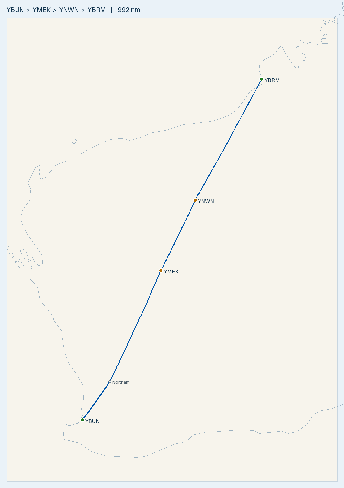

# Plan — Bunbury to Broome in one day, inland: Bunbury · (Northam) · Meekatharra · Newman · Broome

**Route:** YBUN → *Northam (overhead)* → **YMEK Meekatharra** → **YNWN Newman** → **YBRM Broome**, and the reverse to come home
**Aircraft:** [Cirrus SR20 G1 **VH-SRA** (s/n 1312)](../../aircraft/SR20.md) · AVGAS · 56 USG usable · MTOW 3000 lb (1361 kg) · empty 973 kg @ FS 140.9
**Planning basis:** 150 KTAS · 12.5 USG/hr · reserve 10.1 USG (45 min; the legal VFR-by-day minimum is 30 min, MOS Table 19.02(2)) · **nil wind** · climb +1 min / 2,000 ft · mag var per leg from ERSA
**Loading:** pilot 85 kg + passenger 65 kg (front), luggage 40 kg (baggage bay). **Full tanks at every stop: takeoff 2,900 lb**, 100 lb under MTOW and exactly at max landing weight.
**When:** March/April 2027. **Data:** ERSA **03 SEP 2026**. Re-check every field against the ERSA cycle in force when you fly.

> ✈️ **Bottom line:** **992 nm, 6 h 47 m flying, two fuel stops, all over land.** Leave Bunbury at 07:00 and you're in Broome by about **15:15**, with ~2½ h of daylight in hand.
> Every leg works on full tanks. The long first leg (433 nm) lands **+8.9 USG over the 45-min reserve** in nil wind and still +3.4 with a 20 kt headwind.
> **Things to sort before you go:** an **Air BP card** (all three bowsers are Air BP cardswipe), an **ASIC escort or VIC at Newman**, and a **flight plan or SARTIME** for the last ~125 nm into Broome, which is in the MOS *Central Australia remote area*.
> **The coastal way takes two days** (Karratha overnight, see *Alternatives*). Inland is ~250 nm shorter.

---

## Route Summary (nil wind)

| Leg | Segment | Dist (nm) | Track °T | HDG °M | Cruise alt | Time | Leg fuel (USG) | Lands with (USG) | Arrive (07:00 start, 45-min stops) |
|:---:|---------|----------:|:--------:|:------:|:----------:|-----:|---------------:|-----------------:|------:|
| 1a | YBUN → Northam (overhead) | 116.6 | 026 | 028 | under the Perth steps, then 7,500 | 51 m | 10.5 | 45.5 | — |
| 1b | Northam → **YMEK Meekatharra** | 316.8 | 018 | 019 | 7,500 | 127 m | 26.4 | **19.0** | **09:57** |
| — | *Meekatharra fuel stop (fill to full)* | | | | | *45 m* | | 56.0 | |
| 2 | YMEK → **YNWN Newman** | 203.6 | 020 | 019 | 7,500 | 84 m | 17.6 | **38.4** | **12:06** |
| — | *Newman fuel stop (fill to full)* | | | | | *45 m* | | 56.0 | |
| 3 | YNWN → **YBRM Broome** | 355.4 | 023 | 022 | 7,500 | 145 m | 30.2 | **25.8** | **15:16** |
| **—** | **Total** | **992** | | | | **6 h 47 m flying · ~8 h 17 m door to door** | **84.8** | | |

- **Climb allowance:** +4 min out of Bunbury (53 ft), and +3 min out of Meekatharra (1,696 ft) and Newman (1,724 ft). The leg times include it.
- **Cruise level:** every track is NNE (019–028 °M), so the eastbound **7,500 ft** level applies. 9,500 ft is the other option if it's smoother or cooler. Read the **LSALT off the ERC-L for each leg**, especially through the Hamersley/Ophthalmia ranges around Newman. Stay below 10,000 ft, because you have no oxygen.
- **Northam** is an overhead turning point, not a stop. It's also a fallback fuel stop if needed (Viva/Dunnings **AVGAS H24 credit-card bowser**, 117 nm out).
- **On the day:** work the WCA and groundspeed from the forecast winds, then re-time and re-fuel each leg.

## Daylight

| Date | Bunbury first light / sunrise | Broome sunset / last light |
|------|:----:|:----:|
| 20 Mar 2027 | 05:55 / 06:20 | 18:03 / 18:24 |
| 20 Apr 2027 | 06:17 / 06:43 | 17:39 / 18:01 |

*Computed (civil twilight). Check the official first/last light times for the date.* Arriving at 15:16 gives ~2 h 20 m to Broome sunset in late April. You could absorb an extra stop, a weather detour or a slow refuel and still land well before the **flying-fox window on final RWY 28** (from 1 h before last light, per ERSA). If you're running more than ~1 h late at Newman, consider Newman → Port Hedland → Broome or stay overnight in Newman.

## Fuel Plan

**Fill to full (56 USG) at every stop.** At your loading, full tanks give exactly 2,900 lb, so there's no part-fill to measure and no overweight landing.

| Leg | Dist (nm) | Nil wind: lands over 45-min reserve | 20 kt headwind | 30 kt headwind | Headwind that uses up the 45-min margin |
|-----|----------:|------------------------------------:|---------------:|---------------:|---------------------------------------:|
| 1 YBUN → YMEK | 433 | **+8.9 USG** | +3.4 | −0.1 (still +4.3 over the 30-min legal reserve) | **~30 kt** |
| 2 YMEK → YNWN | 204 | +28.3 | +25.7 | +24.1 | n/a |
| 3 YNWN → YBRM | 355 | +15.7 | +11.1 | +8.3 | ~52 kt |

- **Leg 1 is the only one that needs watching.** A ~30 kt headwind on it is unusual but possible behind a front in autumn. **Make the go/no-go overhead Northam** (117 nm out, AVGAS H24), because ERSA lists no fuel at the fields near track between there and Meekatharra (Mount Magnet, Cue):

  | Groundspeed Bunbury → Northam | Expect on board overhead Northam | Minimum to continue to YMEK + 45-min reserve | Spare |
  |------------------------------:|---------------------------------:|---------------------------------------------:|------:|
  | 150 kt (nil wind) | 45.5 | 36.5 | +9.0 |
  | 130 kt (20 kt HW) | 43.9 | 40.6 | +3.3 |
  | 120 kt (30 kt HW) | 43.0 | 43.1 | −0.1 |

  **If your groundspeed is under ~125 kt, land at Northam and fill up.** That makes the next leg only 317 nm and costs ~35 min.
- **Leg 3 has plenty of margin**, but it's remote (see *Remote area*). **Port Hedland** (H24 AVGAS) is 194 nm NNW of Newman if you'd rather route via the coast (Newman → Port Hedland → coastal to Broome, +132 nm, arriving ~17:00).
- **Cost:** ~85 USG (~321 L) one way at ~$3.00/L ≈ **$960**. Remote prices are often higher. **~$1,950 return.**

## Fuel cards & payment

| Stop | AVGAS (ERSA) | Card | Hours (local AWST) |
|------|--------------|------|-------|
| YBUN Bunbury | **Air BP H24 AVGAS card bowser** (08 9725 4377, AH 0460 031 288) | Air BP card | H24 |
| YMEK Meekatharra | **Air BP cardswipe self-serve bowser H24**, AVGAS overwing (0417 968 115) | Air BP card (ERSA doesn't list other cards; phone ahead) | H24 bowser |
| YNWN Newman | **Air BP H24 cardswipe bowser** (0438 920 048) | Air BP card (ERSA doesn't list other cards; phone ahead) | H24 bowser; attended 07:00–19:00, then a service fee |
| YBRM Broome *(return)* | **Air BP** (0436 412 616, radio 129.9) | Air BP card (⚠️ Viva/Skyfuel at Broome is Jet A1/JetPlus only) | 06:00–18:00 daily; AH 1 h PN + fee |
| YNTM Northam *(fallback)* | Viva / Dunnings **AVGAS H24 credit-card bowser** (08 9622 1413, AH 0438 035 328) | **Visa/MC** | H24 |

**An Air BP card is essential.** It's the only payment ERSA names at three of the four bowsers you'll actually use.

## Weight & Balance (full fuel)

| Item | Mass (lb) | Arm (in) | Moment (lb·in) |
|------|----------:|---------:|---------------:|
| Empty (973 kg, owner-confirmed arm) | 2,145 | 140.9 | 302,231 |
| Front seats: pilot 85 + passenger 65 kg | 331 | 143.5 | 47,456 |
| Baggage bay: luggage 40 kg | 88 | 208.0 | 18,342 |
| **Zero-fuel** | **2,564** | **143.5** | **368,029** |
| Fuel 56 USG | 336 | 153.95 | 51,727 |
| **Takeoff (full)** | **2,900** | **144.8** | **419,756** |
| Landing Meekatharra (~19 USG) | 2,678 | 144.0 | — |
| Landing at reserve (10.1 USG) | 2,624 | 143.8 | — |

**Inside limits throughout** ✓. At takeoff the forward limit is 143.1 in at 2,900 lb (1.7 in margin), and the aft limit is ~148. At reserve the forward limit is 140.7 in (3.1 in margin). Takeoff weight equals max landing weight, so an early return is fine. Baggage is 88 of 130 lb ✓.

- **The forward margin is the one to watch:** everything heavy is in front. Keep the luggage in the baggage bay, not on the rear seat floor.
- **Spare to MTOW: 100 lb (~45 kg).** That's room for the remote-area water and survival kit (see below), or more holiday luggage. Re-run the numbers if you add the life raft and kit for the Indonesia trip.

## Radio & en-route hazards (ERSA 03 SEP 2026)

| Where | What | Action |
|-------|------|--------|
| Bunbury departure | **Searchlight display** 3.8 nm NW. **Model aircraft** SFC–1,000 ft AGL within 500 m of a site 8.8 nm SSW. RWY 07/25 **0.15% down to the SW**. TORA 1,015 m (07) / **1,219 m (25)** | CTAF **127.0** (shared with Busselton), area **124.9**. You're at 2,900 lb, so check takeoff distance for the day's temperature. RWY 25 has the longer TORA |
| Leg 1a, Murray Field ~16 nm W and Serpentine ~17 nm W | Murray Field: **parachuting HJ to FL150**, low-level aerobatics. Serpentine: aerobatics, emergency-services helicopters H24 | Well clear on this track. Monitor Perth Centre for DZ activity |
| Leg 1a, **Perth CTA** | The direct line passes **~24 nm E of Perth Airport and Jandakot** | **Read the Class C step bases off the Perth VTC/VNC** and stay under them or get a clearance. This plan doesn't quote the steps. A dogleg via **Boddington** (-32.80,116.47) adds 7 nm and keeps you ~33 nm from Perth Airport |
| Leg 1a, Pearce | **RAAF Pearce** is ~30 nm W of the Northam overhead | Check on the VNC that your track stays clear of the Pearce restricted areas, and check NOTAMs for activation |
| Northam overhead (117 nm) | **Ultralight flight training.** Turbulence near the RWY 14 threshold in strong easterlies | CTAF **124.2**, area **120.3**. Overfly well above the circuit |
| Leg 1b, Mount Magnet 8 nm E (336 nm) | Possible **plume rise** from a power plant 1 nm N of the RWY 16 threshold | Avoid the plume. No fuel listed in ERSA |
| **Meekatharra** | **Weather balloon** ~07:15 local (2315 UTC), and at other times | CTAF **126.55**, area **122.6**. RWY 09/27 sealed 2,181 m (0.12% down to E); 15/33 gravel 1,065 m |
| **Newman** | **ASIC required airside; passengers escorted by an ASIC holder or issued a VIC.** Security screening around RPT services. Coded gates. **Mine blasting 4.8 nm N and 8 nm NW at 11:00 and 15:00 daily** (more by arrangement) | CTAF **122.0**, area **123.4**. **Phone the AD operator ahead** for blasting times and an escort/VIC. You arrive ~12:06 and leave ~12:51, between blasts. RWY 05/23 2,072 m (0.1% down to NE) |
| Leg 3, Ginbata 8 nm off track (~51 nm out) | **UA (7 kg multi-rotor) within 10 nm**, SFC–1,000 ft AGL. Operator broadcasts on **127.05** | You'll be well above it. Monitor 127.05 near there |
| Leg 3, area change | **Melbourne Centre → Brisbane Centre** somewhere on the leg | Read the boundary and frequency off the ERC-L. Broome area is **123.95** |
| **Broome arrival** | **Class D.** Bird and animal hazard. **Flying foxes on final RWY 28** from 1 h before to 1 h after last light. **Blast embankment** 6 ft AGL, 230 m short of the RWY 28 threshold (LDA 2,204 m). Weather balloon ~07:15. Radio mast 230 ft AMSL, unmarked and unlit, 1,760 m SSW of the ARP. Runway: **W 737 m level, E 1,721 m 0.5% down to E**. TWY F3 and TWY F west of F2 are unsealed and **not available Nov–May** | ATIS **128.2**, TWR **126.0**, GND **121.7**. Outside tower hours it's CTAF 126.0. Don't land short on 28 |

- **Controlled airspace:** the Perth steps on leg 1a, and Broome Class D. Everything else is Class G.
- **Don't take step altitudes, zone boundaries or PRD limits from this plan.** Read them off the current VTC, VNC and ERC-L.

## Remote area & survival kit

- The last **~125 nm of leg 3** (from about -19.86, 121.38, roughly 231 nm out of Newman) is inside the **Central Australia remote area** (Part 91 MOS **26.65**: east of the Anna Plains–Wiluna line).
- **MOS 9.02(2)(c):** a VFR flight in a designated remote area needs a **flight plan, a SARTIME, or a flight note** with a responsible person. File a flight plan with a SARTIME for Broome.
- **MOS 26.64:** carry **survival equipment appropriate for the remote area**. Inland WA in March/April is hot. Take **water (several litres each)**, hats, sunscreen, a first aid kit, a **PLB**, and a satellite messenger. The 100 lb margin covers it.
- **Diversions are sparse:** most strips on leg 3 are mine sites (private, PPR, often Jet A1 only). Your options are realistically **back to Newman**, or Port Hedland if you've routed coastal.

## Season & weather (March/April)

- **March** is still the wet season in the Pilbara and Kimberley. Expect afternoon **thunderstorms**, possible **tropical lows/cyclones** near Broome and the Pilbara coast, and flooded or closed unsealed strips. **April** usually settles as the trades start.
- **Leave early** (07:00 works) so legs 2 and 3 are done before the worst of the build-ups. Watch the TAFs for Meekatharra, Newman and Broome, the GAFs, and the **BoM tropical cyclone outlook**.
- **Heat:** Meekatharra and Newman are ~1,700 ft and can be 35 °C+ in March, which puts density altitude around **4,000–4,500 ft** at 2,900 lb. The runways are long (2,072–2,181 m), but check takeoff distance and expect a slower climb than the +3 min allowance. Afternoon thermals mean a bumpy ride at 7,500, so 9,500 may be smoother.
- **Smoke, dust and haze** are common inland. Keep VMC and use the S-TEC 30 to hold track and altitude in poor horizons.

## Parking at Broome (a few days)

- ERSA: **"AD charges to all ACFT"**. Check landing and parking fees on the BIA website (broomeair.com.au). **Ground handling on request only**: contact the AD operator. Broome is a **security-controlled airport**, so keep your passenger with you airside.
- Itinerant fixed-wing parking is marked on the ERSA aerodrome sketch. **Ask the operator about tie-downs or hangarage**: in March/April you're still in cyclone season, and an SR20 parked outside needs proper tie-downs. **If a cyclone watch is issued while you're there, move the aircraft or fly out early.**
- Book AVGAS for your return departure. Air BP is 06:00–18:00; an earlier start needs 1 h PN and a fee.

## Coming home (reverse)

| Leg | Dist (nm) | Cruise alt | Time | Fuel (USG) | Lands over 45-min reserve (nil / 20 kt HW) |
|-----|----------:|:----------:|-----:|-----:|---------------------------:|
| YBRM → YNWN | 355 | 8,500 | 2 h 26 m | 30.4 | +15.5 / +10.9 |
| YNWN → YMEK | 204 | 8,500 | 1 h 24 m | 17.6 | +28.3 / +25.7 |
| YMEK → (Northam) → YBUN | 433 | 8,500, then down under the Perth steps | 2 h 56 m | 36.7 | **+9.2 / +3.6** |

The return is the same 992 nm, ~6 h 46 m flying. Southbound tracks (199–208 °M) use the westbound **8,500 ft** level. The Broome → Newman leg is in the remote area for its first ~125 nm, so file a flight plan/SARTIME again. Leave Broome at 07:00 and you'll be in Bunbury about 15:15. **Check the Pearce/Gingin NOTAMs and the Perth steps** for the run in past Northam.

## Alternatives considered

| Option | Distance | Days | Notes |
|--------|---------:|:----:|-------|
| **Inland, YMEK + YNWN** ✅ | **992 nm** | **1** | Chosen. Shortest, all over land, two H24 Air BP bowsers. Remote last ~125 nm; few diversions |
| Inland via Port Hedland (YNWN → YPPD → coastal) | 1,124 nm | 1 | Three stops, arrives ~17:00. Use it if storms are sitting over the Great Sandy Desert or you want the coast for the last leg |
| Coastal, Karratha overnight (YGEL · YCAR · YPKA) | 1,239 nm | 2 | The coastal VFR route used in the [Kununurra](../YBLN-YPKU/2day.md) and [Rote](../YBUN-WATR/plan.md) plans. Scenic, more diversions, Perth steps, Pearce/Gingin military areas north of Joondalup |
| Coastal in one day (YGEL · YCAR · YPPD) | 1,208 nm | 1 | **Not recommended:** 8 h 19 m flying plus three stops arrives ~17:35, at sunset in late April |

*Planning aid only. Verify everything against the current ERSA/AIP, NOTAMs, the POH and VH-SRA's W&B record before flight.*
